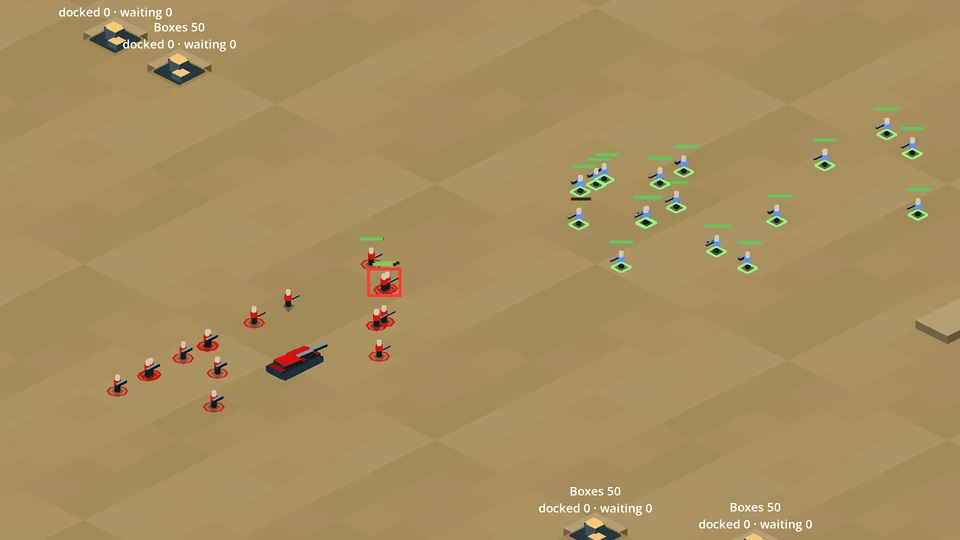

<h1 align="center">Wargrid</h1>

  <b>A free, open-source real-time strategy game in the spirit of Command &amp; Conquer: Generals – Zero Hour.</b> 
  Build a base, secure your supplies and outfight a bot or a friend, in the browser or on the desktop.

  <a href="https://wargrid.pdstuber.dev"><b>Play in the browser</b></a>
  &nbsp;·&nbsp;
  <a href="https://github.com/pdstuber/wargrid/releases">Download for Linux, Windows and macOS</a>

  
  
  

*USA against China on Dry Wells, both sides played by the skirmish bot, four seconds after the armies first met (3:41 of game time, tick 6630). Captured by a script, so it is redone whenever the look changes.*

Wargrid is an isometric RTS written in Godot 4 and typed GDScript. Its design follows Zero Hour (factions, base building, supply economy, combat feel and pacing); the code is Wargrid's own and leaves out the original's known bugs and slow paths. Not affiliated with or endorsed by Electronic Arts, see [License](#license).

## What's in it

- **Three factions:** USA, China and the FRC, each with its own units, buildings and supply collectors.
- **Base building and economy:** builders, power, finite supply piles and production queues.
- **Skirmish against a bot** on three maps: Dry Wells, Broken Crown and Ashfall.
- **Online 1v1** with a match code, no account needed.
- **Sound:** music, combat effects and announcer lines.
- **A geometric 2.5D look** (machines built from a few flat shapes, bright owner colours over muted terrain) is merged on `main` and ships with the next release.

## Play

- **In the browser:** https://wargrid.pdstuber.dev (verified in Safari; Chrome and Firefox untested).
- **Desktop:** Linux, Windows and macOS zips on the [Releases](https://github.com/pdstuber/wargrid/releases) page. Builds are unsigned: on macOS 15 and later open System Settings > Privacy & Security > Open Anyway after the first blocked start (or run `xattr -dr com.apple.quarantine Wargrid.app` once); on Windows, SmartScreen needs More info, Run anyway.
- **Online with a friend:** one player clicks *Create match* and shares the match code; the other enters it and clicks *Join*. The host chooses the map; the other player's game checks it. Both need the same version.
- **From source:** Godot 4.7.2, see [setup and commands](docs/development.md#setup-and-commands).

## Status

Early development; the latest build is on the [Releases](https://github.com/pdstuber/wargrid/releases) page. Playable today: three factions, skirmish against a bot and online 1v1 on Dry Wells, Broken Crown or Ashfall. The long-term target is 3v3 online, friends against bots; scope and milestones are in the [blueprint](docs/blueprint.md).

What is done and what comes next (generated from [packages](docs/packages.md) and [STATUS](docs/STATUS.md)):

<!-- roadmap:begin -->
**18 of 47 parts done**

| | What | State |
| --- | --- | --- |
| ✅ | Move and select units | Done |
| ✅ | Build a base and mine supplies | Done |
| ✅ | Fight with infantry and tanks | Done |
| ✅ | Play online with a friend | Done |
| ✅ | Teams and big maps | Done |
| ✅ | Choose your faction | Done |
| ✅ | Releases and sound | Done |
| ✅ | Tell us what you see | Done |
| ✅ | Laborers that pay | Done |
| ✅ | You clicked, we heard | Done |
| ✅ | New launcher | Done |
| ✅ | Quick rematch | Done |
| ✅ | Notes that never block | Done |
| ✅ | See your selection | Done |
| ✅ | Build from the dock | Done |
| ✅ | Pan with the mouse | Done |
| ✅ | Know what your factory is making | Done |
| ✅ | A short Esc menu | Done |
| ⏭ | Team up against bots | Next |
| 📋 | A lobby for every match | Planned |
| 📋 | First new units | Planned |
| 📋 | Hear the whole battlefield | Planned |
| 📋 | Know why an order failed | Planned |
| 📋 | Read the battlefield | Planned |
| 📋 | See the whole map | Planned |
| 📋 | Reconnect after a drop | Planned |
| 📋 | More maps | Planned |
| 📋 | Desync reports that send themselves | Planned |
| 📋 | You and two friends vs three bots | Planned |
| 📋 | Keep your teammate's base | Planned |
| 📋 | Units that find their way | Planned |
| 📋 | Three armies | Planned |
| 📋 | Units that make room | Planned |
| 📋 | Friends against friends | Planned |
| 📋 | Supplies you can read | Planned |
| 📋 | Three kinds of base | Planned |
| 📋 | Smooth motion | Planned |
| 💡 | Order controls | Later |
| 💡 | Smoother big moves | Later |
| 💡 | Crowds that sort themselves | Later |
| 💡 | Fog of war | Later |
| 💡 | Ground batch A | Later |
| 💡 | Fight over income points | Later |
| 💡 | Wrecks | Later |
| 💡 | Ground batch B | Later |
| 💡 | Team up with a bot | Later |
| 💡 | Bots worth playing | Later |
<!-- roadmap:end -->

<!-- perf-table:begin -->
Performance against the low-end budget (generated):

**Checked against the limit: 2 of 9 areas over budget**

| Area | Status | Budget used | vs last run | As of |
| --- | --- | --- | --- | --- |
| **Steam Deck in Firefox, 3v3 match: CPU time per frame** | 🔴 Over | ██████████▶ 188% | 🆕 first run | 2026-11-22 |
| **Steam Deck in Firefox, 3v3 match: CPU time per frame, slowest moments** | 🔴 Over | ██████████▶ 108% | 🆕 first run | 2026-11-22 |
| Drawing the screen, big map (Ashfall) | 🟢 OK | ███████░░░ 77% | 🔺 4% worse | 2026-11-24 |
| Drawing the screen | 🟢 OK | ███████░░░ 75% | 🔺 3% worse | 2026-11-24 |
| Combat, normal fights | 🟢 OK | ███████░░░ 75% | ➖ same (busy host) | 2026-11-24 |
| Combat, normal fights, slowest moments | 🟢 OK | █████░░░░░ 59% | 🔻 1% better (busy host) | 2026-11-24 |
| Unit movement | 🟢 OK | ████░░░░░░ 44% | 🔻 4% better (busy host) | 2026-11-24 |
| Unit movement, slowest moments | 🟢 OK | ██░░░░░░░░ 25% | 🔻 22% better (busy host) | 2026-11-24 |
| Online play overhead | 🟢 OK | █░░░░░░░░░ 11% | 🔺 3% worse (busy host) | 2026-11-24 |

Percent of the limit for a low-end device, estimated from this Mac, except the Steam Deck rows, which are measured on the Deck (see the ledger for how). 🔺 = used more of the limit than last run. Small changes can be run-to-run noise. As of = when that area was last measured; areas drawn from rendered runs update only at milestone gates.

The two Steam Deck rows are one goal. The 3v3 match ran at 58 frames per second there on 2026-11-22, but the CPU work behind a frame must fit in 16.7 ms on most frames (p95) and 33.3 ms on the slowest (p99); the planned worker thread is the route to that, not yet measured on this build.

**Tracked, no route under the limit yet**

These areas are over their limit and no known change brings them under it yet, so they show only how they move: the last run against the median of the three runs before it, with a change inside the run-to-run spread shown as same. Recent runs: one bar per run, oldest first; each step is about 5% above or below those runs' median. Stress = far more units than a real match; real 3v3 = a 3v3 team match measured on this Mac. Every limit is in the ledger.

| Area | Latest on this Mac | Recent runs → | vs recent runs | As of |
| --- | --- | --- | --- | --- |
| Background upkeep, huge crowds (stress) | mean 1.94 ms | ▄▄▄▄▄▆▄▄ | ➖ same | 2026-11-24 |
| Combat, huge battles (stress) | p95 2.97 ms | ▄▄▄▄▄▄▄▄ | ➖ same, -1% (noise ±41%) | 2026-11-24 |
| Background upkeep, armies on the move (stress) | mean 1.32 ms | ▄▄▄▄▄▄▄▄ | 🔺 1% slower | 2026-11-24 |
| Combat, big armies in the open (stress) | p95 1.93 ms | ▄▄▄▄▄▄▄▄ | ➖ same | 2026-11-24 |
| Combat, big armies packed close (stress) | p95 1.87 ms | ▄▄▄▄▄▄▄▄ | ➖ same | 2026-11-24 |
| 3v3 match, background upkeep (real 3v3) | mean 1.15 ms | ▄▄▄▄▄▄▄▄ | ➖ same | 2026-11-24 |
| 3v3 match, simulation (real 3v3) | p95 2.75 ms | ▄▄▄▄▄▄▅▄ | 🔺 2% slower | 2026-11-24 |
| 3v3 match, bots and simulation (real 3v3) | p95 3.32 ms | ▄▄▄▄▄▄▄▄ | ➖ same | 2026-11-24 |

The latest run of every tracked area was on a busy host.

Details: [performance ledger](docs/reference/performance.md).
<!-- perf-table:end -->

## How it's built

- **Deterministic simulation.** Tick-based and kept apart from rendering and wall-clock time, so builds on different platforms produce identical replay traces (Linux and Windows compared in CI, macOS locally). See the [determinism rules](docs/reference/determinism-rules.md) and the [simulation interface](docs/reference/sim-interface.md).
- **Lockstep online play.** A small Go relay only forwards commands; every client runs the full simulation. The wire protocol is fixed by test vectors and a black-box conformance suite in `protocol/`. See [relay scaling](docs/reference/relay-scaling.md).
- **Tested headless.** More than 700 test cases cover simulation, replays and HUD layout; CI also runs the exported builds and netplay scenarios through a local relay.
- **Performance budgets from a measured target.** Budgets are derived from a Steam Deck running the browser build, and every measurement, passed or exceeded, is recorded in the [performance ledger](docs/reference/performance.md).
- **Checked against the original.** A [parity harness](docs/reference/zero-hour-parity-harness.md) measures the same mechanic in a source build of Zero Hour, so values are compared, not estimated.

Where things live:

- `game/`: the Godot project (simulation, presentation, scenes, tests, map data)
- `relay/`: the Go WebSocket relay
- `protocol/`: wire-protocol test vectors and the black-box conformance suite
- `tools/`: test, benchmark, release and map-conversion scripts
- `web/`: the static web server image for the browser build

Developed with AI coding agents (Claude Code) working from written plans, review gates and recorded evidence: [development notes](docs/development.md), [project rules](AGENTS.md).

## License

Code and the Wargrid logo (`game/art/logo-32.png` and the sizes derived from it): GPL-3.0-or-later, see [LICENSE](LICENSE). The Ashfall, Dry Wells and Broken Crown maps (`game/data/maps/`) are converted from Electronic Arts' GPL-3.0 map sources and keep EA's copyright line and additional terms, see the [map notice](game/data/maps/NOTICE.md). Unit and weapon numbers were researched from EA's GPL source and the retail game's configuration; no EA files, art, audio or text are copied. Wargrid is not affiliated with or endorsed by Electronic Arts; Command & Conquer is a trademark of Electronic Arts Inc. and is named only to describe the inspiration.

Released zips and the web build carry `LICENSE`, the map notice, the audio credits (`game/audio/CREDITS.md`), the font license (`game/fonts/PublicSans-OFL.txt`) and Godot's license notices (`GODOT_LICENSES.txt`); the launcher shows the license and the source link, and its Credits button lists the music, voice, map, font, Godot and Wargrid notices. Wargrid-made audio (generated effects, vocoded announcer lines): GPL-3.0-or-later. Free music: CC BY 3.0 / 4.0; released builds also carry licensed music and sound effects (Luca Baradel's ASSAULT pack and Ovani Sound packs), used under their licences inside the compiled game and not part of this repository; both credited in [game/audio/CREDITS.md](game/audio/CREDITS.md). Wargrid's own art (the art-direction sheets in `docs/art-direction/` and any later Wargrid-made art): GPL-3.0-or-later.
