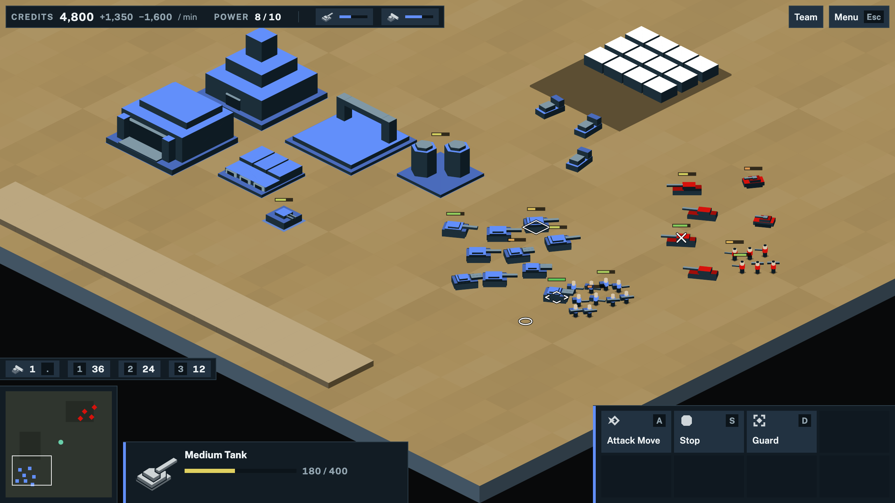
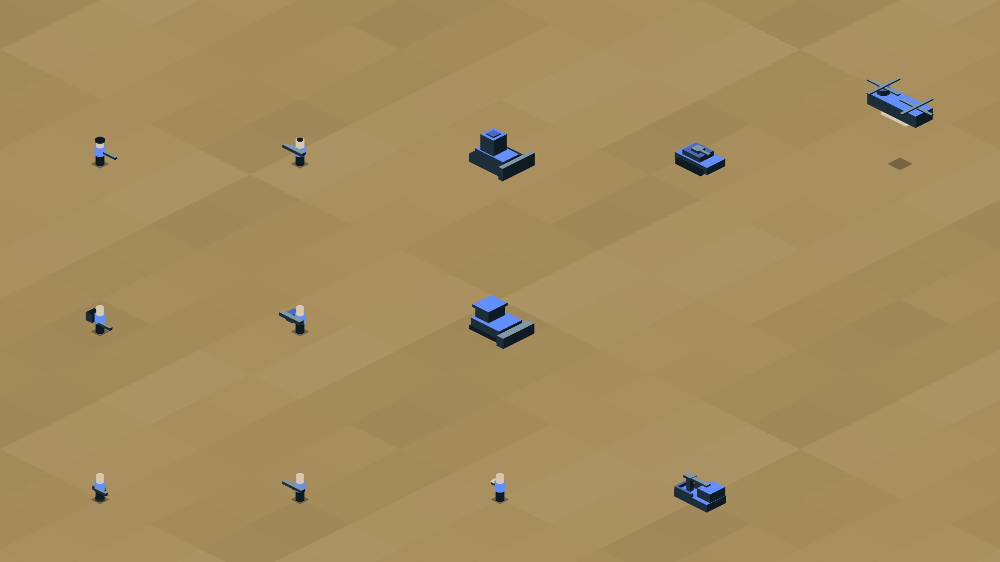
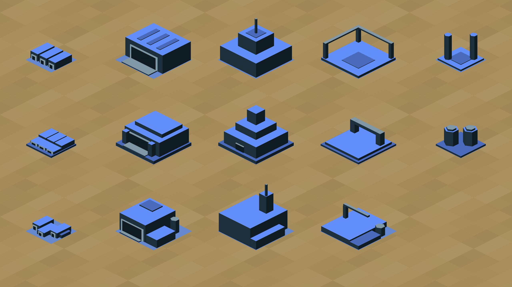
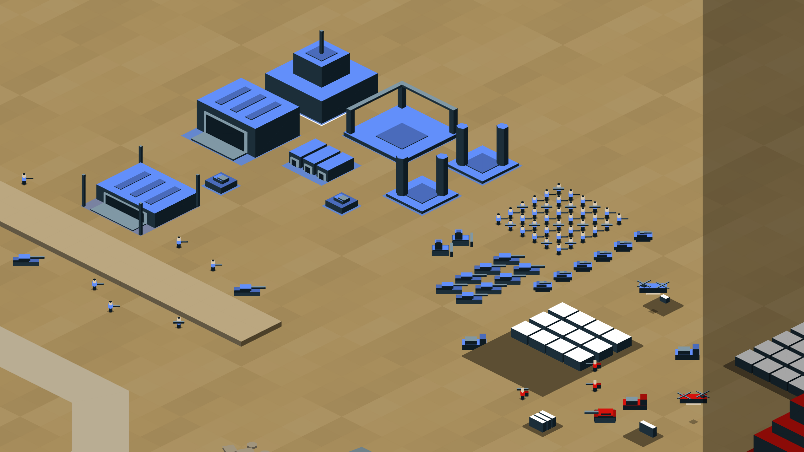
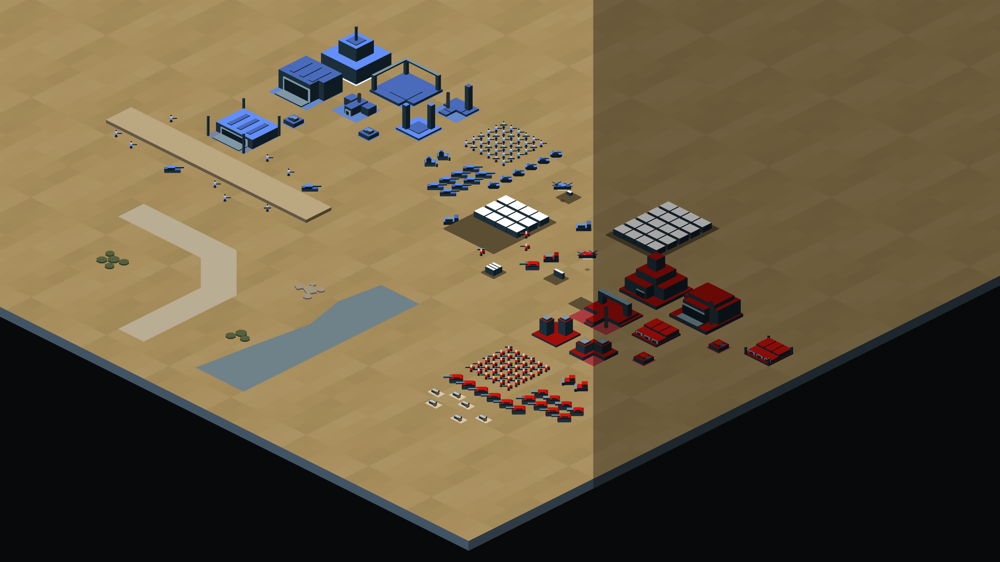
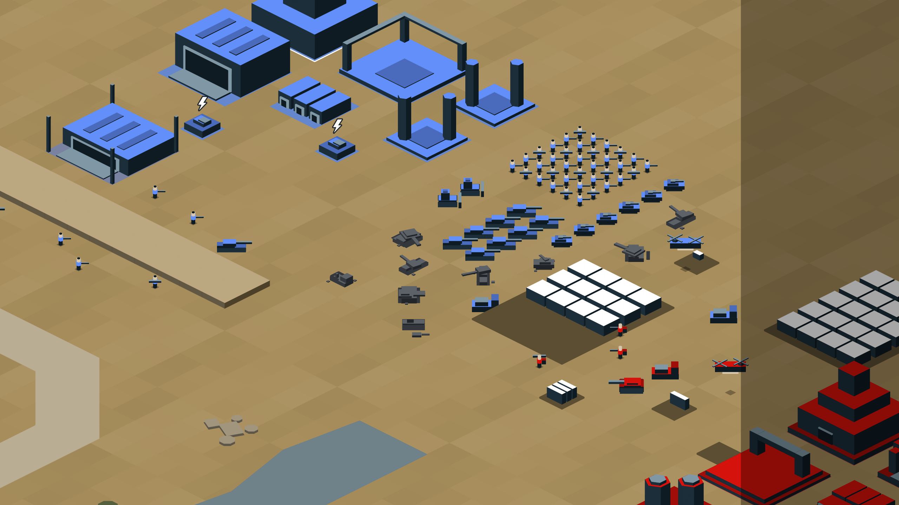
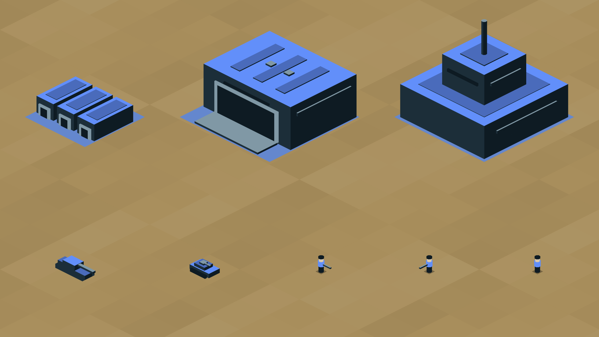

# Wargrid — art bible

**Version 2 · 2026-11-17.** Who wrote which part: the interview table in §1 and the closing section [Where it started](#where-it-started-2026-11-09) come from the user's interview and GPT's art pack (2026-11-09); the looks in §4 to §9 were picked by the user on A/B pages and in the art lab (2026-11-09 and 2026-11-10) and in map art rounds 1 to 6 (2026-11-13 to 2026-11-17); this rewrite is by an agent (map art round 6, 2026-11-17). A rule tagged "(user, DATE)" is decided, with its reason in the [design answers](../reference/design-answers-2026-11-08.md#map-art-faction-shapes-m75-user-2026-11-13); anything else is labelled a proposal. Rules are in words; every size, colour value and affected test is in [map art shapes](../reference/map-art-shapes.md) and the export [`shapes-picked.json`](../images/map-art/shapes-picked.json), never repeated here (user, 2026-11-17). GPT's QA images, validation and handoff notes are outside the repository at `~/projects/wargrid-art-archive/`.

The gate reference (map art round 6): the picked shapes and owner colours, the map edge on the dark canvas, the white marks and the HUD v5 layer, showing all five [screenshot marks](#11-acceptance-gates) in one picture. It is drawn by the map art page from the exported shapes, not a screenshot of the game.

## 1. Authority and the thirteen decisions

The complete questions, alternatives, answer quotes and illustrations remain in the [interview archive](interview/INTERVIEW_ARCHIVE.md) (images in `~/projects/wargrid-art-archive/interview/`). The [JSON archive](interview/interview.json) retains all 13 verbatim answer fields. Q1 explicitly rejected the initial pixel-art-like concepts; liking option C's contrast did not approve its detailed rendering. Unillustrated hybrid options have not been given invented historical images.

| Q | Preserved decision | What it requires here |
|---|---|---|
| 1 | High-contrast abstract geometry; reject pixel-art / detailed low-poly concepts | Rectangles, circles, triangles and flat polygons; no textured surface imitation |
| 2 | B — Functional icons from simple primitives | Tank, bulldozer and factory recognizable by construction |
| 3 | C — Filled shapes with selective outlines and accents | Mass from fills; an edge only when it clarifies form or state |
| 4 | B — Responsive and punchy animations | Short recoil, decisive impact, quick settle; no cartoon bounce |
| 5 | B — Minimalist 2.5D top and side faces | Existing fixed isometric camera; modest extrusion |
| 6 | C — Muted biomes with bright units and effects | Distinct terrain character without competing saturation |
| 7 | D — Geometric destruction normally, spectacle for powerful attacks | Small fragments and readable wrecks; large rings reserved for rare power |
| 8 | B — Shared functions, faction-specific styling | Role, faction and owner remain separate visual channels |
| 9 | D — Functional building silhouettes with selective mechanical animations | Buildings read when motion and glow are off |
| 10 | D — Matte shaded objects with selective luminous components/effects | Quiet permanent surfaces; brightness signals an event or state |
| 11 | B — Progressive simplification | Remove small detail, retain barrel, blade, wings and role mass |
| 12 | B — Balanced player-colored surfaces with neutral sides | Large readable colored tops; neutral mechanics and vertical faces |
| 13 | B — Refined geometric minimalism | Consistent proportions, spacing, grounding and timing before extra detail |

The 13 answers are the starting point and may be revisited (user, 2026-11-09).

**Order of authority:** user decisions ([design answers](../reference/design-answers-2026-11-08.md)) → this art bible → [map art shapes](../reference/map-art-shapes.md) and `shapes-picked.json` → the [map art pictures](../images/map-art/notes.md) and their [source](../images/map-art/source/README.md). The starting proposals at the end of this document are history, not an authority. Current repository rules still govern any implementation; this document does not silently rewrite them.

## 2. What is proven

- **Geometry is proven in the game's own bake:** a headless round trip bakes every picked shape with the game's `ShapeBake` and matches the page's drawing, with one listed failure that is today's game shape ([what is proven](../reference/map-art-shapes.md#what-is-proven-and-what-is-not)).
- **Page data only:** colours, the map edge, the marks and the power bolt; they are judged on the page and computed there, not seen in a Godot window.
- **Not run:** motion, feel, the rendered benchmark, a Steam Deck, human recognition in a crowded match. Each package that brings a look into the game proves it there.

## 3. Construction and camera

Keep the existing 2D simulation plane. The game projects ground coordinates as `screen_x = 32 × (x − y)` and `screen_y = 16 × (x + y)` (`game/scripts/presentation/isometric.gd:3-4` at `8cb338c`), so a cell is a 2:1 diamond. A raised vertex subtracts its visual height from screen Y (`shape_bake.gd:81-82`), one height unit being a fixed number of pixels (`shape_bake.gd:7`). Hull geometry is rotated in the ground plane and projected afterwards (`shape_bake.gd:44-45`), at one of 64 heading steps (`shapes.gd:5`); never rotate an already projected drawing as a flat sticker.

Each piece has a ground anchor distinct from roof and turret height; pieces sort by that anchor (`world_batch.gd:151-154`), and the unit shadow sits on it (`world_batch.gd:183`). Tracks, foundations and shadows touch the anchor. A barrel emerges from a turret; a blade connects to a chassis; a factory ramp meets its opening. Ground shapes are 2:1 like the cells; today's unit shadow is a square screen diamond (`world_batch.gd:307`) and becomes 2:1 with P2.4 (user, 2026-11-15).

Every piece has an owner-coloured top, a lit neutral side and a dark neutral side. The side a face gets depends on its direction in the ground plane, not on the hull (`shape_bake.gd:69-72`), so the light stays fixed on screen as a piece turns; faces turned away are not drawn (`shape_bake.gd:70-71`). Roof and machine parts take the neutral sides (`shape_bake.gd:63-65`). Prims of a part paint back to front for each heading (`shape_bake.gd:50-57`). Fills are flat: no textures, gradients or bloom.

Shapes are data, not drawings: boxes and cylinders in cells and height units, each in one of eight colour slots resolved per owner (`shapes.gd:6-13`, `palette.gd:28-34`). Boxes and cylinders only, no wedge (user, 2026-11-13, for buildings; 2026-11-14, for hulls). The format and the projection constants are in [how to read `shapes-picked.json`](../reference/map-art-shapes.md#how-to-read-shapes-pickedjson).

## 4. Unit vocabulary

- **True size** (user, 2026-11-09): units are drawn at their real footprint, one-cell hulls (user, 2026-11-10); a 1.5x drawing looked far too big.
- **Infantry:** a full owner-colour torso with a light head and dark legs (user, 2026-11-10); a narrow body with a wider click box (user, 2026-11-10). Each faction has its own soldier, today's body with the faction in headgear, pack or weapon (user, 2026-11-13). Infantry do not show their faction at zoom 0.5, accepted (user, 2026-11-17).
- **Builders:** USA and China bulldozers have their own bodies, USA narrow with a tall rear cab, China low with a wide blade; FRC builds with the Laborer (user, 2026-11-13).
- **Light vehicles:** the Scout Car is a low closed car, lower than a tank; the Armed Pickup has an off-centre cab, an open bed and a gun on a post; the FRC tank stays the bigger vehicle (user, 2026-11-13 and 2026-11-14). Small guns (user, 2026-11-10), at least 2 px wide at zoom 1 (user, 2026-11-14).
- **Tanks** are all the same height and keep Zero Hour's height-to-length rule (user, 2026-11-14); faction comes from the hull outline (§6).
- **Supply Helicopter:** a tandem-rotor transport with a cargo pod (user, 2026-11-13); both rotors follow their end of the hull.
- **Turrets** turn toward their target at a fixed rate, drawing only (user, 2026-11-09).
- **A small dark shadow under every unit,** on High quality only (user, 2026-11-09).
- Proposal: a role needs a different primary feature, not a tiny accessory on the same box; no panel lines, rivets or vents. Tracks and wheels go to a P2.4 A/B (user, 2026-11-17, [P2.4 riders](../reference/map-art-shapes.md#p24-three-armies-unit-shapes-and-the-palette)).

Heights, hull lengths and the tests they touch: [P2.4](../reference/map-art-shapes.md#p24-three-armies-unit-shapes-and-the-palette). More: [tanks at eight headings](../images/map-art/tanks-picked-z2.webp), [unit fixes](../images/map-art/fix-units-picked-z2.webp), [zoom 2 finish](../images/map-art/zoom2-picked-z2.webp).

## 5. Buildings communicate activity

- **Same role cue in every faction** (user, 2026-11-13): barracks low with repeated rooms, power plant two drums, supply depot an open pad under lifting gear, vehicle factory one hall with a wide dark door, headquarters the tallest, with a tower or mast. The barracks is the lowest building; China's power plant drums clearly top its barracks (user, 2026-11-14). All read in a still frame without labels, lights or motion (interview Q9).
- **Doors are framed openings** (user, 2026-11-17): each door keeps its dark slab inside a light steel frame; USA, FRC and the China barracks get two side posts and a top bar; the China factory and Headquarters a top bar only. [Surfaces](../images/map-art/surfaces-picked-z1.webp).
- **No text on the map** (user, 2026-11-09): progress and amounts are in the selection panel.
- **Construction rises out of the ground** (user, 2026-11-09) **inside four thin corner posts at its final height** (user, 2026-11-13), so progress reads as how full the frame is. **A paused site shows its four posts alone** (user, 2026-11-17): it looks just started, whatever its progress. Its owner tells it from an active site by the P3 stalled-site mark (rider) and the panel's `PAUSED · NO BUILDER`. [Paused](../images/map-art/paused-picked-z1.webp), [placeholders](../images/map-art/placeholders-picked-z1.webp).
- **Damage** (user, 2026-11-09 and 2026-11-14): at 70 % one corner facing the camera goes and the remaining roof turns dark; at 35 % a second corner goes and one thin, still smoke column rises, clear of doors and the Headquarters tower. [Damage](../images/map-art/damage-picked-z05.webp).
- **No power:** a steady white bolt over each dark powered defence, nothing else on the map; the production slowdown shows in the HUD power readout (user, 2026-11-17, a favourite until the art lab confirms it in the game; F21 stays open). [Power](../images/map-art/power-picked-z1.webp).
- Animation reinforces a real state and never delays a spawn or changes the economy. The Power Plant drums are a P2.6 rider; a completion settle and a roof inset while producing are art lab toggles with P2.6 (user, 2026-11-15). Proposal: factory machinery moves only around production, cargo only during supply work.

Heights, door sizes and tests: [P2.6](../reference/map-art-shapes.md#p26-three-kinds-of-base-buildings-doors-paused-sites-no-power).

## 6. Faction identity without color dependence

Faction is never shown by colour (interview Q8); owner colour means ownership only. Faction outline differences are exaggerated until the three factions tell apart at zoom 1 (user, 2026-11-09).

| Faction | Buildings (user, 2026-11-13) | Tanks (user, 2026-11-14) |
|---|---|---|
| USA | Symmetric, centred modules | Long and slim |
| China | A thick plinth and mass that steps inwards | Broad; both China tanks share the hull and differ by turret (one long barrel, a short twin-barrel block) |
| FRC | Unequal boxes pushed together off-centre | Short, with a set-back, lopsided turret |

Every tank keeps tracks, turret and cannon; faction style never implies a second weapon, armour value or mechanic. If a faction difference disappears in play, change the main outline, not small decorations (proposal). Bases: [USA](../images/map-art/base-usa-z1.webp), [China](../images/map-art/base-china-z1.webp), [FRC](../images/map-art/base-frc-z1.webp), [two bases at zoom 0.5](../images/map-art/base-usa-china-z05.webp).

## 7. Terrain, ownership and state

**Ground.** Sand by default and the dark ground as the second biome (user, 2026-11-10), each with a slight per-cell shade (user, 2026-11-10). Cliffs are a low raised step with a lit top, never high enough to hide a unit (user, 2026-11-09), firmer since round 5 (user, 2026-11-14). Water is a muted blue-grey flat surface (user, 2026-11-09). Roads, rocks, trees and water lie flat on the ground, decoration only, and land with the next map ports (user, 2026-11-14). The grid shows only while placing a building (user, 2026-11-09). Fog darkens what is not seen now, lighter than Zero Hour's half brightness; the fog package confirms the value in the game (user, 2026-11-14). [Dark ground](../images/map-art/world-picked-dark-z05.webp), [fog](../images/map-art/world-fog-z1.webp), [cliff and decoration](../images/map-art/world-cliff-decor-z1.webp).

**Map edge.** Slate side faces hang from the two camera-facing map edges, no lit line on the top edge (user, 2026-11-15), and a near-black canvas lies beyond (user, 2026-11-17). On fogged dark ground the ground nearly meets the canvas (2.33, noted by the user) and the fogged edge faces more so (lit 1.64, shaded 1.30, no bar decided). [Edge](../images/map-art/edge-picked-z05.webp).

**Ownership.** One colour per player on every ground, palette A (user, 2026-11-17), on the large tops; sides and machinery stay neutral (interview Q12), and the dark side band carries the outline against the ground (user, 2026-11-14). Building roofs take the owner colour on the whole roof, in a calmer, darker version, so units stay the brightest things on screen (user, 2026-11-09, [look Q5](../questions/next-m75-art-look.md)). Since the art lab the game and every round 1 to 6 picture draw building roofs in the same full owner colour as unit tops (`palette.gd:29-33`), and palette A was picked on that look; whether building roofs get the calmer shade back is open for the user, at P2.6 (agent note). The palette meets a bar of side-band contrast and colour distances under colour-vision simulation, not owner-top contrast (user, 2026-11-17). The Neon set is removed (user, 2026-11-17). An opt-in friend/foe colour mode with colour-blind presets, off by default (user, 2026-11-09 and 2026-11-17). The bar simulates deuteranopia and protanopia, not tritanopia (blue/teal 12.1). Accepted and open: owners under fog for colour-blind players (art lab), pink near the HUD cyan (P2.4), green near the HUD `ally` colour and an enemy's owner without colour in 3v3 (open, agent finding, 2026-11-17); [list in the reference](../reference/map-art-shapes.md#p24-three-armies-unit-shapes-and-the-palette). [Owners](../images/map-art/owners-picked-z1.webp). Values and the bar: [P2.4](../reference/map-art-shapes.md#p24-three-armies-unit-shapes-and-the-palette).

**Supplies.** Cargo is white, the neutral owner's colour (user, 2026-11-17). Piles show their fill as rows of pallets that empty from one end, no text (user, 2026-11-13), on an earth pad, the ground darkened (user, 2026-11-17). A salvage crate is a small crate beside a drum on an oblong mat (user, 2026-11-13). [Cargo](../images/map-art/cargo-picked-z1.webp). Values: [P2.5](../reference/map-art-shapes.md#p25-supplies-you-can-read-cargo-piles-crates-and-sites).

**Marks.** Marks on the map are white with a dark under-stroke and told apart by shape; no red marks on the map, red stays an owner colour and the health bar's low end (user, 2026-11-15; the launcher's error chip keeps its colour). Selection is a thin ground diamond (user, 2026-11-09), hover four corner ticks, an attack target an X, a move order a ring closing onto the point, placement cells an outline with an X when blocked, a rally a pole with a square flag, battery and defence targets a dashed line (user, 2026-11-15). Marks on a unit draw above the pieces, marks on a place under them (user, 2026-11-15). A horde shows a flat ground ring (user, 2026-11-10). Health bars go green to yellow to red inside a thin frame in own, ally or enemy colour (user, 2026-11-09); which units show one goes to an in-game A/B before the P2.3a plan (user, 2026-11-15 and 2026-11-17). Amber means "act here", never decoration (user, 2026-11-15). [Marks on sand and the dark ground](../images/map-art/marks-z1.webp). Sizes, and which are still open: [P2.3a](../reference/map-art-shapes.md#p23a-see-your-selection-map-edge-canvas-and-marks).

## 8. Motion, effects and destruction

- **Pieces are drawn between the last two ticks** (user, 2026-11-10); drawing only, no simulation change.
- **Four shared motion durations,** progress always linear, nothing loops unless work is ongoing; a reduce-motion setting sets them to zero ([second pass](../reference/design-answers-2026-11-08.md#visual-and-ux-proposal-second-pass-user-2026-11-15), user, 2026-11-15).
- **Shots:** a short bright dash flies to the target (user, 2026-11-10). No hit flash on the hull (user, 2026-11-10). No screen shake (user, 2026-11-10); shake for special-weapon explosions was not shown.
- **Big effects only for special weapons;** building and vehicle deaths get none (user, 2026-11-10).
- **Infantry bodies fall and fade within about 2 s** (user, 2026-11-09).
- **Vehicle wrecks** keep their lifetimes (user, 2026-11-10, kept 2026-11-17; [numbers](../reference/design-answers-2026-11-08.md#map-art-faction-shapes-m75-user-2026-11-13)): full hull volume in charcoal greys with no owner colour, loose debris and a different break per wreck, no effects; a salvage crate draws above or beside a wreck (user, 2026-11-17); whether "beside" may offset it from its cell, where it is picked up, is open (agent finding, 2026-11-17). Wrecks are their own item after P2.4 ([wrecks](../reference/map-art-shapes.md#not-placed-in-a-package-yet-wrecks)).
- Weapon families told apart by geometry and timing, not hue, are input to the combat polish package, not decided (user, 2026-11-15).
- Cosmetic effects never consume simulation randomness or reveal hidden units through fog ([determinism rules](../reference/determinism-rules.md)).
- Proposal: barrel recoil is a short backward move and a solid return, the hull stays nearly still; no squash and stretch. Under load, decorative debris goes first; shot and hit confirmation, selection and destruction state stay.

## 9. Zoom and heading discipline

- **Three fixed zooms,** 0.5, 1 and 2 (`game/scripts/match/match_screen.gd:14`); the zoom picks the detail level, so nothing flickers (user, 2026-11-09). Low quality always draws the lowest level (`graphics_settings.gd:34-36`).
- **Zoom 0.5 draws the same parts as zoom 1; zoom 2 keeps every part and adds up to four finishing parts** (window bands, vents, track bands, hatches) that leave the outline unchanged (user, 2026-11-14). The identity audit checks exactly that (user, 2026-11-14). Cylinders lose sides at the lower detail levels (`shape_bake.gd:35`).
- **No switch to an unrelated icon** at any zoom; barrel, blade, wings and role mass stay (interview Q11).
- **Eight-heading paint order:** from P2.4 the shape audit checks paint order at eight headings with no wrong sample allowed (user, 2026-11-14).
- Shapes with no zoom 2 version yet are listed in the export and drawn by their package, never invented ([not covered](../reference/map-art-shapes.md#not-covered-or-not-decided)).

## 10. Repository integration, when separately authorized

- How shapes are baked and drawn today: [guide chapter 5](../guide/05-presentation.md).
- Inspected code, boundaries and gates from before the art lab: [Godot integration review](../reference/art-godot-integration.md); the art lab: [verification](../reference/art-lab-verification.md).
- What each package takes and which tests it touches: [map art shapes](../reference/map-art-shapes.md); the pictures and the page that re-makes them: [map art](../images/map-art/notes.md), [source](../images/map-art/source/README.md).

## 11. Acceptance gates

| Gate | Evidence required before progressing |
|---|---|
| Reference pack | Eight paired sheets; full and 25% visual inspection; current links and palette; 13 decisions and archive hashes preserved |
| Art laboratory | Tank, dozer, plant, factory and infantry at real footprint sizes; three owners; eight vehicle headings; selection and near/play/far views |
| Human recognition | Unlabeled role quartet; same-color faction comparison; frozen building roles; owner changes that leave faction clear |
| Motion and combat | Recoil and machinery align with actual events; normal and signature effects; local hit feedback; legible wrecks and dense combat |
| Integration | Correct ground anchors, picking and overlap behind/in front of buildings; intact fog and HUD behavior; no trace or gameplay change |
| Screenshot marks (every art and HUD package; user, 2026-11-15) | A capture shows all five: the board has an edge and rests on the dark canvas; pieces have an owner-coloured top, slate sides and one light direction, ground shapes at 2:1; marks on the board are white with a dark under-stroke, no red lines, no map text; interface panels are dark, square, matte, hug their content and carry the owner colour on one edge; amber only where the player must act, at most one amber button per screen, launcher included |
| Performance and rollout | Existing native/Web requirements and benchmark ledger; unchanged gates; failures explicitly reported; user approval for integration and Git actions |

Only GPT's static artifact checks (archive: `VALIDATION.md`, `VISUAL_QA.md`) have been performed. Human recognition, animation, in-engine accessibility and performance gates remain open. No fabricated percentage recognition score or inferred benchmark pass.

Since round 6 (2026-11-17) the picked shapes' geometry also passes the Godot round trip; pixels, motion and feel stay not run ([what is proven](../reference/map-art-shapes.md#what-is-proven-and-what-is-not)).

For future comparisons record commit, scene/map/seed, viewport, camera/zoom, visible counts, effect state, platform, baseline and revised images, frame/tick measurements, and reviewer decision. Keep scene composition fixed for renderer comparisons; this revision's before/after sheets are editorial comparisons, not controlled game benchmarks.

## 12. Interface mock-ups

Applies to mock-ups of the launcher, the HUD and other menus (user, 2026-11-14, from the P2.1 launcher run):

- **Typeface:** Public Sans, the game's UI font, from `game/fonts/` (Regular, SemiBold, Bold, ExtraBold; [decision](../reference/design-answers-2026-11-08.md#new-launcher-user-2026-11-13)). Draw mock-ups in it at the sizes the game uses, so type carries over 1:1. The P2.1 mock-ups were drawn in Helvetica Neue, which the game cannot ship.
- **Source with every picture:** keep the HTML/CSS (or SVG) a mock-up was rendered from beside it; implementers take sizes, weights, paddings and colours from that source, not from pixels.
- **Resolution:** export at 2x the layout size (2560x1440 for a 1280x720 layout), WebP lossless or high quality; 1x pictures look blurry on a Retina screen next to the sharp build.
- **Every state:** draw each state a screen has (empty, error, locked or busy, folds open), not only the happy path.
- **Map art pictures** follow the same source-beside-pictures and 2x resolution rules ([source](../images/map-art/source/README.md); user, 2026-11-17).

## 13. Provenance and rights

Read `~/projects/wargrid-art-archive/PROVENANCE.md` before reusing interview images. “Original” in an inherited path is not proof of authenticity. We verify preservation from the supplied ZIP; independent access to the original Q1–Q12 conversation and generation outputs is unavailable. New sheet geometry is newly authored for this revision, with no EA artwork imported or traced. The historical package remains intact. Shipping license/credits for new art remain a separate project decision.

## Where it started (2026-11-09)

The starting proposals: version 1.3 of this document, written by GPT from the user's interview, and its eight reference sheets. Where a rule above differs, the rule above stands; these are history, not rules. Its motto was: "Recognizable machines from a few deliberate shapes. Bright ownership surfaces over quiet terrain. Physical depth without surface clutter. Force through timing, not permanent spectacle."

**What changed across the whole pack** (GPT, 2026-11-09). The issue was not confined to the faction sheet. The previous pack mixed two editorial systems, small isolated objects, weakly distinguished construction families, competing palettes, and captions repaired separately from their generator. Its eight-sheet guide and six-sheet manifest disagreed.

This revision uses one composition system: 1600 × 1000 canvases, fixed header/footer zones, dedicated caption areas, and geometry that fills its allotted space. The battlefield now has a quiet base area and a clear combat focus. Units have separate tracks, role attachments and grounded mass. Building openings are actual negative space. Terrain follows the same 2:1 ground projection as the objects. Effects demonstrate both impact tiers and readable destruction. Zoom includes eight tank and bulldozer headings. Palette examples separate owner hue from state.

These changes improve the references; they are not measured proof that players can identify every object in a crowded match. GPT's QA evidence is in `~/projects/wargrid-art-archive/VISUAL_QA.md`.

The sheets (each with its editable SVG beside it in [`references/`](references/)) and GPT's [palette proposal](palette-proposal.json):

