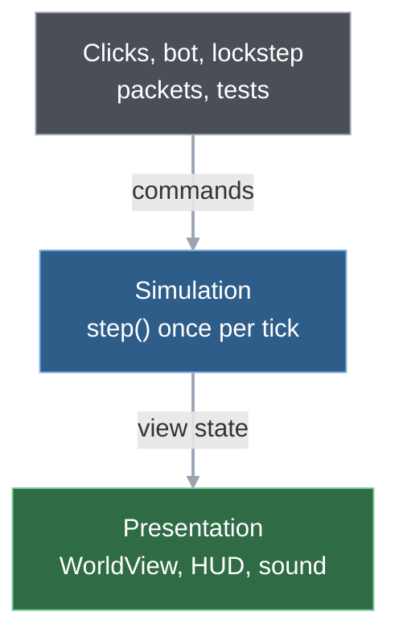
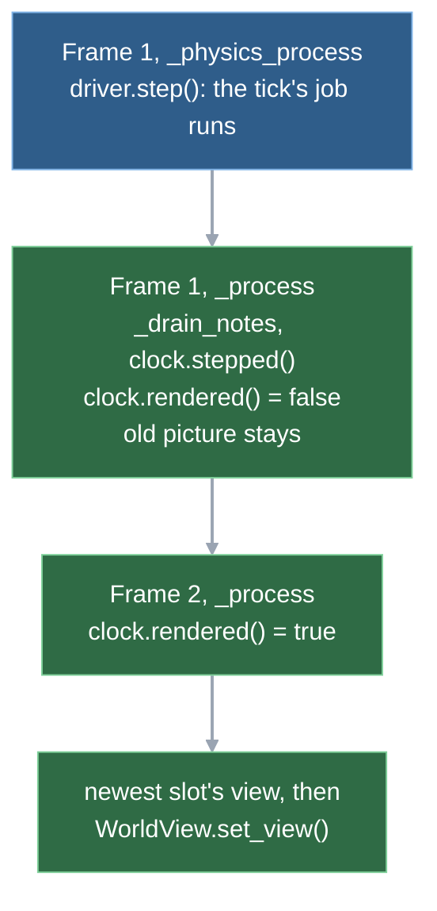
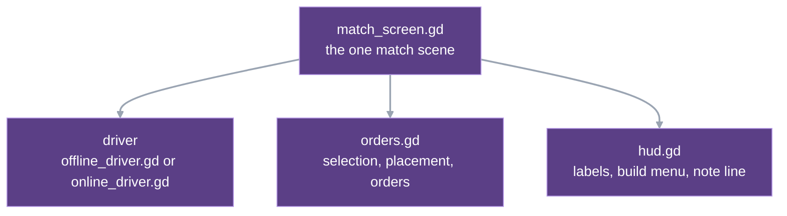

# 1. Big picture and time

Wargrid is two programs in one process. The **simulation** holds every unit, building and credit and advances the whole game in fixed steps of simulated time, 30 per second, with no idea that a screen, a clock or a network exists. The **presentation** draws that state and never decides anything. Thin scene scripts, the **drivers**, sit between the two: they hand each tick's work to a **pump** that holds the simulation, turn clicks into **commands** and pass the new state on. The only things that cross the line are commands going in and state coming out. That one boundary is what lets the same game run headless in tests, replay from a list of commands, and stay identical on every machine in a lockstep match.

## Two halves joined by commands and state

The drivers carry both arrows. The three layers:

1. **Simulation** (`game/scripts/simulation/`). Plain GDScript classes extending `RefCounted`, not `Node`. No scenes, no rendering, no wall-clock time, no network. State lives in dictionaries and arrays inside `Simulation`, and the only clock is its `_tick` counter. The blueprint calls this "authoritative simulation state": sprites show state, they do not own rules ([blueprint §3](../blueprint.md#3-engine-language-tools), "Simulation constraints"). What outside code may call is listed in the [simulation interface](../reference/sim-interface.md).
2. **Presentation** (`game/scripts/presentation/`). Godot nodes that draw, play sound and show the HUD. They hold no reference to the simulation. The pump builds the state with `view_state()` after every tick; the screen takes the newest one from its driver (`driver.current().view`) and pushes it in with `WorldView.set_view`. It also asks the view what is under the mouse (`pick_target`, `pick_object`). No presentation script calls `issue_command`. None calls `snapshot()` or `view_state()` either.
3. **Drivers**: the scene scripts (the chain below). They own the pump (below), which owns the `Simulation`; they post one job per tick on the clock (offline the job carries the queued commands and steps the simulation; online the job carries the commands lockstep released for that tick and steps it the same way), turn clicks into commands and hand the new state to the presentation. Online they hand commands to the lockstep code in `game/scripts/net/` instead ([chapter 11](11-multiplayer.md)). One call bypasses commands: the movement demo's obstacle key. It calls `replace_blocked_cells`, a terrain edit, from `main._toggle_obstacle`.

The simulation never calls a presentation method. Other callers use `Simulation` with no presentation at all, for example the headless test runner. The runner is `game/tests/run_tests.gd`, a `SceneTree` script. Tests such as `test_replay.gd` call `sim.step()` directly. The benchmarks in `game/benchmarks/` and the headless network client do the same.

The other chapters zoom into one box each; the list is in the [README](README.md).

## One right-click, from mouse to moving unit

Offline skirmish, a unit selected, the player right-clicks open ground. The path through the code:

1. **Input.** The match screen hands the click to its orders object, which tries each kind of order in turn. First it checks whether the click is a defence order or an attack on an enemy. Neither, so it looks for a supply source, another object or a rally point, finds none and falls through to the right-button branch, which issues the move after converting the screen position to a map position (chapter 2).  
   `match_screen._unhandled_input → orders.handle → _combat_input (_view.pick_target) → _building_input (_context_order, _set_rally) → _selection_input → orders._move(Iso.plane_to_world(...))`
2. **Command.** The orders object wraps the target into a move payload and gives it to the screen, which shows a hint marker and hands it to the driver. The offline driver adds the local seat as the player and parks the command in its queue; it returns a placeholder `ok` the screen ignores (the real answer comes later) and does not touch the simulation. The screen repaints the view it already shows (`shown_state`, the last state it was given) at once, so the click gets a hint marker and an order voice before any tick runs; nothing is read from the simulation for that.  
   `orders._move → match_screen._submit → driver.submit → _queue` (also `_show_hint`, `_reshow`)
3. **Queue.** On the next physics callback the driver posts a **job** (one tick's work) that carries its queue. The pump gives each command in it the simulation's current tick and the player's last sequence number plus one, so no counter exists outside the simulation. The simulation validates the command and queues it for its tick. Nothing has moved yet.  
   `driver.step → SimPump.post → run_job → Simulation.issue_command → _pending`
4. **Tick.** In the same job the bot issues its commands, then the simulation steps. The answer for the click (accepted, or the rejection text) travels in the job's **note**; the screen takes it when it drains the notes at the start of its next rendered frame. Online play answers when the scheduled command tick has run, a few ticks after the click.  
   `match_screen._physics_process → _step_frame → driver.step → SimPump.post → run_job → Skirmish.issue_opponents → Simulation.step`
5. **Inside the step.** The command is due this tick. The simulation gives each unit a destination and queues a path request, answers the request with a route, and starts turning the unit; it begins to roll two ticks later. [Chapter 4](04-the-tick.md) follows these steps function by function. Then the tick counter advances.  
   `Simulation._apply_orders → _service_paths → _assign_route → _advance → Locomotion.step (START_DELAY_TICKS) → _tick += 1`
6. **State out.** At the end of the job the pump wrote a fresh `view_state()` into a slot. The screen drains the notes (sound and visual events, answers), tells the presentation clock the tick advanced, and on the right rendered frame reads the newest slot, keeps it as `shown_state` and pushes it to the view and the HUD. Input between ticks (selection, hover) repaints from that kept copy instead of reading anything new.  
   `match_screen._process → _drain_notes → PresentationClock.stepped … _present_if_due → _refresh → driver.current().view → _show (sets shown_state) → WorldView.set_view, hud._refresh_hud`
7. **Draw.** The view draws the new state. On this first tick the unit has only turned toward its route; it starts to move two ticks later. On each following rendered frame the view can slide it toward the newest pose (interpolation, below).  
   `WorldView.set_view → WorldView.advance_frame`

Online the same click takes a different middle. The online driver sends the command to lockstep instead of its queue, which stamps it with a future tick and a sequence number and queues it. It travels to the relay inside a packet and reaches the simulation only when every seat's packet for that tick is in; lockstep then hands the tick's commands to the driver, which posts them as an ordinary job (chapter 11).  
`online_driver.submit → Lockstep.submit … Lockstep.take → SimPump.post → run_job → Simulation.issue_command → Simulation.step`, then in `drain`: `Lockstep.record → Lockstep.finish_tick`

## Who keeps the time

Wargrid lets Godot keep the time. The project setting `physics/common/physics_ticks_per_second` is 30 (`game/project.godot`). The match screen asks its driver to `step()` from `_physics_process`, which posts the tick's job. Godot keeps the leftover time between rendered frames (an accumulator) and runs zero to several fixed physics steps per frame, so offline one physics callback is one **tick** (online it may be none or two; see below). The simulation uses no Godot physics; the setting is only the metronome. A tick is 1/30 s of game time, and its cost budget is in the [performance ledger](../reference/performance.md). The rate of 30 was the blueprint's starting default ([decision log](../blueprint.md#14-decision-log)), and it is also Zero Hour's logic rate, so frame counts in a Zero Hour recording map one-to-one to ticks ([Zero Hour verification](../reference/zero-hour-verification.md)).

`_process` is the other callback: once per **rendered frame**, as fast as the machine allows. It first drains the pump's finished jobs (`_drain_notes`), then, if the clock allows, redraws; it pans the camera and calls `WorldView.advance_frame`. So ticks are steady and rendered frames are not; a frame may carry zero, one or (after a long frame) several ticks. The outcome of a tick depends only on state and commands, never on how many frames were drawn. The rate is baked in twice. First, `locomotion.gd` converts speeds per second into distance per tick with a literal `30.0`. Second, every duration in the rules and data is a tick count: weapon delays, build times, the start delay of a move, the bot's decision interval (`delay_ticks`, `DECISION_TICKS`). Changing the project setting alone would change the speed of the whole game. After the match ends, time stops: `step()` returns at once once the **match** is over, and `_tick` stops counting.

### Why the redraw waits a frame

A rendered frame can carry two expensive things: a tick (the job: `step()` and the view build) and a redraw (the world view's batch rebuild, then the HUD). Both in one frame make that frame long. The `view_state()` itself is built by the job, once per tick, whether or not that tick is ever drawn; only the redraw waits. So the presentation clock (`presentation_clock.gd`) holds the redraw back. `stepped` (called from `_drain_notes`) marks it pending and `rendered` releases it on the next rendered frame. If that frame ran no tick, the two costs landed in different frames (a split). If it ran a tick as well, the machine draws no faster than it ticks and waiting bought nothing, so the clock redraws in the tick's own frame for `RETRY_TICKS` ticks before it tries again. `split_share()` is the share of recent redraws that were split; the F3 overlay prints it. The price is a picture one rendered frame older; the simulation never sees any of this.

### Smooth motion between ticks

A unit jumps a short distance each tick. On the highest graphics quality with the smooth option on, the world view keeps each unit's pose from the previous tick and the current one and draws it a fraction of the way between them (`blend`, `advance_frame`). This is **interpolation**. The fraction comes from wall-clock time since the view received the latest tick and `Engine.physics_ticks_per_second`; the simulation never reads it. On other quality levels units snap to the new tick's position.

### The match screen: one screen, three objects

`match_screen.gd` is the scene script of `skirmish.tscn`, the only match scene, offline and online. It owns the clock, the camera, the view and the sound, and holds three objects it builds itself:

- `driver` owns the pump (`driver.pump`) and decides what one tick does (`step`) and where a command goes (`submit`). `offline_driver.gd` makes a tick one job: "queued commands, bot commands, step". `online_driver.gd` makes it "poll the network, then ask lockstep whether this tick may run" (`_lockstep.take`), up to `CATCH_UP_STEPS` per callback; when lockstep releases the tick's commands, the driver posts them as one job, like offline. If another seat's packets are late, `take` says no, the tick does not happen, and rendered frames keep coming. Online play also never pauses time (`pauses_sim`).
- `orders` turns input events into selection, placement and command payloads.
- `hud` writes the labels, the build menu and the queue, and holds the note line (`hud.note`).

The launcher (`launcher.gd`) picks the driver: it instantiates the scene, and the online path calls `setup` with the transport and lockstep, which creates an `OnlineDriver`; without `setup` the screen creates an `OfflineDriver` in `_ready`.

### The pump: the one holder of the simulation

`SimPump` (`sim_pump.gd`) is the only holder of the live `Simulation` on the screen side, so a later worker thread could take the simulation over without the screen noticing. Offline, a driver never calls `issue_command` or `step` itself. It posts a **job**: the commands to issue, which bot seats to run, whether to step, an optional placement preview request, whether a state digest is wanted. `SimPump.run_job`, a static function of `(simulation, recorder, job, slot)`, does it in a fixed order (commands, bots, `step()`) and returns a **note**: that tick's combat events, command results, answers to the player's commands, the commands the bots issued, the placement preview answer, tick number, match-over flag and the match statistics (plus a snapshot and digest when the job asks for one). It also writes a fresh `view_state()` into a **slot**, a `(tick, view)` pair.

- **Slots rotate.** The newest finished view waits in a ready slot; `drain()` returns the pending notes and makes that slot `current()`, keeping the one before it as `previous()`. The shown slot never changes under the screen's feet.
- **Job 0 starts the match.** `start()` runs a first job that does not step, so the screen has a view and a note (`first_note`, with each seat's start cell for the camera) before tick 1. It first warms the definition caches and then freezes them, and freezes the default map, so a late lazy insert fails loudly instead of racing a worker thread.
- **Inline for now.** `post` runs the job at once on the calling thread; `busy()` is always false and `stop()` makes later posts do nothing. No thread exists yet.
- **Online is a job too.** In the game, lockstep no longer touches the simulation: `take` returns a tick's commands once every seat's packet is in, the driver posts them as a job, and `record` and `finish_tick` run when the job's note comes back (`drain`; chapter 11). The hash-tick digest comes from the tick's own job, tick 0's digest and the desync report's hash ring from query jobs, never from a live read. The static check (`tools/test_sim_boundary.py`) lets only `sim_pump.gd` read the live simulation. [Sim boundary design](../superpowers/specs/2026-11-15-sim-boundary-design.md) has the whole sequence.

The full design, with the later stages, is in the [sim boundary design](../superpowers/specs/2026-11-15-sim-boundary-design.md).

## What this design costs

- **State crosses the boundary by copy, every tick.** `view_state()` and `snapshot()` build fresh data on every call, so the presentation can never touch simulation state. The pump builds the view once per job, so a tick whose redraw the clock skips still paid for its view. That hand-off costs about as much as the simulation: the view state plus sorting and batching for drawing take 0.54 / 0.95 / 1.93 ms mean per tick against a step of 0.70 / 1.07 / 1.98 ms (`skirmish3v3`, team match, `hordes300` stress row; measured, [data layout decision](../reference/data-layout-decision.md), section 2). None of it is in the simulation tick budget ([performance next](../reference/performance-next.md), section 1, point 3). Chapters 5 and 12 follow it up.
- **Godot's physics clock drives the ticks.** Built in and steady, no accumulator code of our own. The price: the rate is a project setting shared with Godot physics, and catch-up is Godot's. Past `max_physics_steps_per_frame` (not set in `game/project.godot`, so Godot's default of 8 applies, see the [Engine class reference](https://docs.godotengine.org/en/stable/classes/class_engine.html#class-engine-property-max-physics-steps-per-frame)) Godot does not skip ticks: the game runs slower than real time. That meets the blueprint's rule that "a long frame must not trigger unbounded catch-up work or silently drop simulation ticks" ([blueprint §11](../blueprint.md#11-performance-multiplayer-and-future-architecture)) offline; online play bounds its own catch-up explicitly.
- **Plain objects, not nodes.** Chosen so the rules are testable without the scene tree ([blueprint §3](../blueprint.md#3-engine-language-tools)); it is also what made the later native-port spike possible. The price: nothing in the simulation can use the scene tree, timers or signals; everything is explicit ticks and explicit calls. Randomness comes from a seeded generator inside the simulation (`next_random`), never from the engine ([determinism rules](../reference/determinism-rules.md)). Tests are held to the public interface by `tools/test_sim_boundary.py`, and the match and presentation scripts are kept off the live simulation by the same file.
- **Work is spread over ticks on purpose.** Path requests are answered until `PATH_CELLS_PER_TICK` route cells are spent per tick, so a large move order takes several ticks to get routes; bot decisions run every `DECISION_TICKS`, each seat on its own tick. The blueprint goes further (split rates: movement and firing at the full rate, unit decisions less often, staggered; not built; [blueprint §11](../blueprint.md#11-performance-multiplayer-and-future-architecture), "Performance next").
- **The redraw split is a known shortcut.** The code says it in a comment: when no idle frame comes between two ticks, splitting cannot help at that frame rate, so the clock retries later (`presentation_clock.gd`, `rendered`). In that case the refresh runs in the step's own frame, so that frame is the long one.
- **Interpolation draws one tick behind.** A unit is drawn between its previous and its current tick pose, so the picture trails the simulation by up to one tick on top of the redraw wait. Rules never read the drawn pose. Picking and box selection do, on purpose (`_pick_bounds`, `_drawn_position`): a click hits what is on screen, and the command carries only unit ids. When the view jumps more than one tick between redraws it snaps instead of blending (`_track_poses`). It runs on the highest quality only because of its cost ([data layout decision](../reference/data-layout-decision.md), recommendation 3).

Proposed, not built: running the simulation on a worker thread (a probe passed; the pump is the seam it would plug into, but every job still runs inline). Chapter 12 has the status.

## Where in the code

- `game/project.godot` — `physics/common/physics_ticks_per_second` (the tick rate), `run/main_scene` (the launcher).
- `game/scripts/simulation/simulation.gd` — `Simulation`: state fields at the top (`_tick`, `_entities`, `_pending`, `_path_queue`), `issue_command`, `_apply_orders`, `_assign_move`, `_service_paths`, `_assign_route`, `_advance`, `step`, `tick`, `snapshot`, `view_state`.
- `game/scripts/simulation/locomotion.gd` — `step`: how far a unit moves this tick.
- `game/scripts/match/match_screen.gd` — the match screen: `setup`, `_ready`, `_unhandled_input` (to `orders.handle`), `_submit`, `_physics_process` (calls `_step_frame`, which calls `driver.step`), `_process` (`_drain_notes`, then `_present_if_due`, camera, `advance_frame`), `_drain_notes` (notes to sound and visuals, answers, the clock), `_refresh` (shows `driver.current().view`), `_reshow` (repaints `shown_state`), `_show`, `_take_answers` (turns the driver's answers into the beep, the note and the playtest checklist), `_reset_camera` (from `first_note.starts`).
- `game/scripts/match/sim_pump.gd` — `SimPump`: `Job`, `Note`, `Slot`, `start`, `post`, `drain`, `current`, `previous`, `query`, `live`, `recorder`, `run_job`.
- `game/scripts/match/offline_driver.gd` — `create` via `Skirmish.create` (then `adopt`, which turns the hash ring off), `submit` (queues), `step` (one job: queue, bots `[2]`, preview request), `drain`, `take_answers`, `flush` (tests: issue the queue without a step) and `record` (state digest for the match record), both as `query` jobs, `request_preview` / `preview_answer`.
- `game/scripts/match/online_driver.gd` — `submit` and `step` with `CATCH_UP_STEPS`, `_lockstep.take` and `_tick_job` (one job per released tick), `drain` (`_finish_job`: `record`, then `finish_tick` with the job's digest; answers are built from the command log and the rejections), `take_answers`, `request_preview` / `preview_answer`.
- `game/scripts/match/orders.gd` — input dispatch (`handle`), selection, placement, the order payloads.
- `game/scripts/match/hud.gd` — `_refresh_hud`, build menu, queue, selected and inspected unit lines, result text.
- `game/scripts/net/lockstep.gd` — `submit`, `take`, `record`, `advance` (`take`, issue, `record` and `step` in one call, for the headless client), `finish_tick`.
- `game/scripts/presentation/presentation_clock.gd` — `stepped`, `rendered`, `split_share`, `RETRY_TICKS`.
- `game/scripts/presentation/world_view.gd` — `set_view`, `advance_frame`, `blend`, `_interpolating`.
- `game/scenes/*.tscn` — `launcher.tscn` (main scene, `launcher.gd`); `skirmish.tscn` attaches `match_screen.gd`.
- `game/tests/run_tests.gd` — headless runner that drives the simulation with no presentation.
- `tools/test_sim_boundary.py` — the live-read rule for `match/` and `presentation/`.

## Further reading

- [Blueprint §1](../blueprint.md#1-vision-and-intent), [§3](../blueprint.md#3-engine-language-tools) (architecture and simulation constraints), [§6](../blueprint.md#6-core-systems-and-recommended-implementation-order), [§11](../blueprint.md#11-performance-multiplayer-and-future-architecture).
- [Development notes](../development.md#overview): current status, commands, milestone history.
- [Simulation interface](../reference/sim-interface.md): what outside code may call.
- [Determinism rules](../reference/determinism-rules.md): what simulation code must never do.
- [Performance ledger](../reference/performance.md): tick and frame budgets and measurements.
- [Zero Hour verification](../reference/zero-hour-verification.md): where Zero Hour's logic rate was checked.

---
Checked against `f46993b`; the online-driver and lockstep passages against `dfea626` (SB4, now merged to `main`). Files: `game/project.godot`, `game/scripts/simulation/simulation.gd`, `game/scripts/simulation/locomotion.gd`, `game/scripts/match/match_screen.gd`, `game/scripts/match/sim_pump.gd`, `game/scripts/match/offline_driver.gd`, `game/scripts/match/online_driver.gd`, `game/scripts/match/orders.gd`, `game/scripts/match/hud.gd`, `game/scripts/presentation/presentation_clock.gd`, `game/scripts/presentation/world_view.gd`, `game/scripts/simulation/skirmish.gd`, `game/scripts/net/lockstep.gd`, `game/scripts/launcher.gd`, `game/tests/run_tests.gd`, `tools/test_sim_boundary.py`
