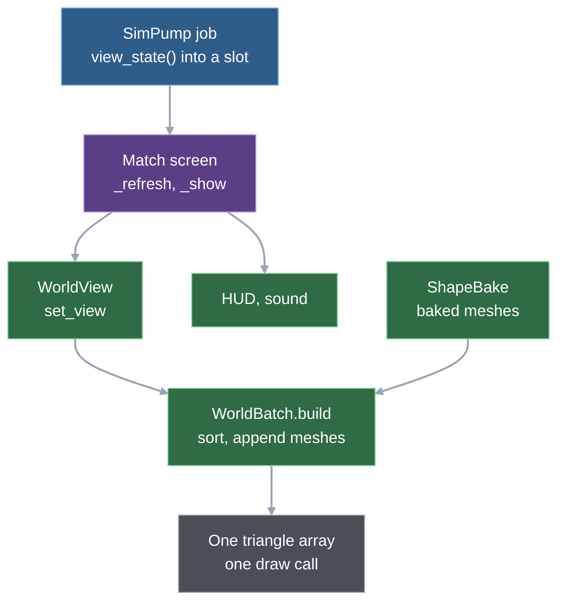
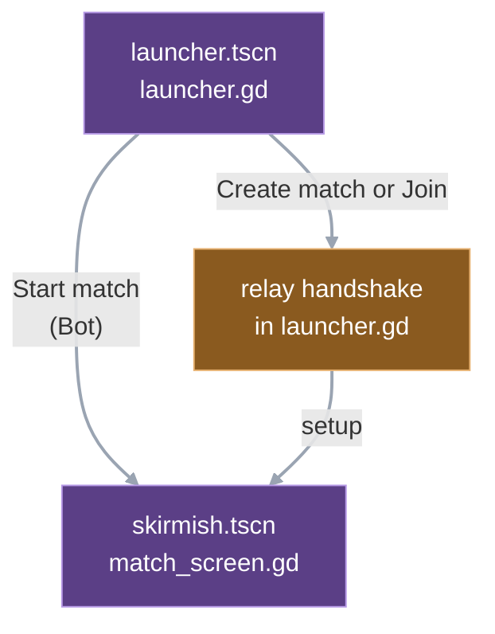
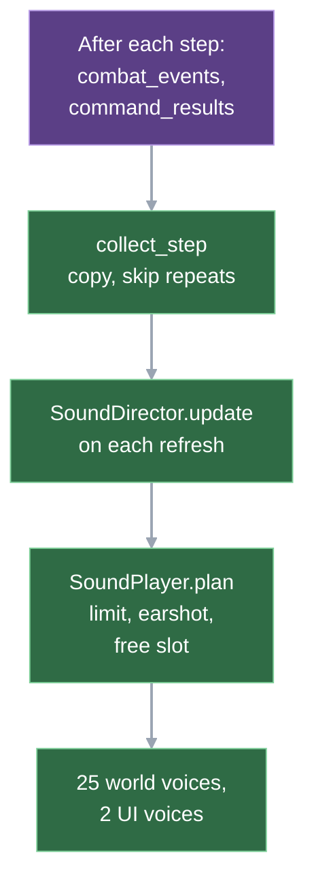

# 5. Presentation

Every refresh, the presentation turns the simulation's state into one packed list of coloured triangles and a handful of sound requests. It owns no rule. A unit's silhouette is geometry baked once per heading and then copied into one big array that the GPU draws in a single call. Chapter 1 explains who calls the refresh and when; this chapter follows what the refresh does with the state.

## From view state to one draw call

The parts, all in `game/scripts/presentation/` unless noted:

- **View rows** (`simulation/view_rows.gd`). The unit half of the state the simulation hands over: one row per unit, stored column by column in packed arrays.
- **WorldView** (`world_view.gd`). One node that receives the state, keeps a per-unit item between ticks, answers picking questions and draws overlays such as health bars, selection marks, focus boxes, hints and labels. Three child layers draw behind those overlays: terrain, building footprints and bodies.
- **WorldBatch** (`world_batch.gd`). Sorts the items into draw order and appends each one's baked mesh to a points array and a colours array.
- **Shapes and ShapeBake** (`shapes.gd`, `shape_bake.gd`). The first is the data table: per role, a list of parts made of boxes and cylinders. The second projects a part at one heading into a flat triangle list and caches it.
- **VisualDirector** (`visual_director.gd`). Turns shot and death events into short effects (muzzle flash, hit, dash, fade) and keeps turret aim angles.
- **Sound** (the `sound_*.gd` files, the announcer and the music player): a short section below.

The presentation holds no `Simulation` reference. It does import static simulation code: the definitions, `ViewRows`, and one pure function, `Combat.masked`, which picking uses to skip a building whose rebuild worker is present. No file in the presentation folder asks the simulation for anything: a search for the three entry points (issue a command, take a snapshot, take the view state) finds no call.

## One tank, from view row to triangles

A USA tank is on the map. This is its path through one refresh on the highest graphics quality.

1. **State.** The simulation keeps the tank as a dictionary with position, heading, hit points, owner and combat state. Once per tick (inside the pump's job, not on the refresh) it collects all units in id order and writes each into one row of the column arrays. The tank's kind becomes an index into a string table that is rebuilt on every call and holds `"usa_tank"`; booleans such as "is attacking" become bits in a flag byte.
   `SimPump.run_job → Simulation.view_state → _view_rows → ViewRows.from_units`
2. **Hand-off.** The match screen takes the newest slot's view (`driver.current().view`), keeps it as `shown_state`, drops dead units from the selection (`orders.prune`) and gives state and selection to the world view. The same step then updates the HUD and sound (`hud._refresh_hud`). Input handlers read `shown_state` too (the same rows the player sees), never the simulation (a static check fails any `match/` or `presentation/` script that reads the live one, except the pump and the online driver); when input changes only the picture (selection, hover, a note), `_reshow` repaints from `shown_state` without clearing the step's result buffer or updating sound, which wait for the next real refresh (the note may already show a buffered refusal).
   `match_screen._refresh → _show → WorldView.set_view`
3. **Depth order.** The view sorts the rows from the top of the screen to the bottom. The key is x + y, because screen height in the isometric projection is 16 × (x + y) (chapter 2), and ids break ties. Every row is keyed as ground here; only the batch sort in step 7 puts aircraft in their own layer, so picking order treats an aircraft as if it stood on the ground.
   `WorldBatch.depth_order`
4. **Item.** Each unit has a small dictionary, its item, that survives from tick to tick: one merge pass over the rows and the old items finds or creates it. A new item learns what never changes: the shape role (`tank_usa`, from an explicit table), the ground layer and a shadow radius of 6. Every tick it is rewritten with the anchor point, the heading angle (an arc-tangent of the row's heading pair), hit points, target and horde flag.
   `WorldView._rebuild_items → WorldBatch.write_unit_item`
5. **Pose.** With smooth movement on, the view keeps the previous tick's anchor and heading, so the tank can slide between ticks (see interpolation below).
   `WorldView._track_poses`
6. **Effects and turret.** The visual director consumes the shot and death events collected since the last refresh. If the tank has a target, its turret angle turns toward it by at most 0.15 radians per call; that angle lives only in the director.
   `VisualDirector.update → _aim`
7. **Batch.** The view then rebuilds the whole batch. It sorts all items (units, buildings, supply piles) and walks them twice: first every shadow quad (High only) and horde ring, then every body, then the effects. So no shadow or ring covers a body, and effects sit on top of everything. For the tank, the heading becomes one of 64 buckets (the angle as a fraction of a full turn, times 64, rounded and wrapped), the turret angle becomes another, and the batch asks for the merged mesh of that pair.
   `WorldView._rebuild_batch → WorldBatch.build → _append_body → _body`
8. **Baked mesh.** On first use, each part of the shape is baked. A USA tank has two: a body (a hull box and two track boxes, turning with the hull) and a turret (a dome box and one barrel box, turning with the turret angle). Baking rotates each box's corners by the bucket angle, projects them onto the screen plane, lifts them by their height (one height unit is 3.5 px) and emits a top face plus only the side faces that turn toward the viewer. Every vertex carries a colour slot, such as roof or machinery, not a colour. At one checked heading bucket the two meshes add up to 30 triangles, 18 + 12 (one-off headless script at the commit named at the end of this chapter, Godot 4.7.2; the count changes a little with heading because the visible faces do).
   `ShapeBake.mesh → _bake`, parts from `Shapes._append_tank`
9. **Copy and colour.** The merged mesh is copied into the batch through a translation-only transform. The tank is moved to its screen position but never rotated at draw time, because the rotation is already in the bucket. Colours come from looking up each vertex's slot in the owner's palette; that list is cached per mesh and owner, which is why the bake never needs to know the owner.
   `WorldBatch._append_body → _mesh_colors → Palette.owner_colors`
10. **Draw.** The view asks its body layer to redraw. The layer's draw callback hands the arrays to the rendering server as one triangle array without indices (`canvas_item_add_triangle_array`): one command for all units and buildings. Later triangles paint over earlier ones, which is how the depth sort becomes occlusion.
    `WorldView._rebuild_batch → BodyLayer._draw → WorldView.draw_bodies → WorldBatch.submit`

Health bars, selection diamonds, focus boxes and the rest are not in that array. They are plain rectangle and line calls in the view's own draw callback, on top of the bodies.

## How rows become triangles, layer by layer

### View rows: columns instead of dictionaries

The rows object holds one packed array per field: id, owner, kind, hit points, target, position, heading, order target, status, combat mode and tier, collection phase, and the flag byte. Three per-call string tables name the kinds, combat modes and collection phases. Row i is one unit, rows are in id order, and a binary search finds a unit's row by id. The fill is one flat loop over local column variables; a comment in `view_rows.gd` records that a helper-per-field version cost three times as much. The flag byte carries the booleans: horde, contained, hole, attacking, ordered, waiting for a source, collecting. The column list is in the [simulation interface](../reference/sim-interface.md); this chapter does not copy it.

Two rules follow from the [view rows design](../superpowers/specs/2026-11-12-view-rows-design.md):

- **Table indices are only valid with their own rows object.** A kind index points into that call's table, and the next tick may number the same string differently. The sound director keeps the previous tick's rows, so it compares strings.
- **A new per-tick field becomes a column**, not a per-unit dictionary again.

Why it exists: before it, every refresh took a full snapshot and copied each unit into dictionaries. The hand-off sum (view state plus sort plus batch preparation) fell from 0.863 to 0.537 ms per tick on `skirmish3v3`, 1.413 to 0.951 on the team match and 2.963 to 1.927 on `hordes300`, against a 0.91 ms plumbing budget: `skirmish3v3` passes, the team match is exceeded by 0.04 ms, and `hordes300` (stress row) and the movement layouts are exceeded (measured, [performance ledger](../reference/performance.md), row "2026-11-11 perf-next stop gate, headless hand-off sum"). Filling the rows is now the smaller part: 0.154 / 0.260 / 0.442 ms against 0.383 / 0.690 / 1.484 ms for sort and batch preparation ([data layout decision](../reference/data-layout-decision.md), section 2).

### Items persist, the batch does not

The unit items are kept across ticks, so a steady-state tick allocates no item dictionary per unit; the per-tick keys are simply rewritten. The batch has no such memory: every build clears the point and colour arrays and refills them from the items, sorting every item and appending every mesh. There is no dirty tracking. A new tick, a selection change (`_reshow` repaints from `shown_state`: no new view state, but a full `set_view`), an interpolation step, and a zoom, quality or Neon change all end in a rebuild. Picking itself reads rows and cached extents and rebuilds nothing. This is cheap per tick and expensive per frame; see interpolation below.

### Depth order and its limits

The sort key packs layer, depth and id into one integer (2 + 22 + 20 bits), and the build step puts the item's index in 16 more bits below. One integer sort therefore gives an order that is total, stable by id and carries the index back. There are two layers, ground and air; air units are drawn 30 px up, after all ground objects.

Two limits are guarded by asserts: fewer than 65,536 items in a batch, and ids below 2^20. Asserts run in debug builds and tests only (the [Godot `assert` reference](https://docs.godotengine.org/en/stable/classes/class_%40gdscript.html#class-gdscript-method-assert); releases are exported with `--export-release`, see `tools/export_build.sh`). Past a limit a released build would mis-sort silently (speculation about the symptom). Neither limit is near: the largest ledger row has a few hundred items.

A unit's whole body gets one depth, its anchor. A long building can in principle be drawn over a unit standing beside its far end, the single-anchor risk the integration note names ([art Godot integration](../reference/art-godot-integration.md), section 2). Whether that shows in play is not recorded.

### Baking: shapes as data, triangles as cache

Each shape role is a list of parts. A part has an angle source (hull heading, turret angle or fixed), a list of primitives (a box or cylinder with offset, size and colour slot) and an optional pivot. FRC's tank turret turns around a point off the hull axis, so the bake rotates the pivot by the hull heading and the primitives by the turret heading.

The role of a kind comes from its id and definition: tank kinds by an explicit table, buildings by name suffix (defences by faction prefix, rubble by footprint width), units by class and then by suffix (builder, collector, rocket infantry). A building with an unknown suffix gets `default_building`; a new vehicle gets the generic light-vehicle shape. This is one place where the faction-prefix naming of kinds is load-bearing ([chapter 3](03-entities.md)).

Baking is lazy and cached in a static dictionary that counts its misses; the art lab design said baking would happen at load, but the code bakes on first use. The batch merges a role's parts for one heading pair into a cached body (points, per-vertex lifts and slots). That body cache is cleared wholesale at 4096 entries. The flush drops the merged bodies and their colour arrays, which are re-merged from the bake cache on demand: no re-bake, no error. The bake cache itself has no cap. Whether a real match reaches either limit is not measured.

Details worth knowing:

- **Colour slots, not colours.** There are eight slots, resolved per owner when the colours are looked up. Eight owners, the Neon palette and a future ally/enemy option therefore need no re-bake. Vertical faces and machinery are neutral; roofs, the soldier torso and a few stripes take the owner hue ([art direction](../art-direction/ART_DIRECTION.md), sections 3 and 7).
- **Variant.** A small integer selects a different part list for the same role: the damage stage of a building (0, 1 or 2, at 70 % and 35 % of hit points, integer maths) or a supply pile's stack level and footprint.
- **Rise.** A building under construction scales its vertex lifts by its progress, so it grows out of the ground.
- **Detail.** Low is always detail 0; High is 0 below zoom 1, 1 at zoom 1 and 2 at zoom 2 or more. Detail changes only the cylinder segment count (4, 6 or 8) and the generic vehicle's extra box. A tank is all boxes, so it bakes identical triangles at the three details (same script) but under three cache keys.
- **Picking reads the bake.** A unit's pick box is the bounding box of its role's baked mesh over all 64 buckets at detail 1, so a click on any drawn pixel picks it. A small margin stands in for sweeping every hull-by-turret pose, which would take 4096 bakes; the code's `shortcut:` comment puts the measured overshoot under 2 px. Infantry get a fixed 36 px wide box instead.

### Layers and what redraws when

The three child layers are drawn behind the view's own overlays, in this order: terrain, building and supply-pile footprints, bodies. The terrain redraws when the navigation snapshot's identity or the palette changes (chapter 2). The structure layer redraws only when a key built from each building's and source's id, owner, kind, origin, completion and selection changes. Building bodies are not in that cached layer: they are in the batch with the units, which is what lets a unit pass behind a tall building. The structure layer draws the flat footprint tint and the selection outline only.

### Interpolation: where the per-frame cost comes from

[Chapter 1](01-big-picture.md#smooth-motion-between-ticks) describes when interpolation runs and what it blends. The mechanism is this. After each new tick the view lists the items whose pose (position and heading) changed since the previous tick. On every rendered frame it computes alpha, the wall-clock time since the tick times the tick rate, clamped to 1, then moves those items between their two poses and rebuilds the batch. That is a full sort and re-append of every item, every rendered frame, while anything is moving. Alpha stays at 1 during a lockstep stall, so nothing is rebuilt when nothing changes. Turret angles are not interpolated; they move at tick rate.

Cost, measured: with interpolation on, CPU per rendered frame is 0.82 to 1.14 ms (p50) against 0.04 to 0.05 ms with it off, on the rendered benchmark's 300-unit layouts (ledger row "2026-11-11 perf-next stop gate, rendered, interpolation on"). At 60 frames per second that is 1.6 to 2.3 ms per tick, and at 120 Hz it doubles ([data layout decision](../reference/data-layout-decision.md), section 7). In that row the frame interval p95 is 3.4 to 4.5 ms (3.8 to 5.7 before the view rows change) against the 3.04 ms frame budget: exceeded on every layout on both trees (report-only row). The gated benchmark rows therefore run with interpolation off, the benchmark's default.

`WorldView._track_poses → advance_frame → blend → _rebuild_batch`

### Effects and turrets

Shot and death events carry no positions. The visual director takes positions from the items of the current refresh, and from the previous one for a unit that just died; an effect for an unknown id is skipped. It copies the events after every simulation step, rejects a tick it already saw and keeps at most 8 steps of history, counting overflow in `dropped`. It consumes them once per refresh. Effects are a muzzle quad (4 ticks), a hit quad (6), a dash from attacker to target (6) and a fade where a unit died (60), with at most 256 live. They join the same triangle array as quads. The simulation never learns about them.

### Quality, settings and the overlay

Quality (Low or High), Neon colours, smooth movement and the destination marks are stored in `user://settings.cfg`, the file the audio settings also use. Low draws no shadows and never interpolates. The Esc menu toggles each setting and emits a signal that `match_screen.gd` wires to the view. On the first run with no stored quality, `match_screen.gd` samples 120 frames of CPU time (tick, redraw and draw) after skipping 60, and picks Low when the p95 is over 8.3 ms. The code marks this a `shortcut:`: it measures a nearly empty map at match start, so it catches only very slow machines. F3 toggles the performance overlay (frame and step time, counts, split share).

## Art direction, as built

The [art direction](../art-direction/ART_DIRECTION.md) was written before the code and is treated as proposals, open to change. The code now has geometric 2.5D bodies from boxes and cylinders with an owner-coloured top and neutral sides, 64 headings where the art direction shows eight, selection as a ground diamond, sand ground with cliffs as a low step, damage stages, construction rise, and muzzle, hit, dash and fade effects. It does not have recoil, factory or generator animation, signature and shake effects, or any fog. Fog and the signature and shake variants exist only in the lab overlays. The two reference notes ([art Godot integration](../reference/art-godot-integration.md), [art perf levers](../reference/art-perf-levers.md)) are pre-implementation research; where they and the code differ, the code wins.

One triangle array instead of one polygon per face comes from the perf-levers note. In Godot's Compatibility renderer every polygon draw is its own GL draw call, while the triangle-array command is one polygon command and so one draw for the whole array (Godot 4.7.2-stable, `rasterizer_canvas_gles3.cpp`, in its item-command recording: "Polygon's can't be batched, so always create a new batch"; re-read 2026-11-12). The result, measured on the rendered benchmark, is 3 to 4 draw calls on the open, dense and horde layouts and 23 on Ashfall, against ceilings of 50 (60 on Ashfall) that `movement_benchmark.gd` asserts (ledger row "2026-11-11 perf-next stop gate, rendered, interpolation off").

### The A/B lab

The lab scene runs a scripted, repeatable fight on a real simulation, built from public calls: mirrored blocks of all 17 listed kinds, builds, a gather order, an attack-move at tick 240 and a wave at tick 600. Keys switch a question's variant (Tab), quality (Q), zoom (Z) and opponent colour (O). The variants go through the same hooks the game uses, such as the biome, ground colour and Neon setters. Lab-only extras (wrecks, signature rings, a fog mask, camera shake) are drawn by two overlay nodes placed around the bodies layer. The lab feeds the view a snapshot, which `set_state` converts to rows; that is why that path still exists.

Palette A, the lab's owner colours, is the game's own since P2.3a1: `palette.gd` holds it (`OWNER_BASE`, plus the dark blue-grey sides `OWNER_SIDE` and `OWNER_SIDE_DARK` for owners 1 to 8; owner 0 and unknown owners keep the grey sides), so the lab and the game draw the same bodies, and the lab scene runs the game's own `WorldView` (`art_lab.tscn`). The change moved the colour golden of the world-batch test WB18 and the digest of the render test VR1, which hashes the batch colours among other parts; both are re-pinned, and WB18's shape golden stayed green. See the [P2.3a1 verification](../reference/p2.3a1-verification.md).

The defaults (sand ground `#A88E5C`, Neon as an opt-in palette, a wide infantry pick box, the dash effect, interpolation) were chosen in the lab and are recorded in the [art lab verification](../reference/art-lab-verification.md); five questions remain open. The lab is self-contained: no game code refers to it.

#### The four P2.3a questions

Four more questions sit after the old ones (`AbVariants.P2_3A`), for the owner to answer in one sitting before the P2.3a plan is written. The status line names a variant only by its letter (`art_lab.status_text`), so a label such as "today" cannot steer the pick:

- **Token set** (`token_set`): the HUD colour tokens of today's slab (set A) against the investigation's palette (set B), drawn as two panels side by side; set A always sits left and set B right, and Tab does nothing on this question.
- **Health bar rule** (`health_bar`): bars on damaged or hovered units; on selected or hovered ones (the Zero Hour rule); on selected, damaged or hovered ones (today's rule).
- **Value size** (`value_size`): the panel's numbers at 14 or at 13 pixels, both bold.
- **Drag box** (`drag_box`): a white 1.5 px line, the same with a 4 % white fill, or today's green 1 px line as a baseline.

These questions need the new look to be judged on a believable crowd, so they share one scene state rather than the lab's running fight. The pieces, all in `game/scripts/lab/`:

- **A frozen army** (`lab_army.gd`). `LabArmy` builds one simulation on a 24 by 24 map: a finished power plant, 47 own units, 12 ally units and 60 enemy units in three grid blocks, then takes one snapshot and never steps it again. Two of every five units per side are damaged, and ten own units are selected (five at full health, five damaged) with one enemy hovered. A fixed crowd means every variant is judged on the same units. `view_copy` returns the snapshot with every unit at full health, and the lab passes an empty selection, so the production health bars and selection diamonds never draw under the lab's own.
- **Lab marks** (`lab_marks.gd`). Two `LabMarks` nodes, one behind the bodies and one on top, draw what the questions are about: the map edge as a lit and a shaded face (behind), then white selection diamonds and building outlines, hover ticks, drag previews and health bars (on top). White lines sit on a dark under-stroke so they read on sand and on the dark ground. Health bars are drawn in screen space and snapped to whole pixels, at the zoom 1 size at zoom 0.5 and 1 and doubled at zoom 2, because at half size the 1 px owner frame, the black track and the fill run into each other (`screen_bar`; test LB23). The price: at zoom 0.5 the lab's bar is twice as large against its unit as production's scaled bar.
- **Drag box** (`lab_drag_box.gd`). `LabDragBox` draws the three styles; a drag shorter than 6 px counts as a click. Styles 0 and 1 draw preview ticks on the units inside the box, and a Shift drag previews only the units it adds. Style 2 draws the same rectangle as the `ReferenceRect` in `skirmish.tscn`.
- **The lab panel** (`lab_panel.gd`). `LabPanel` is a lab-only copy of the HUD v5 bottom panel and its top strips, drawn from the layout note's token table in Public Sans with tabular numbers. It has six states (`one`, `many`, `building`, `enemy`, `pile`, `low_power`).
- **The controller** (`selection_lab.gd`). `SelectionLab` owns the army, the marks, the box and the panels. It takes over when the current question is one of the four (`present`) and gives the lab back exactly as it was when the owner leaves them (`hide_all`). It adds four keys, shown on the status line: **P** cycles the panel state, **G** switches between sand and dark ground, **D** cycles a held drag box (none, over the army, partly past the map edge, and the same box as a Shift drag) so a box can be judged without holding the mouse, and **V** (health bar question only) switches between the frozen army and the live fight, where bars follow real damage. The lab line names the held box (`none`, `army`, `edge`, `army+Shift`), counts the selection and shows the view only in the health bar question. Entering the four questions steps the opponent colour off the ally's owner 3 (to 4); the lab remembers the old opponent and puts it back when the owner leaves. Real mouse drags and hover work too: `pointer` picks and previews through the view's own `pick_entity` and `pick_entities`.
- **Window.** Only when the lab is the running main scene (`art_lab._start_session`) it fixes the window at 1280 by 800, not resizable, opens the four questions on the owner's picks (`PICKS`; Tab compares against the others) and starts on the token set. A test or a capture viewport keeps its own window and variants.

`art_lab._show → SelectionLab.present → WorldView.set_state(view_copy)`

`art_lab.advance → _show → AbVariants.apply, WorldView.set_state`

## App shell, scenes, HUD and input

- **Scenes.** The main scene is the launcher. Offline and online play use the same scene, `skirmish.tscn`, with one script, `match_screen.gd` (chapter 1): a world view, a camera and a HUD layer with a status label, a selection box, a production panel, a result label and Restart. The online path differs only in the driver `setup` creates. The benchmark and the lab reuse the world view.
- **Launcher.** A sidebar with four pages, Play, Join, Settings and Credits, the version at its foot, and a fifth view, Waiting, that replaces the page after Create match. The page that shows is `current_page`; `show_page` switches it and keeps the sidebar button in step. Play has your faction, an opponent slot switched between Bot (with its faction) and Friend (an open slot), the map and one primary button: Start match against the bot, Create match for a friend (with a hint that you get a link to send). Join has the match code and your faction. Waiting shows the invite link with Copy, both player slots, the map and Cancel match. While the launcher connects or waits, `_set_busy` disables the sidebar and the page controls, so a half-made match cannot be left by a click elsewhere; the selected button keeps its grey while locked (`_lock`). The launcher is set in Public Sans (`game/fonts/`, four static weights: Regular, SemiBold 600, Bold 700, ExtraBold 800), imported without hinting and with half-pixel glyph positions; theme sizes are the mockups' CSS pixels 1:1, and the licence ships as a file next to the build and in the Credits page. Join match refuses a code that is not six valid characters (`JoinLink.code`) with a footer line instead of connecting. Join has its own faction selector and Advanced fold, but both are kept in step with Play's through one setter each (`_set_own`, `_set_advanced`), so there is one "You" value and one relay value. In prerelease (`-dev`, `PlaytestSettings.prerelease`) builds the relay URL and a one-line explanation (`RelayHelp`) sit under a closed fold whose plain-text button reads "Show advanced settings" or "Hide advanced settings" (the web default font has no arrow glyphs), and a `?relay=wss://…` page address fills the URL; release builds show neither and use `JoinLink.DEFAULT_RELAY`. On the web, Copy copies a join link (`JoinLink.link`); a page address with `?code=` pre-fills the Join field and opens the Join page, never joining by itself (`code_applied` stops a stale link refilling it after "back to menu"); `PasteShim` makes Cmd/Ctrl+V and the context-menu Paste work in the join and relay fields, because Godot 4.7.2's web input cancels the paste keydown and its own Paste reads a stale clipboard cache. Starting offline writes the choice into static variables on `match_screen.gd` (factions, map, starts, match seed) and changes scene; online it opens the relay connection, sends a hello message (the host's carries the map settings), builds the lockstep object on the start message, instantiates the same scene, calls its `setup` and makes it the current scene (chapter 11 has the protocol). Headless flags redirect to `net_headless.tscn`. With the playtest helper on, the card panel (This build) also shows "Session open: N matches. Picking another card files the session." while a sitting is open, and one line about the notes: "Notes folder:" with the path until something is filed, then "Previous session saved to:" with the file; on the web only "Notes downloaded:" after a download.
- **Launcher keyboard, targets and Quit.** Enter only reaches a focused control, so each page focuses the one action it is for (`_focus_primary`, called from `show_page`, from `set_opponent` while on Play, and after every faction, bot or map pick): Start (bot) or Create (friend) on Play, the code field on Join while it is empty and the Join button once it is filled, Copy on Waiting. A focused button fires on Enter's release, and Godot ignores echo and a release it did not see pressed, so the Enter that opened the menu from a match does not start anything. Every button keeps one focus mark that differs from hover: a 2 px #e6e6e6 outline with a 4 px gap, drawn over the normal state (`focus_ring` in `launcher_theme.tres`, picked in an A/B on 2026-11-16, [design answers](../reference/design-answers-2026-11-08.md#quick-rematch-slice-2-questionnaire-user-2026-11-16)); hover stays a background tint. Click targets are at least 32 px high and the Tag text is 12 px. A Quit button below Credits (`Sidebar/Nav/Quit`, desktop only, hidden when `web`) calls `get_tree().quit()` without a confirmation and is locked with the other nav buttons while connecting or waiting. The Waiting view labels its field "Invite link" with Copy link when the page has a web address, otherwise "Match code" with Copy code.
- **Result panel and leave text.** When a match ends, `match_screen._show_result` hands `result_panel.gd` the outcome, the driver's status line, the match length (`length_text`: whole seconds of `tick / 30` as m:ss) and one row per player built from `driver.match_stats()` (the last note's copy of the simulation's counters) joined with the view state's players (name "P1 United States", the local row "(you)" and bold). The panel stays a pure view: a `Table` (`GridContainer`, four columns, headers Units built, Units lost, Buildings lost) rebuilt only when the rows change, inside the card above the two centred buttons. Focus follows what is still possible: Enter means Play again while it is enabled, and Back to menu takes the focus once Play again is gone for good (friend left, room closed, opponent left); it does not while the panel waits for the friend, and it waits instead of taking focus from the pause menu (`yields_to`, grabbing again when the menu closes, even if Back to menu already had the focus), the playtest form or a focused text field (`yields_when`). Back to menu fires once (`_leaving` in `match_screen.gd`), drops its focus and changes the scene at once: a leave never waits for the playtest form. With the helper on, `keep_match` first files the match record in the open sitting (autosaved to `current.json`) without opening a form. When the friend has already pressed Play again and this player's button is still enabled, the button reads "Accept rematch" (`show_result`'s `accept`, from the driver's `friend_wants_rematch`); it reads Play again whenever the button is disabled, and offline never shows it. The Esc menu's online leave question reads "Leave the match? Your opponent wins and the room closes." and focuses Cancel. If the opponent leaves mid-match the HUD shows Victory with the stats up to the leave ([chapter 11](11-multiplayer.md#playing-again)).
- **Remembered picks and window.** `launcher_settings.gd` keeps your faction, the bot's faction, the map and the Fullscreen switch in a `[launcher]` section of the same settings file as the audio sliders (`AudioSettings.path`), so the launcher opens on Play with Bot and the last picks; an unknown id falls back to the default. A bot match saves all three picks; a hosted match saves faction and map only; a joined one saves its faction only. The launcher sets the root window's stretch aspect to `expand` while it is shown through `ViewCaps.release` in `_enter_tree` (a 1280x720 content size with `expand`; the launcher has no `_exit_tree`), so the page fills any window shape; a match takes the window over through `ViewCaps` (below), and the launcher hands it back. Fullscreen (Settings, under its own Display header, desktop builds only) is borderless fullscreen via `DisplayServer.window_set_mode`, changed only when entering or leaving fullscreen (`fullscreen_target`), so a maximized window stays maximized on return to the menu; headless runs skip the call so tests never flip a window, and the web build shows no switch (the browser owns fullscreen).
- **Match settings.** Map path, map hash and start spots for a match; [chapter 2](02-world.md#start-spots-which-seat-stands-where) explains them, chapter 11 the exchange.
- **HUD.** A player reads the HUD from the screen's edges: credits and power on top, what is selected at the bottom left, the buttons for it at the bottom right. `hud.gd` is a `Control` node (`Hud`, mouse-transparent, full rect) that `match_screen.gd` builds in `_ready` under the HUD layer. Its one entry point is `update_hud(view, selection, view_player, seat)`: the screen calls it once per refresh, after `WorldView.set_view`, with the view state and a small selection dictionary (`_hud_selection`). `Hud` reads nothing else: not the screen, the driver or the orders (`tools/test_hud_sources.py` scans its source for those names, because the exported CI binary cannot). The parts, all built in code over the launcher theme (`launcher_theme.tres`, which holds the colour tokens, the `Hud*` type variations and the 12 px HUD sizes):
  - **Top strip and forecast card.** `TopStrip` shows an owner-colour swatch, `CREDITS` and the player's credits as plain digits, and `POWER used / available` (hidden for a faction with no power kinds, `HudModel.uses_power`). Low power turns the numbers `warn` red and adds `LOW POWER · DEFENCES OFF`. While a building is being placed, `Forecast` sits under it with the same numbers after the purchase (`AFTER PURCHASE`, `−700`). A top-right `Menu` chip opens the pause menu; the Esc key on it shows only while Esc would open that menu and otherwise fades out (alpha 0, not hidden), so the chip never changes width; the playtest chip stacks under it.
  - **Selection panel.** `SelectionPanel` (bottom left) shows one object: a unit, a building, a construction site, a supply pile or an enemy. A group shows one row per kind (`kind_rows`; roster order from `HudModel.roster_key`), each a Button whose click keeps that kind and whose Shift-click drops it (not while a result card, the freeze card or the note form holds the match). While the pointer is inside the panel the row set is frozen, so rows never reflow under it; a window leave ends the hold, because the hovered control goes with the pointer while the mouse position stays (`Hud._holding`). A collector row says what it is doing (`collector_labels`, with the drop-off name from the collector owner's faction).
  - **Slab.** `Economy` (bottom right, 432 px wide) holds the build menu, the capped production queue (rows that cancel their entry on a click; up to five show, more collapse to four under a `Show N more queued` button), `Produce` and `Cancel construction`, and an `Orders` grid with `Attack move`, `Stop` and `Unload`, each printing its key. No slab button takes keyboard focus (`Hud._square`), so Space or Enter after a click never presses it again. The buttons follow the selection through `HudModel` rules: build buttons only with nothing or an own builder selected, order buttons only with an own armed unit, `Unload` only while a Tunnel Hub holds units or a loaded vehicle is selected. Unaffordable prices read in `warn`.
  - **Refusal line.** `Hud.refuse(raw_error)` shows the game's own words for a refused order on a line above the bottom edge for three seconds. Online notices (waiting, disconnected, desync report path) show in a separate card at the top centre. A drain's last refusal wins; the next accepted order answered after the refusal clears it (`match_screen._take_answers`), otherwise the timer does. Plainer words are P2.3a2's job.
  - **Blocking.** `Hud.block(surface)` registers a surface as a stop for the mouse; `blocks(point)` and `blocking_rects()` tell the orders and the pick which screen points are HUD.
  The screen hands `Hud` two players: `view_player` (whose side the HUD describes) and `seat` (whose orders the buttons send). They are equal today; a spectator would split them. HUD changes get a headless layout test ([AGENTS.md](../../AGENTS.md)): tests read words through `hud_text(main)` or `hud.refusal`, and sizes through node ids at 1280x720 and the capped sizes. `Hud._count_rebuild` counts structural changes (`hud.rebuilds`), so a test can tell a patch from a rebuild.
- **Stretch and window.** The match uses Godot's `canvas_items` stretch with a content size from `ViewCaps.layout_for(window)`: 1280x720 with `expand` for windows between 1.6:1 and 2.4:1, a 1728x720 view with `keep` past 2.4:1, and 1280x800 with `keep` below 1.6:1, so a very wide or tall window gets bars instead of a stretched map. `ViewCaps.apply` runs in `_ready` and connects `size_changed`; the handler defers its write to the next idle frame, because the engine emits `size_changed` inside the resize and re-attaches its rect afterwards, and a nested write could be lost. `release` restores the launcher's `expand`. A point outside the visible rect (the bars) is nobody's click: `match_screen._input` marks it and `_unhandled_input` drops it, after the GUI, so a slider or button that took the press still gets its release there; a box drag that ends there is clamped to the picture's edge.
- **Freeze card.** If the offline simulation pump fails (today only a job or query that returns no note does), `sim_pump.failure()` holds the reason, `offline_driver` reads it after a refused post, a null query, `record` and finish, and logs `SIM PUMP FAILED` once (`log_error`, replaceable in tests), and the driver's notice becomes `Match stopped`. The screen then shows a card from `result_panel.show_freeze`: `GAME ERROR`, a report (reason, build, map, tick) with `Copy report` (focused; then `Report copied`) and `Back to menu`. Orders and placement are off behind it, and a box drag in progress ends when it (or the result card) comes up, so pan and zoom stay free; Enter never restarts. Esc opens the pause menu first, as on the result card.
- **Input.** The screen's `_unhandled_input` passes every event to one dispatch, `orders.handle`, which tries the combat keys and clicks, the economy keys, placement, building clicks and plain selection in that order. The mouse position goes through the view's canvas conversion, which undoes the camera, and the pick functions work on that plane point. Selection lives in the orders object and is passed to the view on every refresh. Orders are answered later: a click plays the order voice and shows the hint at once, and the accept or refusal (beep, note) arrives with the next step offline, or once the scheduled command tick has run online (`match_screen._take_answers` calls `orders.answered` from `_drain_notes`; offline the answers come in the job's note, online from the lockstep command log and rejections via `take_answers()`). Placement follows the driver: offline the click keeps placement open and it closes when the order is accepted; online it closes at the click and reopens if the order is refused, unless a selection drag is under way or since the click the player sent another order, armed attack move or placement, pressed Esc, or selected anything but the issuing builder (`driver.closes_placement_on_click`; `orders.gestures` counts submits, arms and Esc). A second build click while the first is unanswered is ignored. A build click on a spot whose preview for the shown tick already says refused is not sent at all, as in Zero Hour: no order voice, the beep (or the funds line) and the reason note, and placement stays open (`_known_refused`, `match_screen.refuse`). The build ghost's colour comes from a preview the driver answers one tick after the request, so it can lag the cursor by a tick; a still cursor asks again every tick (`request_preview`, `show_preview`). The screen pans with the built-in arrow actions, and A, S and F are orders (attack move, stop and unload, formerly U; `orders.gd` reads the keys from `HudModel.ORDER_KEYS`, and the buttons print the keyboard layout's label for the same physical key, falling back to the QWERTY name where the platform reports no layout). F3 toggles the perf overlay in every mode, placement included. Esc first clears pending state, then opens the pause menu; offline that menu pauses the simulation, online it does not. The `Attack move`, `Stop` and `Unload` buttons emit signals that the screen wires to the same `orders` methods as the keys, so a button and its key cannot differ. While attack move is armed the pointer is the system crosshair (`Input.CURSOR_CROSS`), and Esc or a right-click disarms it. Click and hover share one resolver, `WorldView.resolve_pick(plane_point)`: a unit (own side before others, then the one drawn in front) wins over a building, a building over a supply pile, a pile over ground, and units that are `CONTAINED` or a `HOLE` are never picked. A right-click then acts on that tier: move on ground, attack on an enemy, gather on a pile, enter on a Scout Car or Tunnel Hub. The HUD blocks the map: `orders.handle` ignores a click, release or wheel that lands on a registered HUD surface (`hud.blocks`), and a press that began on the map and ends over a panel goes on only as a drag, never as a click or an order; a box select skips own units under a panel (`pick_entities`' `blocked` rects). `match_screen._input`, which runs before the panels see the event, sends motion over a panel to the orders so the hover clears at its edge.
- **Playtest helper.** An optional overlay for play sessions. Its payoff: a tester writes notes while playing, typing and leaving never hold up the match, and notes are saved as they are entered. Terms: a *sitting* is everything from the first note until the notes are filed (several matches, one focus card, one set of answers); *filing* writes the sitting to its own file and ends it.

  **Where it sits.** Top right, under the HUD's Menu chip and out of the way of the buttons. A `PLAYTEST n / m` chip (ticked checklist items over all of them) toggles the checklist as the ` key does; the note form drops below the checklist when it fits above the slab's top (`set_floor`, handed in by the screen so the overlay reads no HUD node) and opens left of it otherwise. F3's overlay goes under that stack, or beside the helper's panels when there is no room (`slot_for`). The overlay's panels register with `hud.block`, so a click on them never reaches the map. They keep the 12 px HUD sizes through `HudSmall*` theme variations.

  **The panel.** One panel on the ` key (a toggle, any time during or after a match, titled with the card name and the key) holds the focus card's checklist, its questions (five score buttons, `1 strongly disagree … 5 strongly agree`, and an optional comment) and one match's markers. It has no Save button and never pauses or blocks play. Its heading reads "This match" for the running match and the one that just ended, and "Last match" after Play again, or for the stored last match of a sitting resumed after a crash, until the new match's first marker; with no markers it says "No markers yet (N adds one)", or "No markers this match" once the match is over. At match end the panel opens on its markers, unless a field is being typed in: that field keeps the focus and its caret through the rebuild, so the next Enter saves it instead of playing again. A new match scene starts a new match entry even if the helper was off when the last one was left. A marker (N) opens the marker box: pick a kind (Good, Bad, Confusing), type an optional note, Save or Cancel. Saving stores the tick, camera, selection and a small screenshot. Its row in the panel reads like `Bad, 2:05: note` (`m:ss` from the tick; the kind is left out when empty), with a Comment field under it for a second, later text. Of the overlay's parts, only the marker box (`holds_match`) counts as an open menu, so only it pauses an offline match, and only while it is open; online nothing can pause.

  **Typing.** Panel fields (answers, marker comments) save on Enter, on Esc or when they lose focus, not per keystroke. Esc releases the field and the pause menu stays closed; a second Esc opens it. A click on the battlefield also releases the field, so the next hotkey reaches the orders. While a field has focus, every key, including modifier shortcuts (Ctrl+S, Ctrl+1) and the arrow keys, stays in the field: the match screen neither issues orders nor pans the camera. The marker box differs: it has no Enter save, Esc cancels it, a battlefield click does not release it, and its draft is stored only by Save (or kept at match end, on a desktop quit or a window close if it holds text). Ctrl/Cmd+M in a field does not toggle the mute. The footer under the panel reads "Saved HH:MM" after the last successful write and "Not saved" when the last write failed.

  **What is saved, and when.** The sitting lives in `current.json` in the notes folder and is rewritten after every change; the next start resumes it (a 0.13.x file without the `filled` flag is judged by its content, so its answers survive). The running match is kept as an unfinished last entry of `matches` (`unfinished: true`, `result: "unfinished"`, no commands) that the first marker creates, so markers survive a crash or a closed tab; only a crash or closed tab leaves that entry, because a quit, a leave or a window close replaces it with the real match record. A sitting is *filled* once anything was entered: a score, answer text, a marker, a marker comment or a checklist box ticked by hand (boxes the overlay ticks itself on a matching order do not count). Only a filled sitting is filed; an empty one is deleted. If a write fails the footer says "Not saved" and `current.json` keeps what was last stored (the write goes to `current.json.tmp`, renamed over `current.json` only on success).

  **How a sitting ends.** One static call, `PlaytestSession.close_sitting`, files a filled sitting (or deletes an empty one) and removes `current.json`.
  - *Desktop.* The pause menu's Quit, the launcher's Quit and a window close (the close-request notification, which scene nodes receive) end it. In a match, Quit and a window close both go through one call, `MatchScreen.close_match(true)`: it stops the simulation pump first (a stopped pump refuses every later `post`, so nothing steps the simulation after the record is read), then the overlay saves the focused field and an open marker draft with text and records the running match (`close_out`). The call then writes `session-<started>.json`. If that write fails, the quit still happens and `current.json` keeps everything.
  - *Web.* A window close does nothing. When the launcher opens, it *requests* a download of a filled sitting as `session-<started>.json` and keeps a copy named `last-session-<started>.json`, because the browser may block the download. Known limit: Chromium asks before a second automatic download in the same tab (stop gate A evidence; whether a click in between resets it is not yet verified).
  - *Other ways, both platforms.* A build change (the stored sitting is from another build id, checked when the launcher opens) and a card pick to another card in the launcher end it the same way. If filing fails, the card is not switched, so two cards' notes never mix. Going back to the launcher from a match does not end it on desktop: `close_match(false)` stops the pump and records the match (`keep_match`), the sitting stays open and the next match joins it. Online, a quit or window close stops the pump but does not call the driver's `leave()`; the transport closes as it did before.

  **Wiring.** The match screen adds the overlay to the HUD. The overlay never touches the simulation: `setup` takes three callables, the current context (tick, camera, selection, over, menu), the match record saved at the end and a header for an unfinished match entry (`driver.match_header()`: mode and factions only, so it builds no command log; the full record, `match_log()`, builds the log once), and it notices orders when the driver answers them as accepted, so a refused order does not tick the checklist. The pump always builds a `CommandRecorder` around the simulation that keeps every accepted command; offline every order the pump issues goes through it, the AI opponent's included. Online, the commands lockstep releases pass through the same recorder inside the tick's job, which keeps an extra copy of every accepted command for the whole match; nothing online reads it, the match record comes from the lockstep command log instead. The overlay is on by default only for versions ending in `-dev`, or when the launcher or pause menu switch says so. Sessions are replayed by tools ([chapter 13](13-testing-and-tooling.md#playtest-session-tools), [chapter 10](10-determinism-and-replays.md)).

## Sound: events in, requests out

Sound is presentation only: nothing in the simulation or a trace depends on it. The simulation clears its event arrays on every step, so the pump copies each tick's events into that tick's note and the screen hands each drained note's events to the director, one note per tick (online catch-up may run two steps per physics callback, so two notes). The director keeps a history of at most 120 steps and ignores a tick it has seen.
`match_screen._drain_notes → _collect_note → SoundPlayer.collect_step → SoundDirector.collect_step`

On each refresh the HUD update calls the sound player, which asks the director for requests. A shot event becomes a cue chosen from the attacker's weapon, by weapon id first and then by damage type; there is no catch-all, so a new weapon needs a row. A rifle burst plays once per burst, splash weapons add an impact at the target, and a death becomes an infantry, vehicle or building cue (vehicle deaths get random pitch within 5 %). State changes come from comparing this refresh with the last: an own building appearing plays a click cue, and low power, construction complete and a finished unit queue announcer lines. Events for ids already gone are looked up in the previous rows.
`match_screen._refresh → hud.update_hud`, then `_sound.update → SoundPlayer.update → SoundDirector.update`

Most requests are dropped by design:

- **Effects.** The player splits requests into world and UI. A static, tested function gives a request a voice only if it is within 1145 px of the camera centre, its cue is under its limit and a voice is free. Nothing queues; a request that loses is gone. There are 25 world voices (attenuation 0.5, fitted to Zero Hour's falloff: [sound spike note](../reference/sound-spike.md), "Godot attenuation") and 2 UI voices.
- **Announcer.** Lines for the local player only, one at a time, highest priority first. A line waits at most 150 ticks, and the alarm lines have cooldowns (900 ticks for base-under-attack and structure-lost, 3600 for low power), so a long fight does not repeat itself.
- **Unit voices.** An order gets a short spoken line at the click, before the driver answers it. `unit_voice.gd` takes each unit's role from the definitions (a kind that builds or collects is a `worker`, else `infantry` or `vehicle`) and maps the command type to a line: `move`, `enter` and `unload` say the move line, `attack` and `attack_move` the attack line, `gather`, `build` and `resume_build` the work line, and `stop`, `set_rally`, `produce`, `cancel_build`, `cancel_production` and `defence_attack` stay silent. The speaker is the first own unit in the order whose role has that line, and the file is one of two variants for role and line. `SoundDirector.order_voice` makes that choice and skips it while the previous line is still playing (not queued, not cut); `SoundPlayer.order` plays it on its own `Voice`-bus player, separate from the announcer. The match screen's `_submit` calls it at the click for every order, before the driver's answer. Variant choice uses the director's own generator, so nothing here touches the simulation.
- **Music.** One music player per scene: the launcher loops one track, a match plays the four non-menu tracks in a fresh shuffle every round (`MusicPlayer.play_match`, presentation randomness) with 25 s gaps; no track plays twice in a row, also across rounds and across matches in one session; Restart keeps the running playlist. It never reacts to the game.
- **Volume.** Sliders on the launcher Settings page and in the Esc menu write the music, effects and voice bus volumes and show each as a number from 0 to 100. Master mute (key M) is never saved, so a muted session cannot leave the next start silent.

The random pitch uses a generator that seeds itself, which is fine because nothing here feeds back. Headless runs skip `play()` for the announcer voice, the unit voice and the music, because Godot reports their queued playback as a leak at exit; pooled effect voices play in every mode.

## Trade-offs and limits

- **A tick's pixels are a pure function of the view state and the settings.** The batch rebuild is stateless apart from caches (bakes, bodies, colours), which is why quality, zoom and Neon changes just trigger a rebuild. The price is that nothing is incremental.
- **Per-frame cost is the open problem.** Interpolation rebuilds the batch each frame (measured above). The [data layout decision](../reference/data-layout-decision.md), section 7, proposes building the array once per tick and moving the vertex ranges of moving items per frame, or a shader or MultiMesh variant, and estimates 1.5 to 2 ms per tick saved at 60 Hz. Proposed, not built; the batch's golden test would change by design. The Auto quality pick may also switch smoothing off exactly on slow machines (same note, inferred).
- **Items are still dictionaries.** The batch build and the pose tracking read dictionary keys. Reading rows directly in the batch was measured at 0.07 to 0.20 ms per tick at most and folded into the interpolation item above rather than done alone.
- **Hard limits are asserts.** See "Depth order and its limits": 65,536 items per batch, 2^20 ids; the 4096-body cache is a flush, not a failure.
- **Match settings are static variables.** The launcher hands settings to the next scene through statics on `match_screen.gd`. Simple, and the scene depends on the launcher having run first.
- **The caches are global.** Bakes, bodies and colours are static variables shared by every batch and shape user, so there is one cache per process and nothing to invalidate per scene.
- **Zero Hour comparison.** The world voice pool, the per-cue limits and the "no ducking" rule follow Zero Hour as recorded in the [sound spike note](../reference/sound-spike.md) ("read in memory, not re-verified"); the two-voice UI pool and the mix levels are Wargrid's own.

## Where in the code

- `game/scripts/simulation/view_rows.gd` — `ViewRows`: columns, flags, `from_units`, `index_of`. `game/scripts/simulation/simulation.gd`: `view_state`, `_view_rows`.
- `game/scripts/presentation/world_view.gd` — `set_view`, `set_state`, `_rebuild_items`, `_track_poses`, `blend`, `advance_frame`, `_rebuild_batch`, `pick_*`, overlays in `_draw`, `draw_bodies`, `draw_structures`.
- `game/scripts/presentation/world_batch.gd` — `write_unit_item`, `structure_items`, `sort_key`, `depth_order`, `build`, `_append_body`, `_body`, `_mesh_colors`, `submit`, `pick_extent`, `top_lift`.
- `game/scripts/presentation/shapes.gd`, `shape_bake.gd` — roles, parts, `HEADING_BUCKETS`, `Bake.mesh`, `bucket`, `Z_SCALE`.
- `game/scripts/presentation/palette.gd`, `graphics_settings.gd`, `pause_menu.gd`, `perf_overlay.gd`, `view_caps.gd` — colours, settings, Esc menu, F3 overlay, window stretch and caps. The HUD theme is `game/ui/launcher_theme.tres`; `ui_style.gd` is gone.
- `game/scripts/presentation/visual_director.gd` — `collect_step`, `update`, `turret_angles`, `effects`.
- `game/scripts/presentation/body_layer.gd`, `structure_layer.gd`, `terrain_view.gd`, `isometric.gd` — child layers and projection (chapter 2).
- `game/scripts/presentation/presentation_clock.gd` — when a refresh runs (chapter 1).
- `game/scripts/presentation/sound_player.gd`, `sound_director.gd`, `sound_cues.gd`, `announcer.gd`, `unit_voice.gd`, `music_player.gd`, `audio_settings.gd`, `volume_sliders.gd` — sound; `credits.gd` — launcher credits text.
- `game/scripts/match/match_screen.gd` (`_drain_notes`, `_refresh`, `_show`), `sim_pump.gd` (`run_job`: the view slot), `orders.gd` (`handle`, `prune`), `hud.gd` (`update_hud`, `refuse`, `blocks`), `hud_model.gd` (the rules the HUD shows: `strip`, `panel`, `kind_rows`, `ORDER_KEYS`), `result_panel.gd` (`show_result`, `show_freeze`, `length_text`, `takes_enter`) — the match screen, input, HUD and result panel. `game/scripts/launcher.gd`, `game/scripts/launcher_settings.gd` (remembered picks, Fullscreen), `game/ui/launcher_theme.tres` (the one project theme: launcher and HUD), `game/scripts/match_settings.gd` — app shell and match set-up; `game/scripts/join_link.gd` — join-link rules; `game/scripts/presentation/paste_shim.gd` — web paste for the launcher fields. `game/scenes/*.tscn`.
- `game/scripts/playtest/` — `playtest_overlay.gd` (`setup`, `open_marker`, `end_match`, `keep_match`, `close_out`, `observe_command`), `command_recorder.gd`, `playtest_session.gd` (`close_sitting`, `settle`), `playtest_settings.gd` (`enabled`, `build_id`), `focus_cards.gd`, `focus_card_view.gd`, `session_form.gd`, `marker_capture.gd`; screen hooks `playtest_context`, `playtest_match`, `playtest_header` and `_add_playtest` in `match_screen.gd`; `close_match` and the window-close `_notification` in `match_screen.gd` (the overlay no longer has its own `_notification`); the drivers supply the match record (`match_log`) and the header (`match_header`), and each has a `stop()` that stops its pump. `sim_pump.gd` holds the recorder; its `record()` query returns the command log, which the offline driver's `match_log` reads.
- `game/scripts/lab/` and `game/scenes/art_lab.tscn` — the A/B lab (`art_lab.gd`, `ab_variants.gd`, `ab_overlay.gd`, `lab_fight.gd`; for the P2.3a questions `selection_lab.gd`, `lab_look.gd`, `lab_army.gd`, `lab_marks.gd`, `lab_drag_box.gd`, `lab_panel.gd`; offscreen `lab_capture.gd`, `lab_clips.gd`, see [chapter 13](13-testing-and-tooling.md#offscreen-captures)).
- `game/audio/` — effects, voice lines, music, `CREDITS.md`.
- Tests: `game/tests/test_view.gd`, `test_view_rows.gd`, `test_world_batch.gd`, `test_shapes.gd`, `test_shape_audit.gd`, `test_visual.gd`, `test_sound.gd`, `test_announcer.gd`, `test_order_voice.gd`, `test_join_link.gd`, `test_graphics_settings.gd`, `test_pause_menu.gd`, `test_skirmish_scene.gd`, `test_art_lab.gd`, `test_selection_lab.gd`, `test_lab_panel.gd`, `test_playtest.gd`, `test_playtest_overlay.gd`, `test_playtest_replay.gd`.

## Further reading

- [Art direction](../art-direction/ART_DIRECTION.md), [art Godot integration](../reference/art-godot-integration.md) and [art perf levers](../reference/art-perf-levers.md): proposals and research from before the build.
- [Art lab design](../superpowers/specs/2026-11-10-art-lab-design.md) and [art lab verification](../reference/art-lab-verification.md): the look, its measurements and the A/B answers.
- [View rows design](../superpowers/specs/2026-11-12-view-rows-design.md) and [data layout decision](../reference/data-layout-decision.md): the hand-off format and what comes next.
- [Sound spike design](../superpowers/specs/2026-11-08-sound-spike-design.md) and [sound spike note](../reference/sound-spike.md): cue table, mix, licences, attenuation.
- [Performance ledger](../reference/performance.md): budgets and the rendered and headless rows quoted above.
- Previous: [4. The tick](04-the-tick.md). Chapter 2 covers the projection and terrain; chapter 11 the online start.

---
Checked against `e053f0d` (branch `p2-3a-ab-lab`, plus the lab-start-on-picks change in the working tree) for "The four P2.3a questions" and the lab file list; `dfea626` (SB4, now merged to `main`) for the online-recorder sentence; `328bc2e` (Pump hardening, on branch `pump-hardening`) for the `close_match`, header-without-log and `record()` passages; `0b1e03e` plus the gate-1 fix round and the leave and Accept rematch changes (3b21ffc plus the working tree) for the result panel, leave-text and playtest passages; `6c83492` for the launcher keyboard and Quit; `4953e9f` for the rest; the hand-off, input, order-answer, sound-events, result-table and recorder passages against `f46993b`, the playtest-checklist passage against `314f487`, the local build refusal against the fix A commit (2026-11-15); the P2 parts (unit voices, join link, paste shim, music) against `9bfb0ff` (fresh review, 2026-11-13); the P2.1 launcher passages against `f7728d7` (the branch commit before the review fixes; the final sha is not known yet); the playtest helper passage (panel, typing, saving, exits) against `b22c7f3` plus the gate-1 fixes (P12; the branch commit follows); the HUD, stretch and window, freeze card, input-resolver and playtest-placement passages, and the file list, against `8fc8be90` (branch `p2-3a1-see-your-selection`, plus the Task 17 docs in the working tree), and the bar, kind-row, slab-focus, freeze-drag and online-reopen sentences against `2db7faea` plus the gate fix round in the working tree (2026-11-20), and the palette A sentences against the Task 15 working tree over `e7afa2d1` (2026-11-20), and the Menu chip's Esc fade against the gate fix working tree over `771e76b1` (2026-11-20). Files: `game/scripts/match/sim_pump.gd`, `game/scripts/simulation/view_rows.gd`, `game/scripts/simulation/simulation.gd`, `game/scripts/presentation/world_view.gd`, `game/scripts/presentation/world_batch.gd`, `game/scripts/presentation/shapes.gd`, `game/scripts/presentation/shape_bake.gd`, `game/scripts/presentation/palette.gd`, `game/scripts/presentation/graphics_settings.gd`, `game/scripts/presentation/visual_director.gd`, `game/scripts/presentation/body_layer.gd`, `game/scripts/presentation/structure_layer.gd`, `game/scripts/presentation/terrain_view.gd`, `game/scripts/presentation/pause_menu.gd`, `game/scripts/presentation/perf_overlay.gd`, `game/scripts/presentation/sound_player.gd`, `game/scripts/presentation/sound_director.gd`, `game/scripts/presentation/sound_cues.gd`, `game/scripts/presentation/announcer.gd`, `game/scripts/presentation/music_player.gd`, `game/scripts/presentation/audio_settings.gd`, `game/scripts/presentation/volume_sliders.gd`, `game/scripts/match/match_screen.gd`, `game/scripts/match/orders.gd`, `game/scripts/match/hud.gd`, `game/scripts/match/hud_model.gd`, `game/scripts/presentation/view_caps.gd`, `game/scripts/match/result_panel.gd`, `game/scripts/match/offline_driver.gd`, `game/scripts/match/online_driver.gd`, `game/scripts/launcher.gd`, `game/scripts/launcher_settings.gd`, `game/scripts/match_settings.gd`, `game/scripts/lab/art_lab.gd`, `game/scripts/lab/ab_variants.gd`, `game/scripts/lab/ab_overlay.gd`, `game/scripts/lab/lab_fight.gd`, `game/scripts/lab/selection_lab.gd`, `game/scripts/lab/lab_look.gd`, `game/scripts/lab/lab_army.gd`, `game/scripts/lab/lab_marks.gd`, `game/scripts/lab/lab_drag_box.gd`, `game/scripts/lab/lab_panel.gd`, `game/tests/test_selection_lab.gd`, `game/scenes/*.tscn`, `game/default_bus_layout.tres`, `game/scripts/playtest/playtest_overlay.gd`, `game/scripts/playtest/command_recorder.gd`, `game/scripts/playtest/playtest_session.gd`, `game/scripts/playtest/playtest_settings.gd`, `game/scripts/playtest/marker_capture.gd`, `game/scripts/playtest/focus_cards.gd`, `game/scripts/playtest/focus_card_view.gd`, `game/scripts/playtest/session_form.gd`
