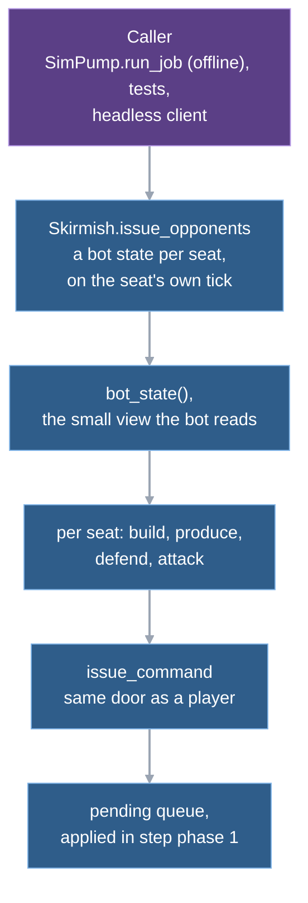
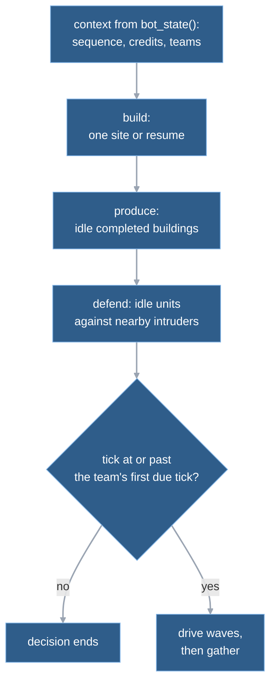

# 9. AI

The computer opponent is not part of the simulation's rules. It is a function that looks at a snapshot once a second and then issues ordinary commands, the same dictionaries a player's clicks produce, through the same `issue_command` call. So a bot cannot do anything a human cannot, and a match with bots is as deterministic and replayable as a match without them. What it does with that: it builds and produces, then sends growing waves of units at one target per team, with the bots of a team sharing one wave clock. The price is that the bot is small and simple (about 750 lines) and, today, omniscient: it reads the whole snapshot, enemy units included.

## The big picture: a function that reads state and writes commands

Three things take part, and only the first is the bot proper:

- **The bot** is `skirmish.gd`, a script of static functions with no state of its own except a small per-seat memory (below). `Skirmish` also hosts the standard 1v1 set-up and the per-faction lookups the bot and the HUD share, so the name covers both.
- **The scripted human** is `scripted_human.gd`: a stand-in for a player in tests. It is the same bot with a later attack tick, plus a few scripted orders.
- **The team match** is `debug/team_match.gd`: six bot seats, three against three, on Ashfall. It is the acceptance and benchmark scenario for bots. A second, smaller trace, `test_team2v2_trace`, plays four bots on Broken Crown, two against two.

A player's `controller` value is a separate thing. It does not start the bot; `"ai"` only switches some combat rules for that seat's units (scan radius, re-targeting; see the [terms appendix](README.md#appendix-terms), "Bot"). Bot seats are created as `"human"` since P7 part 1, so a bot's units fight by the same rules as a player's; `"ai"` is left for records written before that (a record without a `controller` replays as `"ai"`) and for the recorded-match benchmark.

## One decision cycle, from its tick to its commands

Offline, seat 2 is the bot, a USA bot alone on its team. Say the tick is 5400 (three minutes; `FIRST_WAVE_TICK`, when the team's first wave falls due), the bot has six tanks and five riflemen standing idle within 6 cells of its start cell, which is the bot's rally point (anyone further away would get a `move` to it first and join a later wave), and the human's base is across the map.

1. The physics callback asks the bot to play before it steps the simulation. A seat decides only every `DECISION_TICKS` (30th) tick, on its own offset (seat k when the tick is k mod 30), which is once per second of game time; seat 2 decides on tick 5402.  
   `offline_driver.step → SimPump.post → run_job → Skirmish.issue_opponents(recorder, job.bots) → decides`
2. The bot takes a `bot_state()` (entities with only the fields it reads, buildings, players, last sequences), inside a profile zone called `opponent.decide`.  
   `issue_opponents → decide → Simulation.bot_state; Profiler.begin`
3. For seat 2 it reads from that state the seat's last command sequence number, its credits, the team of every player, and its own buildings and faction. The sequence number is how it will number the commands it is about to send.  
   `_decide: state.last_sequences, state.players, state.buildings`
4. Build step: if the seat has a builder and a building is unfinished with nobody working on it, send `resume_build`. While a building is under construction the bot builds nothing else. Otherwise walk the faction's `build_order` and, for the first kind not yet owned (or being rebuilt), send `build` at the map's slot for that kind if the credits cover it. At most one build or resume command per decision.  
   `_decide → _build → _send`
5. Production step: for each completed building with an empty queue, send `produce`. The unit kind is the faction's least-owned kind for that producer; a supply center instead gets a collector until the seat has its quota (3 USA, 4 China, 6 FRC per center), and a lost builder is replaced first. From the team's second wave on, a rule about vehicles can hold the credits back (the next section, "Spending: vehicles in every wave"); wave 0 still buys as described here.  
   `_produce → unit_for, _collector_kind → _send`
6. Defence step: any enemy ground unit within 10 cells (`DEFENCE_RADIUS`) of any of the seat's buildings is an intruder. Every idle unit of the seat (guard mode, no target) is grouped under its nearest intruder, and each group gets one `attack` command. These units are remembered so the attack step leaves them alone this cycle.  
   `_defend → _nearest → _send`
7. The tick is not below the team's first due tick (5400), so the attack step runs. The eleven units are idle at the rally and in no wave, so they are ready, and their cost (6 x 900 + 5 x 225 = 6,525) is counted. The wave leaves when the team's ready cost reaches its target: for wave 0, 8 units per live bot at the team's mean unit cost, here 8 x 531 = 4,248 for one USA bot. 6,525 is more, so the wave leaves now, at the first decision at or after the due tick; with less it would wait up to `WAVE_WAIT` (1800 ticks, 60 s) and then leave with whatever is ready.  
   `_attack → _gather → _wave → _form`
8. The bot picks the team's target: the enemy player attacked least recently, then the best-scoring building of that player scored from the rally. It takes units for the wave, a tank first, then a rifleman, and so on, each kind most expensive first, until the cost first reaches 4,248: four tanks and three riflemen, 4,275. The other four stay home as guards and join the next wave. It sends one `attack` command naming the seven units and the target, with `group_speed` set, records the wave in its memory and sets the next wave's due tick, 2,700 ticks (90 s) later.  
   `_form → _scan_target → _take → _send; bot.waves.append`
9. Each `_send` stamps the current tick, the seat and the next sequence number, and calls `issue_command`. That validates the command exactly as for a human and queues it. A rejection returns false and nothing else happens: the bot keeps no retry list, and the next decision, 30 ticks later, recomputes from the then-current state.  
   `_send → Simulation.issue_command → _pending`
10. The same physics callback now calls `step()`. Phase 1 finds commands stamped with the current tick and applies them like any other: the units get the attack intent and combat planning takes over (chapter 4, "The same click on an enemy"; chapter 8). Because of `group_speed`, the simulation also notes the slowest speed among the seven and holds every one of them to it while the order stands, so the tanks do not outrun the riflemen.  
    `Simulation.step → _apply_orders`

Thirty ticks later, step 1 repeats. The wave's members that went idle are sent at the same target again, and if the wave was hit it takes a detour to the best armed enemy within reach of the hit units, if there is one (the mechanics below).

## Why this is deterministic and replayable

It is a claim worth checking, because lockstep and replays depend on it. Checked in the code at the commit named at the end of this chapter:

- **No hidden inputs.** The three bot scripts contain no random call, no clock and no reference to the simulation's generator (a search for the usual names finds nothing; the files are listed in "Where in the code"). The only time-related calls are the profiler's, which measure and decide nothing.
- **Reads go through `bot_state()`.** The bot reads that view, the current tick and the map data, plus constant definitions. Entities and buildings come out of the snapshot sorted by id. Where the bot builds a dictionary or groups units, it iterates in that order, sorts the group keys before sending (the defence step), and breaks every score tie on the lowest id.
- **Writes go through `issue_command`.** Every effect of the bot is one of the commands listed in the [simulation interface](../reference/sim-interface.md): building, resuming a build, producing, attacking and moving (the attacks carry the optional `group_speed` flag, below). Chapter 4's rules apply: it is validated when issued and again when due.
- **Pinned by tests.** `test_team_match.gd` runs the six-seat match for 20,000 ticks and pins its final digest (TB3) and a rolling hash series (TB4), and runs it twice for 3,000 ticks comparing digests every 200 ticks (TB5); its 2v2 trace (TT1) pins the outcome and a rolling series of four bots on Broken Crown. `test_skirmish_match.gd` runs bot against scripted human twice and compares full snapshots every tick (that test also pins a rolling hash up to the match's end, S1). A bot that read a clock or an unordered container would show up as a diverging second run.

A replay of a match with bots does not need the bot. The commands it issued are the record, and a replay feeds them back. What the bot gives the tests is a source of realistic command streams.

Two limits to know:

- **Its memory is not in the snapshot.** Wave lists live in a dictionary attached to the `Simulation` object as metadata, one entry per seat (`BOT_META`); the wave clock (wave number, due tick, objective) lives in a second one per team (`BOT_TEAM_META`). The state digest never sees either. The one thing a bot leaves in the simulation is a unit's `group_speed` key, set by a group-speed order and removed by the unit's next order; locomotion ignores it once the order has ended. This is harmless while the bot runs from tick 0 in the same process as the simulation. A bot attached to a simulation that is already running would not know its waves (speculation: nothing in the code does this today).
- **Same commands, not same information.** A human sees what is on screen. The bot reads every enemy unit and building in the snapshot. Nothing in the simulation models fog or shroud yet (no fog or shroud code in `game/scripts/simulation/`), so there is nothing to hide from it. Fog is planned before the bots are rebuilt; that rebuild is milestone M8, which is proposed and not approved ([blueprint M8](../blueprint.md#m8--bots-worth-playing)).

## The bot behind a lockstep seat

Online, commands must travel through lockstep, not straight into the simulation. The headless net client does that with `SeatSim`, a wrapper with the same four calls the bot uses. Three pass through to the simulation; its `issue_command` hands the command to lockstep.  
`SeatSim.issue_command → Lockstep.submit`

Lockstep overwrites the tick and sequence fields and queues the command for the next packet (chapter 11), so the bot needs no changes: it believes it is talking to a simulation. Three consequences, all read from the code:

- The wrapper checks the order against the simulation now (`Simulation.check_command`, with placeholder tick and sequence, `_sim.tick()` and `last_sequence(owner) + 1`, which lockstep overwrites when it stamps the order later) and answers with that error when it is refused, so a bot's dead-unit or blocked-slot order never travels; if lockstep's `submit` fails (a full frame) it answers "too many orders"; otherwise it answers "ok", and a command that the simulation later rejects at its due tick is not seen by the bot; it recomputes at its next decision. A seat may only order for the players lockstep allows it (`may_submit`): its own number, and for the host of an online 2v2 the bots too.
- Only the seat's own machine runs its bot. The other peers receive its commands from the relay, so the bot does not have to be deterministic across machines. Whether the *game* stays deterministic is lockstep's job.
- Online, both seats are created with controller `"human"`, so a bot-driven seat's units use the human combat rules (chapter 8), the same as offline since P7 part 1.

The headless client drives a bot through `SeatSim` for the netplay scenarios in `tools/run_netplay.sh`: a scripted human on seat 1, the bot on seat 2.

### Host-run bots in an online 2v2

In an online 2v2 (two friends against two bots, [chapter 11](11-multiplayer.md#two-friends-against-two-bots)) the real online driver runs the bots, on the host's machine only. Each tick job the host posts lists the bot players (`job.bots`, the players its seat may stamp besides itself) and sets `plan_bots`. `SimPump.run_job` then calls `Skirmish.issue_opponents` with a `PlanRecorder` instead of the simulation: the bot reads the live snapshot and map through it (`snapshot`, `tick`, `map_data`) and its `issue_command` calls are checked with `Simulation.check_command` and collected, not applied. A refused order (a dead unit, a blocked slot, setup) is dropped at once and the bot recomputes at its next decision (a seat with no victory building left still orders its surviving units). The accepted orders come back in the note as `bot_commands` and the driver submits each through lockstep as the bot's player, so they apply five ticks later on both machines. With the simulation on a worker thread (SB5a, off by default, [chapter 1](01-big-picture.md#the-pump-the-one-holder-of-the-simulation)) the planning runs on the worker next to the bot memory it reads, and only the finished orders cross in the note; the driver submits them when it handles that note and lockstep stamps their tick and sequence on the main thread, so an order decided in the job of tick N lands in the same packet in both modes, however late the drain (what changes is the wall-clock send delay). Tests: `test_sb5a_worker_host_bot_frames` (a 2v2 host with jobs in flight: command logs, per-round packet ticks and hash rows equal inline) and `test_sb5a_human_order_in_held_window_leads_the_bots`; bots issued on the worker also match inline on the `team` load (`sh tools/run_worker_digests.sh`, which does not set `plan_bots`). The bots keep the decision rhythm of `decides` (seat k decides on ticks k, k + 30, ...) and a full outgoing frame drops a bot order, which the next decision recovers. The planner validates only against the live simulation at the decision tick: two orders of one decision that conflict with each other both pass, as offline. Both bots are `"human"` controllers for the combat rules, as everywhere online.

## The mechanics: waves and target priority

Until its team's first wave is due (`FIRST_WAVE_TICK`, 5400 ticks, unless a caller passes another `attack_tick`) the bot builds, produces and defends but never attacks. After that, two pieces of logic run every decision: one drives existing waves, one forms new ones. The *live bots* of a team (seats that have decided at least once and still own a building that keeps them in the match) share one wave clock, so their waves leave together and go to one objective. A lone bot is a team of one.

**Forming a wave (gather).** Idle units in no wave that the defence step did not just use are either near the rally (within `RALLY_RADIUS`, 6 cells, of the seat's start cell) and *ready*, or far away and *walking*; walkers get one `move` command to the rally per decision. Wave n is due at the clock's due tick: 5400 for wave 0, then `WAVE_GAPS` after the previous wave left (2,700 ticks, 90 s, after waves 0 and 1; 1,800 ticks, 60 s, after that). The first live bot that decides at or after the due tick adds up the team's ready cost, its own ready units plus its teammates' that stand at their rallies, and compares it with the target: `WAVE_SIZES[n]` units (8, 12, 16, 20, 24, 28, 32, then 32) per live bot, times the team's mean unit cost. Cost, not count, because a Militia order buys several units for one price. A faction's unit cost is the integer mean over its bot build list (`units_for`: USA 531, China 512, FRC 387) and is never scaled. The wave leaves when the ready cost reaches the target, or `WAVE_WAIT` (1800 ticks, 60 s) after the due tick with whatever is ready; if nothing is ready then, it leaves at the first decision that has a ready unit.

**What the wave takes.** Vehicles and infantry in turn, a vehicle first, each side most expensive first (ties lowest id), until the cost first reaches the target, that unit included; when one side runs out, the other goes on alone. Wave 0 also takes at most `WAVE0_UNITS` (16) units per team. The rest guard home (the defence step) and join the next wave; units that arrive after a wave has left do the same. The bot that launches takes its share: the target divided by the live bots, or more when its teammates' ready units cannot cover the rest (the target less their ready cost); in wave 0 its unit cap is likewise 16 divided by the live bots or 16 less its teammates' ready count, whichever is larger. Each live teammate joins at its next decision (within 29 ticks), taking its share of what is left, or more when the ready units of the joiners after it cannot cover the rest (wave 0's unit cap likewise), and the last takes all of it; a teammate defeated at its decision leaves the joiners for good. So the order in which the bots decide does not change what the wave holds.

**Driving a wave.** Each decision, for each wave: drop dead ids; drop the wave if empty; note whether it was *hit*, meaning one of its units has fewer hit points than at the previous decision, or died. A hit wave with no detour takes one: the best-scoring armed enemy unit or armed building within `DETOUR_REACH` (10 cells) of the centre of the hit units (of the wave when the hit was a death), skipping any it let go in the last `LET_GO_TICKS` (300). The whole wave attacks the detour target. The detour ends when its target dies, when the wave has not been hit for `DETOUR_CALM` (90 ticks), or when every wave unit is farther than 10 cells from it (this last case marks it let go). An enemy that does not hit the wave is ignored, so a wave does not stop for every unit near its path. Without a detour the wave follows the team's objective while it stands; a dead one is replaced once, by the first wave that notices, with the best pick from that wave's centre, and the team keeps the new one. If the target changed while the old one still stands, every member not busy with defence is re-sent; otherwise only idle members are sent at the target again. If no enemy exists at all, the wave is dropped.

**One speed for the whole wave (`group_speed`, BR8).** A column of tanks (speed 1.2) and riflemen (0.8) strings out on a long walk and arrives piecemeal. So the wave's `attack` orders carry `group_speed: true`. When such an order applies, the simulation gives every unit it commands the lowest speed among them, and locomotion holds the unit to it while its intent is still the ordered one (`move`, `attack` or `attack_move`); any later order without the flag removes the cap. The bot flags the launch, the joiners and every re-send to the objective, and leaves the detour unflagged, so a wave fights at full speed and then walks back at its slowest unit's pace. A wheeled unit under the cap still turns at its own turn speed when that is below the cap (wheels slow to a fixed turn speed in a bend, not to a share of their top speed). The cap is taken once, at the order: it is not recomputed when members die, and a re-send naming only some units caps those at their own slowest speed. A human can give the same order (the command is in the [simulation interface](../reference/sim-interface.md); a key binding is not built yet).

**Choosing the objective.** The objective is one enemy building, picked in two steps:

- The enemy player: among enemies that still own a building that keeps them in the match, the one this team attacked least recently (never attacked counts first, ties lowest id), recorded when a wave launches at that player. Against two human enemies, as in a 2v2, successive waves alternate between them.
- The building: that player's best-scoring building, scored from the team's mean rally point. A replacement for a dead objective is scored from the wave's centre over the buildings of those enemies (a defeated player's leftover defence is no candidate), over all enemy buildings when none is left, and over enemy units only when no enemy building is left at all. Air units, units inside containers and buildings a rebuild worker is currently restoring are never candidates (the same filter as `Combat.valid_target`).

The score is the same everywhere (detours use it too):

- Score = priority minus one point per 4 cells of distance (minimum 1). Highest wins, ties go to the lowest id.
- Priority comes from definition data, not from kind or faction names: a building with a weapon 29; a builder or a vehicle 28; a building that produces builders, 26 (every headquarters, and the FRC Supply Cache); infantry and any other building that receives supply, supplies power or produces something, 27; anything else 1.

**Defences in the way (BR6, from wave 1).** A completed, armed enemy building within `DEF_REACH` (8 cells) of the objective, or of a point every `ROUTE_STEP` (8) cells along the straight line from the team's mean rally to it, counts once as a guard and raises the target by `DEF_UNITS` (4) units' cost. Wave 0 is never raised. If the ready cost is still short at the wait cap and guards were counted, the wave retargets to the best enemy building with no counted guard, the objective's player first and then the others in the order above, or goes anyway when every building is guarded. There is no retreat.

**Spending: vehicles in every wave (BR7, from wave 1).** Buying for every idle producer whenever it can pay left the factory waiting for its price while the barracks spent each credit, so later waves were almost all infantry. Now, after the builder replacement and the collector quota, a completed idle factory short of its pick's price *holds* the credits until it can buy it, as long as the bot's vehicle value is below its faction's `bot_vehicle_share` of its army value (70 percent for all three, in `factions.gd`; owned units count at unit cost, queued orders at order cost, builders and collectors not at all). While the hold lasts the barracks buys nothing; with several factories the lowest id buys first. A factory refused for another reason (its prerequisite is gone) holds nothing. A second hold covers a lost factory: while the builder lives, a factory is the first missing building of the build order and the credits are short of its price, the barracks does not spend either, so the bot saves for the rebuild; with the price in hand and the rebuild still refused (a unit on the slot), the barracks spends. A hold lapses only after `HOLD_LAPSE` (1800 ticks, 60 s) in which the credits did not rise above what the previous held decision left after its own buys; the bot then spends once and the hold starts again. Both holds share that one lapse. Wave 0 is bought as before.

**Defending.** Unlike waves, defence is immediate and local: any enemy ground unit within 10 cells of any building of the seat triggers it, even before the first wave is due. All idle units go, grouped by nearest intruder. Units already in a wave and idle are included, so defence beats the wave.

### The scripted human

`ScriptedHuman.issue` stands in for a player. It calls the same bot for seat 1 with a later `HUMAN_ATTACK_TICK` (9000, 5 minutes). On top of that, on every 30th tick before then, it sends one `attack_move`: if an armed enemy unit is within 16 cells of any seat-1 builder or building, every seat-1 armed unit not already attacking goes to its position; if there is none, armed idle units more than 3 cells west of the staging point (`STAGE`) walk to it. The command carries the current tick and the next sequence number read from the snapshot, like the bot's.

Why have it: it gives the tests a seat that is staged and defended by scripted orders the way a player would, and a match to pin. `test_skirmish_match.gd` uses it, and `headless_client.gd` runs it for netplay. Both seats are `"human"` now, so the combat rules are the same on both sides. From tick 9000 seat 1 attacks as the same bot as seat 2 (each seat is its own team, so their timetables are offset: seat 1's first wave is due at 9000, seat 2's at 5400). The netplay `match` and `rematch` scenarios end on tick 9746; the offline match test (S1) ends on tick 9,765 with seat 1 winning, inside the 7,000 to 17,999 window its check asks for, and its economy, production and combat checks count up to the end.

### The team match

The team match builds its simulation directly from the Ashfall map data: six seats, all `"human"`, 10,000 credits each. Team 1 is seats 1 (USA), 2 (China), 8 (FRC); team 2 is seats 4, 5, 6 (USA, China, FRC). The seat numbers are the map's start numbers, so they are not contiguous. Its step function hands all six seats to the bot in the list's order and then steps the simulation. The match is capped at `TEAM_TICK_CAP` (45,000 ticks).

The teammates coordinate through the team's wave clock only: they share the snapshot, the team table (how a bot knows an ally from an enemy; test TB1 checks it never attacks the nearer ally) and the clock, so their waves leave in one round and go to one objective. A seat with no buildings and no builder is silent (TB2), and a defeated seat drops out of the live bots, so the target shrinks with the team.

It is used by the team-match test, by the shell script that runs the benchmark and pins its outcome line, and by the view-rows test. Three equal bots against three equal bots is an equal mirror, so an end is not required, but since the joiners' share covers what later joiners cannot the match ends again: the pinned line is `TEAM MATCH won tick=40182 winner=2 units_peak=314` ([verification](../reference/p7-verification.md#gate-fix-round-2)). The 2v2 trace on Broken Crown (TT1) does end, on tick 28,061 with team 2 winning ([verification](../reference/p7-verification.md#t1-9-offline-2v2-trace)). The accepted state of this scenario is a ledger row; see the [performance ledger](../reference/performance.md).

### Reading the F3 bot line

In an offline match F3 adds one line per bot under the timings, for example `Bot 2 usa | W1 in 89s | ready 7,875/6,372 | home 3i/8v | $475 | B:Rifleman F:- | ->Headquarters#2` (a test match just after wave 0; before it, `Bot 2 usa | W0 in 178s | ready 10,800/4,248 | home 0i/12v | $9,200 | - | ->none`). Left to right: seat and faction; the next wave number and the seconds until its timer is due (`in 89s`, rounded up), then `late 12/60s` once past due, a counter that keeps rising past 60 while nothing is ready; `ready`, the cost of the ready units (teammates' included) against the target `_form` compares, defences on the way to the objective included, where ready leaves out units the bot sends to defend on that decision; `home`, the units outside any wave, infantry `i` and vehicles `v`; the credits; each finished army producer with the unit at the head of its queue, `-` when idle (`B` barracks, `F` factory; headquarters and supply centres are not listed), or a lone `-` with no producer; and the team's last objective (`->none` before wave 0, `#id gone` once it died). Once the timer reaches zero, a wave leaves as soon as ready reaches the target, or 60 s later with whatever is ready; past 60 s the counter keeps rising while nothing is ready. So a line late with ready short of its target and many units at home means the ready units are too cheap or too few, not that the bot is idle. `Skirmish.debug_lines` builds the text inside the pump's job from the same scan `_form` uses, only reads bot memory, and runs only while F3 is open (`Job.want_bot_lines`, at most every 30 ticks); an online match never asks.

## Trade-offs and limits

**Why a function over a snapshot, not a phase of the tick.** The bot could have been one more call in `step`. Kept outside, it can do only what a client can: nothing it wants happens unless `issue_command` accepts it, and a match without bots runs no bot code at all. That is half of the boundary M8 asks for, observe through one entry point and act through commands ([fair bots research](../reference/fair-bots-research.md), section 2). The command half holds today. The observation half is narrower than before: the bot reads `bot_state`, not the full snapshot, but still through a simulation method rather than a client-visible entry point.

**Cost.** A decision runs once per 30 ticks, so its mean cost per tick is small, and each seat has its own tick, so no tick pays for more than one decision. Before, all six seats shared one tick and `opponent.decide` peaked at 7.7 to 8.0 ms in the team match (measured, [performance next](../reference/performance-next.md#2-where-the-time-goes-measured), chapter 12); with the stagger and `bot_state` it peaks at about 2.1 ms (measured, [verification](../reference/flatter-worst-ticks-verification.md)). The bots act up to 29 ticks apart instead of together. The defence step's intruder test compares every hostile unit against every own building each decision (read from the code, not profiled on its own).

**What the bot is not.** It has no scouting, no combat estimate, no retreat and no economy beyond the fixed build order, the collector quota and the vehicle share. A wave never retreats. The USA and China build orders contain no defence building; the FRC list ends with one. The 29/28/27/26 priorities come from a decoded Zero Hour priority set. The 4-cell divisor and the rally radius are untuned starting values ([M7 archive research](../reference/m7-verification-archive-research.md), "Bot wave update"); the wave timetable and sizes are owner decisions from Zero Hour research ([design answers](../reference/design-answers-2026-11-08.md#p7-part-1), 7-4 to 7-6), the defence constants were probed and kept, and the vehicle share came from a kill check ([P7 verification](../reference/p7-verification.md)).

**Where it breaks, from the notes.** A wave that a fight left strung out keeps its gap on the way back: the units are capped at their slowest member's speed, and nothing catches up the stragglers. Equal bots may never decide a match: identical bots on one timetable send equal waves, and the scripted-human match (bot against bot from tick 9,000) and the 3v3 team match reach their caps. Once supply is gone the bots run out of money and grind ([blueprint M8](../blueprint.md#m8--bots-worth-playing), "End-game income"), which is an M8 question, not fixed.

**Zero Hour comparison.** Zero Hour's skirmish AI is mostly data: attack waves, team templates and the priority sets are in compiled map scripts, and the C++ contains no wave logic (read-only source, [M7 archive research](../reference/m7-verification-archive-research.md)). Wargrid borrows the "priority minus distance" targeting, Normal's 90 s and then 60 s gaps and the rule that late units wait for the next wave, and replaces the scripted escalation with a fixed timetable and growing, capped sizes (a step above Zero Hour's). Zero Hour's teams also march at their slowest member's speed, which the group-speed order copies. The notes call the result a baseline, not parity: bots are meant to move far from Zero Hour ([design answers](../reference/design-answers-2026-11-08.md#bots-m8), [P7 part 1 decisions](../reference/design-answers-2026-11-08.md#p7-part-1)).

**What the proposed bot changes (not built).** The M8 scope in the blueprint is labelled proposed and not approved. It names one observation entry point (own state, team-shared vision, its own last-seen memory), an attention budget for commands, a decision trace, and difficulty levels in M8.1. Of that, only the rule "commands only through `issue_command`" exists today.

## Where in the code

- `game/scripts/simulation/skirmish.gd` — the bot and the standard 1v1 set-up. `issue_opponent`, `issue_opponents` (entry), `decides` (the seat's tick), `next_decision`, `decide` (reads `Simulation.bot_state`), `_decide`, `_send` (stamps and issues), `_build`, `_produce`, `_spend_rest` (BR7), `_defend`, `_attack`, `_drive_waves`, `_detour`, `_gather`, `_wave`, `_form`, `_add_to_wave`, `_scan_target`, `_take`, `_pick`, `_best`, `_priority`, `debug_lines`; per-seat memory in `_bot` (`BOT_META`), the team's wave clock in `_team_entry` (`BOT_TEAM_META`); constants `DECISION_TICKS`, `FIRST_WAVE_TICK`, `WAVE_GAPS`, `WAVE_WAIT`, `WAVE_SIZES`, `WAVE0_UNITS`, `DEF_UNITS`, `DEF_REACH`, `DETOUR_REACH`, `DETOUR_CALM`, `LET_GO_TICKS`, `HOLD_LAPSE`, `RALLY_RADIUS`, `DEFENCE_RADIUS`, `DISTANCE_STEP`; `create`, `build_order`, `unit_for`, `unit_cost`, `faction_unit_cost`.
- `game/scripts/simulation/scripted_human.gd` — `issue` (bot for seat 1 plus `attack_move` staging), `HUMAN_ATTACK_TICK`, `STAGE`.
- `game/scripts/simulation/simulation.gd` (`_cap_group`, the `group_speed` check in `_validate`) and `locomotion.gd` (`_cap`) — the group-speed order the bot's waves use.
- `game/scripts/debug/team_match.gd` — `create`, `step`, `SEATS`, `TEAM_TICK_CAP`.
- `game/benchmarks/run_team_match.gd`, `tools/run_team_match.sh` — the timed, pinned run.
- `game/scripts/simulation/definitions/factions.gd` — per-faction `build_order`, `units_for`, `start_unit`, `bot_collectors_per_supply_center`, `bot_vehicle_share` that the bot reads.
- `game/scripts/net/seat_sim.gd` — the wrapper that routes bot commands into lockstep; `game/scripts/net/headless_client.gd` — `_run_script` picks bot or scripted human per seat.
- `game/scripts/match/offline_driver.gd` — `step` posts the job with `BOTS`; `game/scripts/match/sim_pump.gd` — `run_job`, the offline call site.
- `game/tests/test_bot_rules.gd`, `test_group_speed.gd`, `test_skirmish_waves.gd`, `test_skirmish_match.gd`, `test_team_match.gd` — the spec-worded bot rules (timetable, waves, team clock, defences, vehicle share, group speed, F3 line), the group-speed command, wave rules, bot against scripted human, six-seat determinism and the 2v2 trace.

## Further reading

- [Fair bots research](../reference/fair-bots-research.md) — what "fair" means and what other open-source bots do.
- [M7 verification archive: research](../reference/m7-verification-archive-research.md) — Zero Hour skirmish scripts and priority sets, and the 2026-11-06 wave update that P7 part 1 builds on. Its "Wargrid today" subsection predates the current bot.
- [Converted maps verification](../reference/converted-maps-verification.md) — wave targeting fix and bot sweeps on all maps.
- [Blueprint M8 and M8.1](../blueprint.md#m8--bots-worth-playing) — proposed scope for real bots.
- [Simulation interface](../reference/sim-interface.md) — the commands a bot may issue.
- [P7 part 1 plan](../superpowers/plans/2026-11-21-p7-enemy-bots.md) and [verification](../reference/p7-verification.md) — the rules above with their decisions, probe rows and the owner's matches; [decisions](../reference/design-answers-2026-11-08.md#p7-part-1).
- Previous: [8. Combat](08-combat.md). Next: [10. Determinism and replays](10-determinism-and-replays.md) shows how the digests used above are made and compared.

---
Checked against `5431c936` (branch `p7-enemy-bots`), the driver call chain against `f46993b`. Also checked against `9ff59265` (branch `p7-2-team-online`) for the host-run bots (`plan_bots`, `PlanRecorder`) and the `SeatSim` check. Also checked: the worker-side bot planning sentence against `86d4eb36` (branch `sim-boundary-sb5a`, SB5a; the docs commit follows). Files: `game/scripts/simulation/locomotion.gd`, `game/tests/test_bot_rules.gd`, `game/tests/test_group_speed.gd`, `game/scripts/match/match_screen.gd`, `game/scripts/presentation/perf_overlay.gd`, `game/scripts/match/sim_pump.gd`, `game/scripts/simulation/skirmish.gd`, `game/scripts/simulation/scripted_human.gd`, `game/scripts/debug/team_match.gd`, `game/scripts/net/seat_sim.gd`, `game/scripts/net/headless_client.gd`, `game/scripts/match/offline_driver.gd`, `game/scripts/match/online_driver.gd`, `game/scripts/simulation/simulation.gd`, `game/scripts/simulation/combat.gd`, `game/scripts/simulation/definitions/factions.gd`, `game/benchmarks/run_team_match.gd`, `tools/run_team_match.sh`, `game/tests/test_team_match.gd`, `game/tests/test_skirmish_match.gd`
