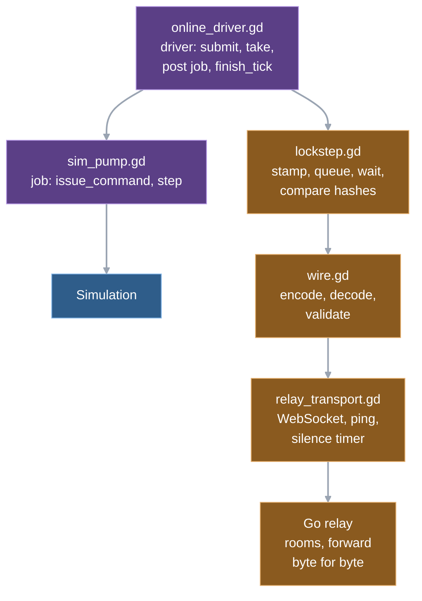
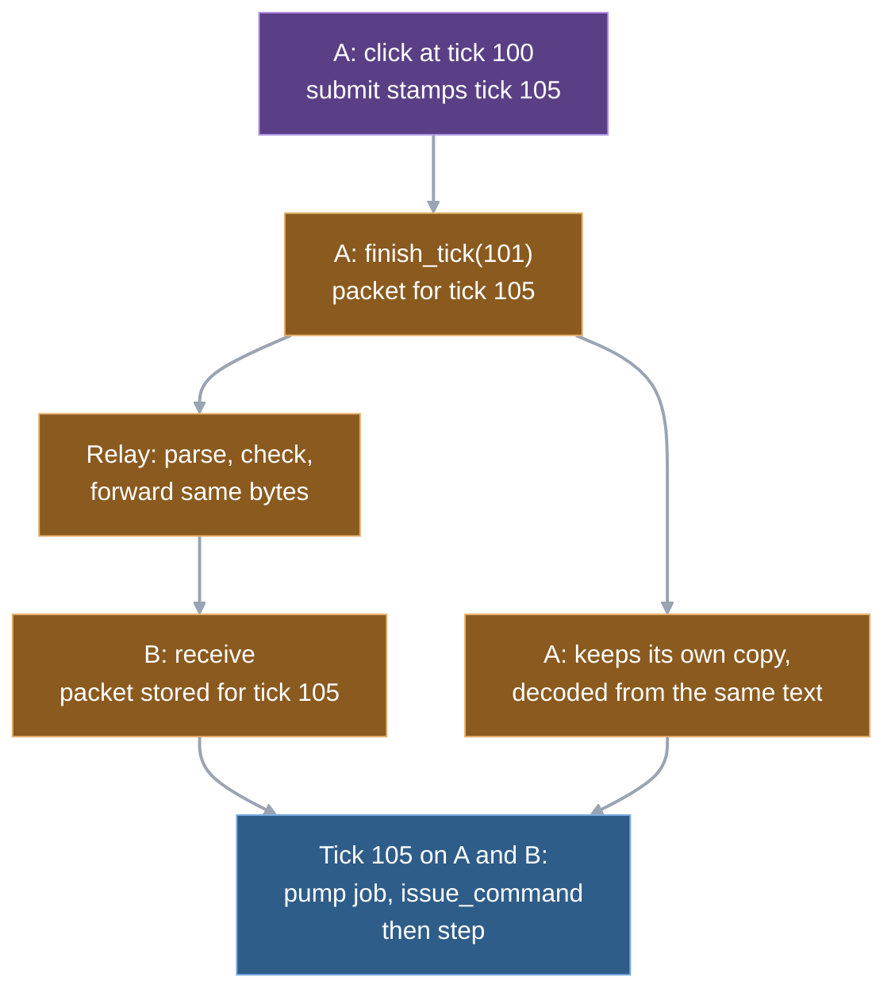

# 11. Multiplayer

An online match sends only orders over the network. Each player's machine runs the whole simulation and gets the other seats' orders for every tick from a small relay server; a tick runs only when all seats' packets for it are in. Nothing about units, damage or economy is ever transmitted, so the average frame measured in the M5 spike was about 52 bytes, and a desync check is one 16-digit hash.

This chapter follows one click across the wire, then opens the three pieces: lockstep (the client rules), the wire protocol and the relay. It covers the online 2v2, two friends against two bots run by the host, which needed no change to the relay. It ends with what a slow or dead peer does to the match.

## Three pieces, one packet per tick

On each machine the online driver feeds `Lockstep`, the object that decides when a tick may run, and posts each released tick to the pump as a job, as offline play does. Lockstep encodes through `wire.gd`, and `relay_transport.gd` moves the text over a WebSocket. The relay is a separate Go program that never sees the game.



The one rule: **every seat sends exactly one packet per tick, empty or not.** The packet carries that seat's commands for one future tick, and optionally a state hash. Every other part follows from it.

- The simulation can tell "nobody ordered anything" from "the packet has not arrived yet", so lockstep needs no clock and no timeout to know when a tick is complete.
- The relay can check that each seat's ticks come one after another with no gap and forward them blindly.
- A peer that goes quiet is visible at once, as a missing packet.

The price is that a packet crosses the network every tick (30 per second) per seat, even when idle. The M5 spike measured about 52 bytes per frame, about 1.55 KB/s uplink per client ([M5 findings](../reference/m5-online.md#latency-budget-command-p95--250-ms)).

## One click, from machine A to both simulations

Two seats, input delay 4 (the relay announces it in the start message; [chapter 4](04-the-tick.md) shows where the online driver steps). Player 1 on machine A orders a tank to move while A's simulation stands at tick 100, with its packets up to tick 104 already sent.

1. The click arrives as an ordinary move payload and the online driver hands it to lockstep instead of the simulation. Lockstep stamps it with tick 105 (the next packet not yet sent), the local seat as player and the next sequence number, and queues it.  
   `online_driver.submit → Lockstep.submit`
2. Machine A's job for tick 100 comes back from the pump and the driver calls `finish_tick(101, ...)` (with the job's state and digest on a hash tick). The packet for tick 105 is built from the queue (plus a hash on every 30th tick) and encoded as JSON text. A also stores it for itself, decoded back from that same text, then sends it.  
   `online_driver.drain → _finish_job → Lockstep.finish_tick → Wire.encode, Wire.decode`
3. The relay's WebSocket handler parses the frame, checks it is well formed, and posts it to the room's goroutine. The room checks that the seat number matches the connection and that this is exactly the next tick from that seat. It then writes the same bytes to every other seat.  
   `relay.OnMessage → parseEnvelope → room.post → room.forward`
4. Machine B polls its socket, decodes the frame and stores the packet under seat 1, tick 105, after checking seat, order, each command's player and tick stamp, and the queue limit.  
   `online_driver.step → RelayTransport.poll → Lockstep.receive`
5. Once both machines have reached tick 105 and hold every seat's packet for it, lockstep releases the tick. For each seat in seat order, `take` collects the packet's commands; the driver posts them as one pump job, whose `run_job` has the simulation validate them as in [chapter 4](04-the-tick.md) and then call `step`, whose first phase applies the move. A and B run identical inputs in identical order.  
   `Lockstep.take → SimPump.post → run_job → Simulation.issue_command → Simulation.step`
6. When the job's note comes back, `record` logs the tick's commands (on both machines); on A only it also notes the click-to-execution time and any rejection for the status line.  
   `online_driver.drain → Lockstep.record: _command_log, _latency, _rejections`



**The order takes effect five ticks after the click, not four.** The stamp is the tick of the next packet to send, which is the delay plus one ahead of the current tick. At 30 ticks per second that is 5 × 33 ms ≈ 167 ms (arithmetic). The M5 command latency on the fixed build was p50 174 and 181 ms for the two seats, p95 191 and 205 ms, against a budget of 250 ms at p95 ([M5 findings](../reference/m5-online.md#latency-budget-command-p95--250-ms), measured).

**Why A runs its own command from the decoded copy.** Step 2 round-trips A's own packet through `Wire.encode` and `Wire.decode`. Godot parses every JSON number as a float, and the simulation's validation demands integers for tick, player, sequence and every id. `Wire.decode` converts integral floats in a fixed list of fields back to integers. A's own commands must pass through the same conversion as B's, or the two machines would apply slightly different dictionaries. The lockstep test `L3` pins this: the applied command equals the decoded sent form, and a target such as 0.1 + 0.2 keeps its full precision.

## Lockstep: when may a tick run?

`Lockstep` is a plain object with no scene or socket; the driver gives it frames and asks it questions. Its state is one table of packets per seat, keyed by tick.

**Starting.** The first packets cannot arrive before they are sent, so the constructor fills ticks 0 to delay-1 with empty packets for every seat. `start` then sends the first real packet, for tick `delay` (the relay refuses anything earlier); the driver gives it tick 0's digest from a query job (`step = false`, `want_digest`), so even the start state is read through the pump. A command queued before `start` (every client queues `choose_faction`) is stamped with that same tick. The simulation runs its first four ticks without waiting.

**Advancing.** In the game, lockstep never touches the simulation. `Lockstep.take(tick, quiet, survivors)` answers "may the tick run?" and hands back that tick's commands, or nothing:

1. Nothing once lockstep has ended (an `ended_*` status). Nothing, and a protocol error (`ended_protocol`, "take tick T, expected N"), if the caller asks for any tick but the next one: ticks are taken strictly in order, quiet or not. Nothing if a seat left, this tick is past its last packet and the seat had not already lost the match ("A leave: end or play on", below). A win or loss is the driver's check, not `take`'s (below).
2. If the packet of any seat that still counts is missing, set the status to waiting and return nothing. The HUD says "Waiting for player N"; no tick runs and presentation keeps drawing the last state.
3. Compare any hashes riding on the packets of seats that still count (below).
4. Collect the commands of every seat that still counts, in ascending seat order, drop those packets, move on to the next tick and set the status to running.

The driver posts the commands as one pump job (`run_job` issues them, then steps; [chapter 1](01-big-picture.md#the-pump-the-one-holder-of-the-simulation)). When the job's note comes back in `drain`, the driver calls `Lockstep.record(tick, issued)` (command log, click-to-execution time, rejections) and then `finish_tick(tick + 1, ...)`, which builds and sends the packet for `tick + 1 + delay`, with the digest the job computed on a hash tick. A packet for `t + delay` leaves only after tick `t`'s note is drained, and `take` needs every seat's packet, so a seat stays about `delay` ticks ahead of its slowest peer at most; taking ahead only delays its own sends. `finish_tick` is strict in the same way: it does nothing once lockstep has ended, and a call whose packet is not exactly the one after the last sent (a gap or a repeat) ends the match as `ended_protocol` ("own tick P after L") and sends nothing, so no frame ever leaves out of order. The relay refuses such a frame anyway; the check catches the client's own mistake before the wire does. The driver asks `pump.has_room()` before it takes a tick, so a pump that is full (with the worker thread, SB5a: three unpublished jobs) leaves the tick's packets in lockstep for the next frame and no tick is lost; it also takes nothing once `pump.failure()` is set. If the pump still refuses the post for a taken tick, the driver ends the match as `ended_protocol`, because that tick's packets are already consumed and cannot be taken again: with the pump's own reason (`sim pump failed: <reason>`, and the transport closes in that frame, so the peer sees the seat leave) when the pump has failed, else "sim pump refused tick N". `advance(sim)` is the same steps (`take`, issue, `record`, then `step`) on a simulation it holds, kept for the headless client, the lockstep benchmark and the lockstep tests.

With the simulation on a worker thread the notes of several taken ticks can be waiting in one `drain`; the driver handles them in post order, pairing each note with its own taken tick (`_paired_tick`), and a bot order decided in note N is submitted when that note is handled and goes into the packet for N + delay, as inline. A leave or any other lockstep end then also stops the pump and records its completed but undrained notes (without sending anything), so the saved record's command log and end digest meet at the same tick. The leave, the failure and the stall rules are in [chapter 1](01-big-picture.md#the-pump-the-one-holder-of-the-simulation).

**Quiet takes.** The driver may take the next tick while the job for the previous one has not come back. That job can end the match (the simulation decides a win or a loss), and a match that ended normally must not turn into "Waiting for player N", a leave or a desync because of a take made too early. So the driver passes `quiet = true` whenever a taken tick is still in flight: a refusal then returns nothing and changes no status (a hash mismatch is left for the next loud take). The driver also stops taking once the last drained note says the match is over. Zero Hour decides a leave in logic-frame order too (`processFrameSynchronizedNetCommand`, `GeneralsMD/Code/GameEngine/Source/GameNetwork/Network.cpp:619-631` at `0a05454` in `~/projects/CnC_Generals_Zero_Hour`, called per frame from `RelayCommandsToCommandList`, `:585-598`); here a quiet take likewise defers a leave until the earlier tick's note has been drained.

**Checks on every received packet.** A packet from an unknown seat or from the receiver's own seat, a tick that is not exactly the previous one plus one, a command whose player or tick differs from the packet's, or a seat with 300 packets already queued (`MAX_QUEUED_TICKS`) ends the match as a protocol error. TCP delivers in order, so "tick out of order" means a buggy or modified peer. The player field check means a seat cannot issue orders as another player (each seat has a list of players it may stamp: its own number, and for the host of a 2v2 the bots too, see "Two friends against two bots"); the simulation's own validation ([chapter 4](04-the-tick.md)) also refuses orders for units owned by someone else.

**Pacing.** Waiting for packets slows the game down, but the opposite problem exists: after a stall, packets arrive in a burst, and running them as fast as possible would speed the game up. `online_driver.step` rations catch-up with a small credit counter, as [chapter 4](04-the-tick.md#trade-offs-and-limits) describes. A hitch longer than about 170 ms now catches up at most input delay + 1 = 5 ticks per rendered frame, since own packets leave in the drain, and the rest over the following frames; the HUD gets every advanced tick's command results, not only the last. While a placement is armed, every job of a catch-up frame carries the standing preview request (P2.3b, F33), so a catch-up frame runs one preview per job, up to the five-tick bound, instead of one, and each previewed gap-closing footprint rebuilds a navigation grid; the cost is unmeasured and the preview changes no simulation state. The first online match ran at about 57 ticks per second before this existed ([M5 findings](../reference/m5-online.md#what-broke-and-why)).

**Ending.** Lockstep reports failure as a status, not an exception, and `take` returns nothing from then on. The statuses are `ended_left` (a seat left and the match cannot go on without it), `ended_relay` (the relay sent an error or the connection was lost), `ended_send` (the WebSocket refused a frame we sent, reason "frame send refused"; the HUD shows the same line as a relay loss), `ended_desync` and `ended_protocol`. The scene turns them into the HUD line and, for a desync, writes the report. A protocol end shows only "Match stopped: game error. Please report it.": its reason ("take tick 5, expected 4") is client jargon that would wrongly blame the network, so `Lockstep._end` prints it to stderr as `NETPLAY PROTOCOL END <reason>` (once per lockstep, also for a late frame on the result panel), and the online driver's `match_log` puts status and reason into the playtest match record as `end` ("ended_protocol sim pump refused tick 8", or "ended_protocol sim pump failed: stall: job at tick 8 ran over 90 frames" when the worker thread stalled).

A win or loss is the simulation's own end, so the driver sees it in the notes: `drain` finishes the match when the last note says over or lockstep ended (`_settle`). Three rules keep the tick after the end harmless. A note for a tick taken past the end (the simulation did not move) records and sends nothing. A note that arrives after lockstep ended still records its tick but sends no packet: `finish_tick` itself does nothing after an end (the driver has no guard of its own any more), and after an own-frame failure a later packet would leave a gap in the tick order. A note whose tick is not the one after the tick taken (notes are paired with takes by post order, so a foreign job in between would mispair them) ends the match as `ended_protocol` through `set_protocol_error`. [Playing online](../playing-online.md#status-lines) lists the player-facing wording.

## The wire protocol

The protocol is JSON text, one message per WebSocket text frame, at most 64 KiB, with version `Wire.PROTOCOL` (2). Every message has a `type`. Who sends what:

| Message | From | Content |
|---|---|---|
| `hello` | client | protocol, build string, match code (empty creates a room), and from the creator the map settings |
| `welcome` | relay | the client's seat number and the match code |
| `start` | relay | seats, delay, a match seed, the creator's settings echoed unchanged; sent to every seat when the room is full |
| `tick` | client, relayed | seat, tick, commands, optionally a hash |
| `ping`, `pong` | client, relay | a timestamp the relay echoes byte for byte |
| `left` | relay | the seat that left and its last forwarded tick |
| `over` | client | this seat's match has ended; no content. Valid once, after the seat's first accepted tick |
| `again` | client, relay | the client asks to play again, no content; the relay echoes it to the other seats with `seat` set to the asker. Valid once, after the seat's own `over` |
| `error` | relay | a reason (`lobby expired` and `room expired` join the older ones); the relay closes the socket shortly after |

Bad ordering of `over` and `again` is `invalid message`: `over` in a lobby, before the seat's first accepted tick or twice, a `tick` after the seat's own `over`, `again` before the seat's own `over` or twice. The protocol number stays 2.

A tick message is one line (this is the committed vector `protocol/vectors/tick.json`):

```json
{"type":"tick","seat":1,"tick":10,"commands":[{"type":"move","tick":10,"player":1,"sequence":3,"entity_ids":[1,2],"target":[14.1,0.30000000000000004]}],"hash":{"tick":30,"value":"3a0ad3856b168044"}}
```

**Handshake.** The creator's hello carries map settings; the relay stores them without interpreting them and puts them in every seat's start. Each client compares the map and its hash with its own files and refuses to start on a mismatch (`MatchSettings.refusal`); the `map-mismatch` scenario shows the host then seeing the joiner leave at tick 4. The relay compares only the protocol number and the build string, which is the project's version setting: an old client cannot join a new relay's rooms, and the reverse. The match seed comes from the relay, not from a client, so neither player can steer where the rule places anyone; a player who wants a start takes it openly on the lobby's preview (P20, below); what the seed does (start spots, not the simulation's own generator) is explained in [chapter 10](10-determinism-and-replays.md#randomness).

**Decoding is strict.** `Wire.decode` rejects an unknown type, a missing required field, a non-integer where an integer belongs, a hash that is not 16 lowercase hex digits, and any frame over the cap. Go's `parseEnvelope` applies its own checks to what a client may send. Both implementations reject a bad frame instead of repairing it. The relay's checks are narrower: it never looks inside a command.

**Floats survive the wire.** `JSON.stringify` is called with sorted keys and full precision, so a coordinate like 0.30000000000000004 goes out and comes back as the same double. Without full precision two machines would compute positions from slightly different targets.

## The relay

The Go program in `relay/` is about 1,300 lines in five files, tests not counted (`main.go`, `room.go`, `envelope.go`, `sender.go`, `limits.go`; [development notes](../development.md#relay) for how to run it). It owns four things: matchmaking by code, forwarding, noticing who left, and refusing clients that ask too much.

**Rooms are goroutines.** A room is created by the first hello and gets its own goroutine. All its state (seats, started flag, settings) is touched only there. Connection handlers talk to it by channel: joins on an unbuffered channel, ticks and leaves on an events channel. A mutex guards only the registry of rooms, which is touched on create, lookup and removal, never per frame. If one room's goroutine panics, `recoverCrash` closes that room's sockets and removes it; other rooms keep running (a recommendation of the relay stack spike).

**Seats and start.** Seats take the lowest free number. The relay serves two kinds of room side by side, chosen by the hello's `protocol`. A protocol 2 room (0.18 clients) starts when it holds `WARGRID_SEATS` seats (default 2). A protocol 3 room is a live room (P20): the host's hello opens it at once, `welcome` carries the room's current settings, the seats already in hear `joined {seat}`, only seat 1 may send `settings {settings}` (stored and forwarded byte for byte to the other seats, each one restarting the lobby expiry up to a cap) and the room starts only on seat 1's `start_request`, sent when every seat is in; a guest may send `pick {pick}` (a JSON object up to 512 bytes, for example its faction), which the relay passes to seat 1 only as `pick {seat, pick}` for display: it is not stored, not echoed, not sent to other guests, not allowed from seat 1, and dropped without an error once the room has started; it draws from the same rate bucket as `settings` (burst 10, 2 per second) and does not extend the lobby expiry; a guest leaving before the start frees its seat for the same code, and seat 1 leaving closes the room with `host left`. Either way, at the start every seat receives start with the delay (a constant, 4), a random 31-bit seed and the latest settings. After start, nobody can join, even if a seat leaves.

**Deadlines by phase.** The read deadline on a socket depends on what the room is doing, so a host can leave the tab while waiting but a dead match is still noticed fast. Each `conn` carries a small `deadline` (mutex-guarded, because the reader goroutine and the room goroutine both set it); `hold` fixes it, `every` renews it on each frame.

| Phase | Deadline | Default |
|---|---|---|
| Connected, no hello yet | `hold`: `WARGRID_HELLO_MS` | 5 s |
| Seat in an unstarted lobby | `hold` until the lobby expires (frames and pings do not extend it; in a protocol 3 room each host `settings` does, up to `WARGRID_LOBBY_CAP_MS`, 60 min, from creation) | `WARGRID_LOBBY_MS`, 15 min |
| Started, no tick from this seat yet (start window) | `hold`: one `WARGRID_LOBBY_MS` from the start | 15 min |
| Running match, from the seat's first accepted tick | `every`: renewed by any frame | `WARGRID_SILENCE_MS`, 10 s |
| Parked (between matches) | `hold` until the park limit plus a 1 s grace | 15 min |

The lobby timer lives on the room, not the socket. When it fires with the room unstarted, the room removes itself from the registry, sends `lobby expired` to every seat and closes; a later join gets `unknown match`. The socket deadline sits one second behind the timer so the error frame lands before the close. The error is the socket's last frame: the sender is sealed with it, so no pong, tick or `left` follows (`sender.sendLast`, `relay/sender.go`). The start window exists for a hidden browser tab (F11): a host whose tab is hidden when the friend joins has the whole window to come back and send its first tick, while a running match keeps the 10 s rule. The attended hidden-tab check on a real browser is still pending.

**Park and rematch.** A seat sends `over` when its simulation decided the match. When every seat has sent it, the room is parked: it keeps its seats and runs the same timer again, now as the park limit, and a fire sends `room expired` and closes. A seat's `again` is echoed to the others at once; when every seat is parked and has sent `again`, the room clears each seat's tick counter, `over` and `again` flags (frame and byte counts stay, so `MATCH END` reports the whole room) and sends a second `start` with a fresh seed, logging `rematch`. An `again` that was queued when the timer won, or after a drain began, is dropped, never answered with `start`.

**Forwarding.** For every tick frame the room checks the match has started, the seat in the message equals the connection's seat, and the tick is exactly the previous one plus one (the first is 4). Anything else marks the seat dead: the relay replies with an error, closes the socket after a 200 ms grace (Godot drops queued frames when it sees the close, so the error would otherwise be lost), and the others hear `left`. A valid frame is copied once and the same bytes are queued to every other seat. The sender gets no echo. The relay keeps no command history: it counts frames and bytes per seat for its end-of-match log line, and holds the pending hash values described next.

**The lead bound.** A seat may not run far ahead of the slowest other seat. The limit is that seat's last forwarded tick plus the delay plus one (`room.leadLimit`, `relay/room.go:292-303`; before a peer has sent anything its tick counts as 3, so the first frames may reach tick 8). An honest client never gets near it: it sends the frame for tick T plus the delay only after running T, and running T needed every other seat's frame for T, which passed through this room first. A frame past the limit is refused before it is counted, with the error `too far ahead` and a log line `lead bound`; the seat is dropped like any other bad sender. The bound keeps the future ticks a single seat can push into the other seats' queues small. After a rematch the bound starts over with the second `start`.

**What the relay looks at in a hash.** The relay still reads no command. It does read the hash a frame may carry: an honest client attaches the hash of tick T to the frame for T plus the delay (`room.recordHash`, `relay/room.go:305-325`), and when every seat has sent the same tick's hash the relay compares them. A mismatch is logged once per room as `DESYNC code=… tick=… groups=1,3|2` (seats with equal values share a group) and repeated in the `MATCH END` line. The relay still never rules on a desync or pauses a match: the clients end the match themselves (see "Desync detection" below), and the relay line is for whoever reads the logs. Memory stays bounded whatever a client sends: a hash that cannot complete is dropped once every seat has sent the frame for that tick plus the delay, and with the lead bound at most `delay + 1` comparisons stay open (`pruneHashes`, `relay/room.go:327-339`). ([State digest research](../reference/state-digest-research.md) explains why the verdict stays with the clients.)

**Limits.** Per client address the relay allows 16 open sockets and a burst of 10 `hello` messages refilling one per second; globally a burst of 20 `hello` messages refilling one per 50 ms, and a separate bucket for `unknown match` replies (a burst of 10 refilling one per second), beyond which it closes without answering (`relay/limits.go:12-21`, `relay/main.go:185-195`). The refusals are the errors `too many connections`, `too many joins` and `relay busy`. The address table holds 4096 entries and refuses with `relay busy` when full, so a flood of addresses cannot grow memory. The address comes from a request header named by `WARGRID_CLIENT_IP_HEADER` (IPv4 as sent, IPv6 cut to its /64); without that variable the relay has no address to count, keeps no per-address rule and applies only the global buckets (`clientKey`, `relay/limits.go:57-70`); with the variable set but the header missing or unparsable, the socket skips the per-address rules and the relay logs `client ip header unusable, per-IP limits skipped` at most once a minute (`relay.key`). The relay logs a refusal as `limit rule=… refused=<count>` (the first and every hundredth) and never an address; each refused `hello` also logs `join rejected reason=…`. The hello deadline (5 s) frees a slot whose client connected and said nothing. Known limit, kept (user, 2026-11-17; revisit at M9 hosting): production runs without the variable, so one client sending more than about 20 `hello` messages a second on new sockets can drain the global bucket and make real joins fail with `relay busy`.

**Leaving.** When a seat's socket closes, for any reason, the room tells the others `left` with that seat's last forwarded tick, removes the seat, and when the last seat is gone removes the room and logs one `MATCH END` line. The line carries, per seat, the frames and bytes sent (`seat1=9014f/471081B`), the largest frame (`seat1_max_frame`) and the most bytes in one tumbling second (`seat1_peak_bps`; the name is the log key, the value is bytes; the window restarts on the first frame at least 1 s after the last restart, so a burst across a restart is split and the value can under-report the true worst second), counted for the whole room across rematches. Section "What a slow peer does" below covers how a silent peer's socket gets closed.

**Writes.** Each socket writes through a small `sender`: with no test delay configured it is a plain asynchronous write. Two knobs exist for tests. A test delay holds every forwarded tick back while keeping frame order, and `left` waits behind the ticks. A batch interval joins ticks into one newline-separated message, which the current Godot client cannot read; the sender cuts a batch before the joined message would pass 64 KiB (`addBatch`, `relay/sender.go:63-78`), so even this test mode never makes a message bigger than one full frame.

**Draining.** On a shutdown signal the relay stops accepting connections, closes lobbies that have not started, closes parked rooms too (a park that starts during the drain closes at once), lets started matches run for `WARGRID_DRAIN_MS`, then closes everything. A match longer than that does not survive a deploy ([development notes](../development.md#relay)).

## One protocol, three checkers

The protocol is the one thing both a GDScript client and a Go server must agree on, so it is pinned outside both implementations.

- **Vectors (`protocol/vectors`).** 32 JSON files, each holding a message as text plus its parsed form, or marked invalid. The Godot wire test and the Go test `TestVectors` read the same files, and the Godot one also checks that there are exactly 32. Each side must accept the valid ones and reject the invalid ones (a fractional tick, an unknown type, a start without a seed, ...). Go must accept only the valid client messages (hello, tick, ping, over, again, settings, start_request, pick) and reject the other server messages and invalid vectors, since a client may send nothing else; `pick_forwarded` shares the `pick` type, so Go accepts it too.
- **Conformance suite (`protocol/conformance`).** A separate Go program that plays two or more clients against a live relay and checks exact bytes: that ticks are forwarded unchanged, that a bad frame gets an error, a close and a `left` with the right tick, that a full match refuses a third client, that settings are echoed byte for byte, that seeds are in range and vary. It has five profiles, because some behaviour needs a differently configured relay: default (53 cases, including the `over` / `again` ordering rules, the rematch round trip and the lead bound's edges), delay (2), silence (10: hello deadline, lobby survives silence and expires despite pings, start window, park limit, silence in a match; the relay runs with 300 ms hello and silence and a 1.5 s lobby), limits (3: connection cap, join rate, `unknown match` replies; the relay runs with `WARGRID_CLIENT_IP_HEADER=X-Wargrid-Test-Ip` and the cases send addresses from the documentation ranges) and global (1: the global join bucket). `sh tools/run_conformance.sh` starts one relay per profile and ended `CONFORMANCE PASSED 69` on this branch. The relay's global join bucket is fixed and has no test setting, so the suite paces its own dials 50 ms apart (`helloGap`, `protocol/conformance/client.go:21-36`); the limit cases dial unpaced on purpose.
- **Relay unit tests (`relay/*_test.go`).** Run with the race detector. They cover parse rules, join rules (a protocol mismatch outranks bad settings), concurrent joins never overfilling a room, a panic ending only its room, drain keeping a started match, a stalled reader still producing `left`, the lead bound, the hash comparison and the `MATCH END` fields, the limiter, the batch cut, and that 180 rooms (plain, rematched, rejected and abandoned) leave no goroutine and no registry entry behind.
- **Netplay scenarios (`tools/run_netplay.sh`).** Two (three for the trio scenarios) real Godot clients, headless, through a real relay. Thirty scenarios (CI runs twenty-eight; `silent` and `relay-term` stay local). Every client speaks protocol 3, so the host asks to start once `--seats N` seats (default 2) are in, `--joins N` friends (default seats − 1) have joined in all and every present guest's `pick` (sent on its welcome, logged as `NETCLIENT PICK SEAT`) has arrived: a full match (terminal tick pinned, hashes equal on both sides and against an offline replay of the command log), a rematch (both seats finish, send `over` and `again`, play a second match with a new seed and end on the same tick and hashes as the first; the relay logs one `rematch` and one `MATCH END`), a peer killed, a peer that closes cleanly at tick 600 (`left-mid`: the other seat must print `NETCLIENT VICTORY left`, which the headless client prints from `Lockstep.opponent_left()`, the same rule the game uses), a 3 s stall, a 15 s silence, a relay that delays every forward by 200 ms, a deliberate desync, a version mismatch, two map scenarios, a relay killed and a relay sent SIGTERM. `left-mid-pump` is `left-mid` with seat 1 on `--pump`, so the real driver on the inline pump must also end `ended_left` and print its latency line. Three more run three clients on `broken_crown` (the relay with `WARGRID_SEATS=3`, every seat idle): `trio-play-on` (`--defeat 2@300` on all three, seat 1 on `--pump`, so the real driver's survivors argument is exercised; seat 2 is defeated at tick 300 and leaves at 320; seats 1 and 3 play on and seat 1 ends as `ended_left` only when seat 3 stops at 900, with equal hashes throughout; seat 1 must print its latency line, so the pump ran), `trio-left-first` (no defeat; seat 3 leaves at 300 with its buildings standing, so the match ends for both others between ticks 300 and 310, and the relay must not refuse a frame as too far ahead) and `trio-result` (`--defeat 2@300,3@1200` on all three, seat 1 on `--pump`; seat 2 defeated and gone at 320, seat 3 defeated at 1200: seats 1 and 3 end as `match_over` on tick 1201 with equal hashes, and seat 1 prints its latency line). Five more play the online 2v2 on `broken_crown` with the start seed fixed by `--seed 7` on both clients; seat 1 runs the real driver (`--pump`) with `--bots 3:china,4:frc`, so the bots' orders go through `OnlineDriver._finish_job`, and both seats use `--seat-script opponent`: `team` (both stop at tick 6000 with equal hashes against the oracle, which replays seat 1's command log, bot orders included, and ends `oracle_overrun` at 6000; the tick-6000 digest is pinned as `3f515e4b795fc678` and moves with every simulation tune that changes a 2v2 match), `team-guest-defeated` (`--defeat 2@300` on both; seat 2 stops at 320, seat 1 plays on with the bots to its stop at 900), `team-guest-quits` (seat 2 stops at 300 undefeated; seat 1 ends `ended_left` "player 2 disconnected" between 300 and 310), `team-host-leaves` (seat 1 stops at 300; seat 2 ends `ended_left` "player 1 disconnected") and `team-defeated-host-leaves` (`--defeat 1@300`; seat 1 stops at 320 and seat 2 still ends `ended_left`, because the host's bots live on). All five check that seat 2's log holds an order of bot player 3 and that no leave printed `NETCLIENT VICTORY left`. Four more run each seat through `tools/netfault`, a small Go proxy that sits between one client and the relay and applies a timeline of faults (cut every write into pieces of at most 7 bytes, hold both directions for a while and then release at once, reset the connection, or drop all bytes from some moment without closing): `proxy-clean` (no fault; the match must end exactly as `match` does), `proxy-burst` (seat 1 held 3.5 s from 2 s, seat 2 held 3 s from 3 s, the two holds overlapping; the match must still end on tick 9746 with equal hashes, bytes must have been held in both directions, and the relay must not call a frame too far ahead), `proxy-reset` (seat 2's connection is reset at 4 s; both seats must end within 2 s, seat 2 as relay lost, seat 1 as left) and `proxy-blackhole` (seat 2's bytes vanish from 3 s for 7 s: seat 2 must end through its own 5 s silence rule 4.5 to 6.5 s after the hole began, measured about 6.0 s because the client waits 1 s for a close first; seat 1 must hear `left` 9 to 12 s after it, through the relay's 10 s silence rule). Four more exercise the live room: `lobby` (the host opens on Broken Crown, sends Ashfall before the friend joins (`--lobby-maps ashfall,skirmish`), the friend's welcome names Ashfall, the host logs the friend's pick, the host sends the test map just before its `start_request`, and the match on it must end like `match`: tick 9746, equal hashes against the oracle), `lobby-left` (a friend joins and leaves at once with `--leave-on-welcome`, a second friend takes seat 2 with the same code, and both play to tick 900 with equal hashes) `lobby-host-leaves` (the host is killed before the start; the friend ends `ended_relay` with `host left`) and `lobby-pick` (the host takes start 4 with `--start 4`, the guest asks for start 3 in its pick, where the rule would give it 2; the host folds it into the settings it sends before `start_request`, and both clients must print `STARTS 4,3` and stop at tick 300 with equal hashes). The headless client got that 5 s rule for this (its silence check in `headless_client.gd`; on `--pump` it comes from `OnlineDriver.step`), mirroring the online driver. Each proxy writes a timestamped log, and a failed run prints a repro line.

Together these make the protocol an interface any relay can be checked against. That was the use made of it in the relay stack spike: five ports against the same suite, with Go chosen to replace the first (Kotlin) relay ([relay stack spike](../reference/relay-stack-spike.md)).

## Playing again

Between matches the client keeps its socket. In `online_driver.gd` a phase string tracks it: `playing`, then on a sim-decided end (win, loss, draw) `over`, after Play again `again`, and `done` once the room is gone. `_finish` sends `over`, sets `RelayTransport.patient` (the 5 s silence rule relaxes to the 15 min lobby length, because a parked room sends nothing) and keeps the transport. `play_again` sends exactly one `again` and moves to `again`; `can_play_again` is true only in `over`, so the panel's button is disabled while waiting and a second click cannot send a second `again`; `leave` moves to `done` at once (and sets `_left`, so `notice()` shows nothing for a deliberate leave although it ends the lockstep through `set_relay_lost`), so Play again is off. A finished match has no new ticks, so `match_screen` redraws the panel whenever `rematch_line` changes. The relay's `again` for the friend is remembered (`rematch_line`: "Your friend wants a rematch", also after this client's own Play again, so answering a friend never flashes "Waiting for your friend…"); if it arrives before this client's own end, `Lockstep` hands it to the driver's `session_handler` instead of ending the match as a protocol error.

On the relay's side the second `start` also restarts the lead bound and drops every hash comparison still open (`room.rematch`, `relay/room.go:426-436`). The relay's second `start` also reaches `Lockstep.receive`, which gives it to the driver; the driver builds a new `Lockstep` (`Lockstep.for_start`, shared with the launcher) at once, so a peer's tick 4 in the same poll batch lands in the new one. `match_screen` then sees `take_rematch` return the new seed and rebuilds the world from it, with start spots from `MatchSettings.starts`. A `left` in the same batch, a closed or silent socket, or an expiry cancels the rematch ("P2 USA left the match", "The room closed"). Quit also cancels it: once `close_match` has stopped the driver, `take_rematch` returns -1, so a `start` that arrives after Quit builds no new match and opens no playtest sitting. A friend who leaves after the end is a leave, not a relay loss, so no relay notice shows behind the panel; the panel line names who left (`rematch_line`: player number and faction tag, as `P2 USA left the match`). An abnormal end (desync, left, relay lost, protocol) never sends `over`: it closes the transport and shows today's notice with Play again disabled, so an end the relay never parked cannot be restarted. The result panel (`result_panel.gd`) shows the outcome, a status line from `rematch_line`, the match length, a table with one row per player (units built, units lost, buildings lost; the local row marked "(you)" and bold), Play again (Enter) and Back to menu; offline it always allows Play again. When the friend pressed first and this player's Play again is still enabled, the button reads "Accept rematch" (`friend_wants_rematch`); the first presser keeps the greyed "Play again" and "Waiting for your friend…". The numbers come from `Simulation.match_stats()`, counters outside the snapshot and the hash ([chapter 10](10-determinism-and-replays.md)), so both seats and a replay show the same table; the length is `tick / 30` as m:ss. While Play again is gone for good (friend left, room closed, opponent left) Back to menu takes the keyboard focus, so Enter activates it; while the panel waits for the friend's answer it does not, so a second Enter cannot leave the room, and the panel never takes focus from the open pause menu.

**Opponent left.** `Lockstep.opponent_left()` is the one rule: status `ended_left`, the leave came after the start (`left_before_start` false) and the room had two seats. The online driver's `leave_heading` returns "Victory" for it, and `match_screen._result` uses that heading when the simulation has no result of its own, so a player whose opponent leaves mid-match sees Victory with the stats up to the leave, Back to menu focused (unless the pause menu, the playtest form or a text field holds the focus; it takes it when they release it) and no Play again. A leave on the tick the simulation itself ends the match stays a normal outcome (a quiet take defers the leave, and no take follows once the last note says over). A leave after a normal end keeps the plain line `P2 USA left the match`. With more than two seats, or with bots in the room, the rule is false: the three-seat cases run only in the lockstep, pump, online-scene and netplay tests, and the 2v2 uses the end texts below. The leave line shows once: after the start the HUD notice is empty for a leave (`notice`), and the panel holds the words; before the start the notice still says the opponent left before the start. The online leave confirmation says "Leave the match? Your opponent wins and the room closes." in a 1v1 and focuses Cancel, so a stray Enter does not forfeit.

In the launcher, `RelayTransport.patient` is set at the welcome, so a host who switches tabs while waiting is not dropped by the client's own 5 s rule. While the code waits, the Play footer counts down the 15 minutes (`code closes in 14:59`), the relay's `lobby expired` shows "Your friend did not join in time", and while connecting the page shows "Connecting… N s" with a Cancel button; Esc cancels too, but not once the code is there (Stop hosting is the way out then). Enter in the code field joins.

**The live room (P20).** Clicking Host game sends the hello at once (`_connect("")` from the mode button), so the code shows in the invite box with the welcome and stays until Stop hosting; the host keeps changing map, bots and factions. Each change only marks the setup dirty; `_process` sends the full snapshot (`MatchSettings.for_map` with the bot rows, the same shape `start` carries) at most once per 750 ms (`SETTINGS_GAP_MSEC`), the latest winning, which stays under the relay's settings refill of two a second with margin (bucket of 10). A Random bot keeps its roll while it stays Random (`_bot_rows`), so a map change does not re-roll it. `joined` fills the friend's row ("Picks at start") with the cue line "Your friend joined" under the teams and unlocks Start match; `left` reopens the row with "Your friend left", the code still valid; both cues clear after 5 s. When the friend joins, the focus moves to Start match only from Copy, a Mode button or nowhere, and the window asks for attention (the guest's asks on `start`); otherwise a live change never moves a focus the player still has, and while a dropdown list in the rows is open it waits and lands when the list closes (`_refresh_live`). Start match first sends a pending change and re-rolls the Random bots (a bot row carries `"random": true`, so the guest reads "Random", not the roll), then sends one `start_request`, turns off, reads "Starting…" and locks the map, + Add enemy bot, the bot dropdowns and their X until the start or a `left`; a `left` turns it back on, since the relay ignores an ask sent before the room is full; both windows open the match on the relay's `start` (`_start` → `_open_match`, the driver's `start` submits `choose_faction` with the current pick), and frames after the start in the same batch go to the new lockstep. The guest renders `welcome.settings` at once and re-renders each `settings`, with one cue line for the change ("Host changed the map to Dry Wells", "Host added a bot", "Host removed a bot", "Host changed a bot's faction", "Host picked China", or "Host changed the setup" for several at once, with " · you are on the host’s team now" or " · you play against the host now" when the bots appear or go and move the guest, `_change_line`); a setup this build cannot play ends the join with the reason, as at the start. Factions show both ways before the start: the snapshot carries `players`, the host's pick and each present guest's last pick (`_snapshot`); the guest sends `pick {faction}` on its welcome and on each own change, at most once per 750 ms (`_send_pick`), and the host shows it in the friend's row and folds it into its next snapshot (`_take_pick`; an unknown or missing faction is ignored, a `left` drops that seat's pick). The relay drops a pick that arrives after the start; the match's factions still go in-band as `choose_faction`, so `players` is display only. The guest's own selector is never rebuilt from the snapshot, so its pick survives every change. Starts ride the same way: the snapshot carries `chosen`, a `{player, start}` row per player or bot with a start (the host's own, the guest's and the bots the host placed), only when it has entries (`_placement`); the guest's `pick` adds `start` and the map it was picked on when it took one (a host map change, or settings that show the start taken, drop an ask still waiting, so a pick is never stamped with the wrong map), and a pick without it gives the start back. The host ignores a start picked on another map (the pick crossed a map change) and folds a guest's start only when it is a free start of the current map (`_take_guest_start`); a clash with the host's or a bot's start, or a bad value, keeps the guest's last start, and after Start match no start changes. The guest draws the markers from the settings, except its own ask: that shows at once as a ring in its colour until the settings agree, and a give-back removes its disc at once; when the settings disagree the guest follows them, so a refused pick snaps back to where the settings say; its own start for the next pick follows each later settings unless a pick is still waiting to go out (`_own_start`), but never the welcome's, which may still list the start of a guest who just left; when the host drops the start a guest asked for, the guest forgets it sent it, so asking for the same start again sends a new pick. A host change to the starts names itself: "Host moved their start", "Host placed Bot 2" or "Bot 2's start is open again" (a bot removal that renumbers the later bots reads only "Host removed a bot") (several at once read "Host changed the setup"). `MatchSettings.refusal` also checks `players` (a list of rows, each human seat once, a known faction or Random; "The host's player setup is not valid") and `chosen` where it checks the bots: rows for players 1 to the seat count plus the bots, each player and start once, starts on the map ("The host's start setup is not valid"); and seats plus bots must fit the map's starts. At the start both windows pass the start's settings to `MatchSettings.starts`, which hands the chosen ones to `StartSpots.assign`, so the same settings give the same starts on both (`test_starts_same_through_the_wire`, the `lobby-pick` scenario). Both footers say who starts ("Everyone is here. Start when you are ready" or, before the friend joins, "Start match unlocks when your friend joins"; the guest reads "Waiting for the host to start"), with " · room closes in 2:59" added only in the last 3 minutes (`_timed`), counting down to the relay's deadline (`_room_deadline`): `WARGRID_LOBBY_MS` (`RelayTransport.LOBBY_EXPIRY_SEC`) after the welcome or the last settings sent or received, but never past `WARGRID_LOBBY_CAP_MS` (`LOBBY_CAP_SEC`, an hour) after the welcome; the guest shows no clock until its first `settings`, because the relay's expiry ran from the room's creation, not from the join, and its cap counts from its own welcome, an upper bound. The relay's `lobby expired` reads "Your friend did not join in time. Press Try again for a new code." for a host alone, "The room closed: nothing changed for 15 minutes. Press Try again for a new code." with the friend in, and "The room closed: nothing changed for 15 minutes." for the guest, or "The room closed after an hour." when the hour cap closed it (`_capped`); every other relay reason is mapped to words (`_relay_reason`: an old relay's `protocol mismatch`, `relay busy` and the connection limits, `build mismatch` naming both builds' need to match) or reads "The relay refused the connection (…)"; `host left` (or a `left` for seat 1) sends the guest back to the Join game card with "The host stopped hosting. Ask them for a new code.", and the guest's own Leave reads "You left the game"; after a failed join the code field takes the focus with the code selected. The join field takes up to 64 characters, so a pasted chat line or link goes through `JoinLink.code_from`, which tries `code=`, then an upper-case six-character token, an upper-case split code (two halves around one space, no-break space or dash), then both again in any case, so "use the code K7Q4MX" and "thanks k7q 4mx" both read K7Q4MX. A host who stops hosting or cancels goes back to Skirmish ("Hosting cancelled"; a join reads "Join cancelled"); a room that fails (the relay unreachable before the welcome reads "Can't reach the relay (<url>). Check your connection and try again.", a refusal, expiry) keeps the host on Host game with the reason in red and a Try again button that opens a new room. A code-shaped entry with O, 0, I or 1 reads "Codes never use O, 0, I or 1. Check the code with your friend." (`JoinLink.lookalike`). With the friend in, Stop hosting asks "Stop hosting?" first, and so does any other mode in the Mode row (the friend expected Skirmish to leave hosting); a joined guest's other modes ask "Leave the game?"; confirming leaves the room and switches to that mode (`_leave_for`).

## Two friends against two bots

The online 2v2 is two humans on team 1 (the host is seat 1, the guest seat 2) against two bots, players 3 and 4, on team 2. The relay still has two seats and never learns about the bots; they exist in the hello settings and in the host's driver. What the player sees is [chapter 5](05-presentation.md#two-friends-one-team-colours-and-pings); how a bot decides is [chapter 9](09-ai.md).

**Who knows about the bots.** The host's hello carries `settings.bots`, a list of `{player, faction}` rows, which the relay echoes in `start` like the map. `MatchSettings.refusal(settings, seats)` rejects a list that is not an array, empty, holds an unknown faction or players other than seat count + 1, + 2 and so on ("The host's bot setup is not valid"), or that needs more start places than the map has (checked on every settings, with or without bots, so a three-seat room on a two-start map is refused) ("The host's map has too few starting places for this match"). `Lockstep.for_start` reads the bot players and gives seat 1 the list `[1, 3, 4]` (`_allowed`); every other seat may stamp only its own number. `receive` checks each command's player against the sender's list, so a guest frame carrying player 3 ends the match as `ended_protocol` ("bad command stamp"), and `submit(payload, player)` refuses a player the local seat may not stamp. `online_driver.create` builds a four-player simulation with `teams()` = `[1, 1, 2, 2]` (`MatchSettings.teams`), and `Skirmish.create` gets the bots' factions.

**The host runs the bots through its own packets.** Each tick job the host posts has `bots` set to the players its seat may stamp besides itself and `plan_bots` set. `run_job` then lets the bot code decide against the live simulation, but through a `PlanRecorder` that only checks each order (`Simulation.check_command`, the validation without the apply) and writes the accepted ones into `note.bot_commands`, instead of issuing them at once. `_finish_job` hands each of them to `Lockstep.submit(command, command.player)`, so the bot orders ride in the host's next frame, stamped with the bot's player, and apply five ticks later on both machines in the same order as any command (tick, player, sequence). The guest never runs a bot; it only receives the orders. A full frame drops a bot order, which the bot recovers at its next decision. The planner checks an order only against the simulation at the decision tick, not at the tick it will apply.

**A leave with bots.** The lockstep's play-on rule ([A leave: end or play on](#what-a-slow-peer-does-to-everyone)) counts a seat as defeated only when none of its allowed players survives. So a defeated guest who leaves plays on: the host keeps stepping with the bots and the match ends the usual way. A guest who leaves undefeated ends the match for the host, and a host who leaves ends it for the guest (the bots die with the host's driver), even when the host is defeated and its bots live (`team-defeated-host-leaves`). `Lockstep.opponent_left()` is false whenever bots exist, so a leave is never shown as a win: 2v2 results read "Victory" and "Defeat" only from the simulation.

**The words.** The online driver composes them; the screen only shows them.

| When | Words | Where |
|---|---|---|
| Lockstep status `waiting` in a 2v2: the start, and any later stall while a packet is missing | "Waiting for your teammate…" | HUD notice |
| 5 s (`START_LINE_TICKS`, 150 ticks) after every player's faction arrived | "You and P2 USA vs 2 bots (China, FRC)" | HUD notice |
| Guest defeated, host plays on (guest only) | "You are out. Your teammate plays on: watch, or leave from the menu (Esc)." | HUD notice |
| Host defeated, guest plays on (host only) | "You are out. Keep this window open: it runs the bots for your teammate." | HUD notice |
| The guest left | `P2 USA left the match` under the heading "Match ended", Play again hidden | result panel |
| The host left, guest's panel | "The host left. The match is over." under "Match ended" | result panel |
| The WebSocket refused a send (`ended_send`) or the relay was lost | "Connection to relay lost" | HUD notice |
| Esc, Leave match, as host | "Leave the match? You run the bots. Leaving ends the match for your friend." | pause menu |
| Esc, Leave match, as guest, still in | "Leave the match? The match ends for your friend too." | pause menu |
| Esc, Leave match, as guest, defeated | "Leave the match? Your friend plays on against the bots." | pause menu |
| Esc, Leave match, as host after the defeated guest left | "Leave the match? Your friend already left." | pause menu |

The Quit question is the same with "Quit the game?" and "Quitting". An empty driver question keeps the 1v1 words. The result table groups the rows under "Your team" (you first, then "(teammate)") and "Enemy bots" (each "(bot)"), with an owner-colour square beside each name; offline and 1v1 tables keep their single list.

**Pings** are an ordinary command, `ping`, with a target point: the simulation validates it like a move target and changes nothing else, so it needs no special wire path. The driver turns the accepted pings of you and your teammate (read from the command log and the result rows) into marks (`take_pings`); `can_ping` is false once the teammate has left.

## Desync detection

Every 30th tick (`hash_interval`), `finish_tick` attaches the state hash to the outgoing packet, tagged with the tick it describes. The receiver compares it when it takes that packet's tick, and on a mismatch ends as `ended_desync` before applying that tick's commands (a quiet take leaves the mismatch for the next loud one). A divergence is therefore caught at most 33 ticks (about 1.1 s, arithmetic) after it happens. The report (`Lockstep.desync_report`) also carries `hash_ring`, the simulation's last 64 per-tick hashes; online, `_report` fetches it with a `want_ring` query job, and the hashes stay on the client and are never sent. What the hash covers, the report and how to find the first differing tick and field are in [chapter 10](10-determinism-and-replays.md#how-a-desync-is-caught-and-narrowed-down). The lockstep overhead (encode, decode, digest on hash ticks) is p99 0.067 ms against a 0.6 ms budget (measured, [ledger budget table](../reference/performance.md#budgets)).

## What a slow peer does to everyone

**Lockstep window.** A seat reaches tick T only when every seat's packet for T is in. That packet was sent when its owner reached T minus delay. So one-way network delay plus jitter has to stay under about `delay` ticks (133 ms) for the game to run at full speed. Beyond that the faster machine waits on every tick and the game runs stop and go. This is derived from the code and not measured at that limit. Measured on one good link between two Macs: relay round trip p95 of 34 and 42 ms, command p95 of 191 and 205 ms, which the note attributes mostly to the delay itself ([M5 findings](../reference/m5-online.md#latency-budget-command-p95--250-ms)). The Go relay added 1.6 to 8.7 ms at p99 locally with 10 to 100 rooms, and the hosted relay answered in 11 to 12 ms at p50 from the development Mac (measured, a single home connection, indicative only: [relay stack spike](../reference/relay-stack-spike.md#latency-measured)).

**A slow machine counts like a slow link.** If a machine needs more than 33 ms per tick, its packets come late for everybody. Chapter 12 has the tick budgets; the slowest machine paces the match.

**What happens when a peer is not just slow.** Each case below is read from the code and the scenarios.

| Peer state | Who notices | Result |
|---|---|---|
| Slow but alive (still pinging) | nobody; the others show "Waiting for player N" | others wait with no time limit: nothing in `take` times out while the relay connection is healthy |
| Frozen for a few seconds (the `stall` scenario, 3 s) | nobody | packets arrive late and in a burst; catch-up credit rations the replay; both finish with equal hashes |
| Silent for over 10 s in a running match (no packets, no pings: the `silent` scenario, 15 s) | relay read deadline (`WARGRID_SILENCE_MS`, default 10 s, from the seat's first tick) | relay closes that socket, others get `left`; the scenario asserts that this happens within 12 s |
| Socket closed or process killed | relay at once | others get `left` with the last tick forwarded |
| Stops reading (full TCP buffer) | relay write deadline, same timeout | socket closed, `left`; `TestStalledPeerStillProducesLeft` (the stalled seat keeps sending, so neither the read deadline nor the lead bound fires; the test fails if the lead bound is what ended it) |
| Runs far ahead of its peer (a modified client) | relay lead bound | `error` `too far ahead`, socket closed, `left` for the others; the `lead bound` log line, conformance `lead_bound_*` and `racing_ticks_rejected` |
| Held up in transit, then released in a burst (the `proxy-burst` scenario, 3 to 3.5 s holds) | nobody | both sides wait, then catch up; the match ends on tick 9746 with equal hashes and the relay logs no `lead bound` |
| Connection reset by the network (`proxy-reset`) | the relay at once, the client by the closed socket | seat 2 `ended_relay`, seat 1 `ended_left`, both within 2 s of the reset |
| Bytes silently dropped, socket still open (`proxy-blackhole`) | the client's 5 s silence rule (relay lost); the relay's 10 s rule for the other seat | seat 2 `ended_relay` "connection to relay lost", seat 1 `ended_left` |
| Reads, but slower than the room sends | relay write-queue cap: more than 1 MiB waiting for that socket | socket closed at once, `left`; `TestSlowReaderBacklogIsCapped` |
| Relay unreachable | each client: a socket close, or the silence timer (5 s without any frame, pongs count) | `ended_relay`, "Connection to relay lost"; the `relay-down` scenario (relay killed) asserts both clients end within 2 s |
| Sends bad frames | relay, or the receiver if the relay passed the frame | relay-detected: `error` to the sender (`ended_relay`), `left` to the others (`ended_left`); receiver-detected: `ended_protocol` on that receiver |

Clients ping the relay once per second after their first send, so a healthy but idle connection keeps both timers fresh. The headless netplay client applies the same 5 s silence rule as the game (`headless_client.gd`), so the blackhole scenario can end a seat the way a player would be ended. The online driver never pauses the simulation (`pauses_sim` is false), so a peer is running, waiting or gone; there is no pause rule.

**A leave: end or play on.** A leave ends the match unless the leaver had already lost it. A seat that leaves and is already out of the game (no victory building left; `Simulation.survivors()` lists the seats that still have one, and every seat during faction setup, so a leave then ends the match) is simply gone: the others play on, and the match ends the usual way, by the simulation. Any other leave ends it as `ended_left`. The mechanics: `left` carries the seat's last forwarded tick, and lockstep keeps a set of left seats with that tick (`_left`; a second `left` for the same seat ends the match as `ended_protocol`). The others can still run ticks up to that last tick, because those packets are in hand. The first tick without the leaver's packet is the decision point, and `take` decides there: if the leave came after the start, the take is loud, and the survivors list the caller passed does not contain the seat, the seat is marked as played on (`_played_on`) and from then on never counts: its packets are not waited for, its hashes are not compared and it adds no commands. Otherwise (the seat still has a building, the caller passed no list, or the leave came before the start) the match ends as `ended_left` and the seat is remembered as the one that ended it (`_ended_by`, what `left_seat()` returns). The list comes from the note of the tick before: the online driver passes `_last.survivors` (`Note.survivors`, filled in `run_job` after the step) only when the last drained note's `tick` is the tick it is about to take (the note of the step before), and `advance(sim)` passes `sim.survivors()` itself when some seat's last tick is the one before; with no list, a leave ends the match, which is the old behaviour. A quiet take returns nothing instead of deciding, so a leave is never decided from a stale note. There is no pause, no bot takeover and no reconnect: a seat that left stays gone. With bots the seat's players are its own number plus the bots it runs; the seat counts as defeated only when none of them survives (`_defeated` over `_allowed`). "Dropped player becomes a bot" and reconnect with command-log replay are on the M9 list (proposed, not built: [M5 findings](../reference/m5-online.md#m9-list)). A leaver before the start means a refused map or version, and the HUD says so.

## Trade-offs and limits

**Why a relay and lockstep rather than a server that simulates.** The relay never sees a unit, so its cost grows with frames and rooms, not with army size: 5.2 % of a shared vCPU for one 3v3 room in the Go build (measured, [relay stack spike](../reference/relay-stack-spike.md#cpu-per-3v3-room-measured)). Authoritative-server simulation was the blueprint's fallback in case lockstep failed the M5 gate; lockstep passed ([blueprint §11](../blueprint.md#11-performance-multiplayer-and-future-architecture)). The cost moved to the game: every machine must stay bit-identical ([determinism rules](../reference/determinism-rules.md)), and every client holds the full state, so a modified client could read hidden information (the blueprint notes this for bots). The relay is for private matches with friends ([relay scaling](../reference/relay-scaling.md)); a public game would need more.

**Input delay is a constant.** The relay hard-codes 4, and the client takes whatever start says. With the stamp at delay + 1, command latency is bounded below at about 167 ms before any network time. The M5 note records that a farther link would exceed the 250 ms budget, and lists dynamic delay for M9 (not built). Raising it is a change to one relay constant (the conformance suite pins 4 as well) but makes every game feel slower.

**Hash checks are sparse and final.** One hash per 30 ticks keeps lockstep overhead tiny, but a desync can hide for about a second (at most 33 ticks), and the match then simply stops. There is no repair, rollback or resync. The report exists so a developer can find the first differing field.

**The packet-per-tick rule limits what the relay can do.** It forces every seat to send 30 frames a second even while idle, and it ties the relay's checks to the exact tick sequence. A batching mode (one message per interval) halves relay CPU in measurement but adds half an interval of latency (+18 ms p50 at 33 ms; [relay stack spike](../reference/relay-stack-spike.md#batching-measured-go-idiomatic-wargrid_batch_ms33)) and needs a client that can read it.

**Packet size is bounded by the frame cap.** All commands queued since the last packet go in one frame, and the client does not split a packet. A frame over 64 KiB is refused by the relay as an invalid message and by the receiving client as a protocol error. The client now keeps its own packet under that cap: `Lockstep.submit` refuses an order that would push the queued commands past the frame cap minus a 256-byte reserve for the envelope and hash (`FRAME_RESERVE_BYTES`, `game/scripts/net/lockstep.gd`) and returns false, taking no sequence number. `OnlineDriver.submit` turns the refusal into an answer (`TOO_MANY_ORDERS`), and the screen shows its bare text, "Too many orders at once; wait a moment", as the refusal line; the order is dropped, not queued for later. A send the WebSocket itself refuses closes the transport (`RelayTransport._check_sent`, `relay_transport.gd`), because a lost frame would leave a tick gap the relay rejects; the driver sees `refused()` and ends the match as `ended_send` ("frame send refused"), which the HUD words as "Connection to relay lost".

**WebSocket send delay was measured, and none was found.** On native loopback, a headless pair played a full `match` (18,260 frames): a client's send reached the relay in a median 41 µs (p95 62 µs, max 547 µs), and the relay's forward reached the other client in a median 2.2 ms (p95 8.5 ms), bounded by the receiving client's frame time, not the network. On the web export two Firefox windows through the live relay gave 12,523 send-to-receive pairs, p50 18 ms, p95 35 ms, p99 46 ms, one 314 ms outlier and no cluster near 40 or 200 ms; the split per leg is not measured ([netplay reference review](../reference/netplay-reference-review.md#gaps-and-unverified-points)).

**Fixed integer field list.** `Wire.decode` converts integers only in named command fields, plus the lists `entity_ids` and `origin`. A new command with a new integer field must be added to that list, or it stays a float on both machines and fails validation consistently (speculation on the exact symptom; the code requires integers for ids, tick, player and sequence).

**Capacity and availability are host questions.** Rooms live in one process's memory; a relay crash ends every live match, and the high-availability options (rebuild rooms from clients, mirror state) are proposed in [relay scaling](../reference/relay-scaling.md#high-availability-options-proposed-2026-11-05) and not built. The lobby for one friend is built (P20, "The live room" above, on relay protocol 3); 3v3 online is milestone M9 and not built, and the relay's seat count is still one global setting (`WARGRID_SEATS`, default 2), so rooms of other sizes need a per-room seat count first ([blueprint M9](../blueprint.md#m9--3v3-online)). The outbound queue per connection is capped at 1 MiB waiting (2026-11-12): the `gws` library's own queue has no limit, and the write deadline only bounds one write, so before the cap a peer that read slowly but steadily grew the relay's memory without bound (reproduced: 122 MB kept for 120 MB sent, on a 256 MB machine).

**Cross-platform identity is evidenced, not assumed.** macOS, Linux and Windows exports produced identical netplay traces in the M5 gate (364 rows matched); a mismatch would show first as a desync here. See [M5 findings](../reference/m5-online.md#answer).

## Where in the code

- `game/scripts/net/lockstep.gd` — `Lockstep`: `submit`, `receive`, `take`, `record`, `advance` (headless client and the lockstep benchmark), `finish_tick`, `set_protocol_error`, `waiting_for`, `can_step`, `desync_report`, `for_start`, `session_handler`, `opponent_left`, `left_seat`, `owner_of`, `may_submit`, `allowed`, `bots`, `seat_ids`, `set_send_refused`; statuses; constants `MAX_QUEUED_TICKS`; private `_receive_tick`, `_verify_hashes`.
- `game/scripts/net/wire.gd` — `encode`, `decode` (also `over`, `again`), `tick_message`; `PROTOCOL`, `MAX_FRAME_BYTES`; required-field and integer-field tables.
- `game/scripts/net/relay_transport.gd` — `RelayTransport`: WebSocket peer, `poll`, `send_text`, once-a-second ping, 5 s silence (`silent`, 15 min while `patient`), `LOBBY_EXPIRY_SEC`, round-trip samples.
- `game/scripts/net/seat_sim.gd` — wrapper so bot and script code drive a networked seat through `Lockstep.submit`; it refuses a player the seat may not stamp and checks an order with `Simulation.check_command` first.
- `game/scripts/net/headless_client.gd` — the netplay test client: seat scripts, stall, kill and perturb hooks, `--defeat SEAT@TICK[,..]` (removes that seat's buildings at the tick, so the seat has lost and a later leave plays on), `--pump` (runs the real `OnlineDriver` on the inline pump instead of `advance`), `--bots PLAYER:FACTION[,..]`, `--seed N`, three seats, command-log replay.
- `game/scripts/match/online_driver.gd` — online driver: `submit`, `step` (poll, catch-up credit, `Lockstep.take`, post one pump job per taken tick; returns nothing), `drain` (`_finish_job`: `record` and `finish_tick` per note; `_settle`: the end of the match), `_report` (query job for the ring); the answers to our orders, built from the command log and the rejections `Lockstep.record` saw, come from `take_answers()`; `request_preview` / `preview_answer` (the placement ghost: the request stands and rides on every tick job of a step call, so each job's note carries an answer for its own tick), the phases and `play_again`, `take_rematch`, `rematch_line`, `leave_heading`, `leave_question`, `teammate`, `take_pings`, `rematch_pending`, `notice`, `_tick_job` (the host's `bots` and `plan_bots`), desync report writing, latency line. `match_screen.gd` `setup` creates it.
- `game/scripts/launcher.gd` — hello, welcome, joined, left, settings and start handling (`_connect`, `_handle`, `_send_setup`, `_take_settings`, `_start`); shows the code in the lobby after a welcome and locks the sidebar while connecting or hosting (`_set_busy`; a failure, Cancel or Stop hosting unlocks it); countdown, Cancel, Enter and the did-not-join text; builds the `Lockstep` object (`Lockstep.for_start`) on the relay's start and starts the match scene with it at once (`_open_match`).
- `game/scripts/match/result_panel.gd` — `ResultPanel`: outcome, status, length, stats table, Play again, Back to menu, the focus rule (`show_result`, `takes_enter`, `length_text`); `game/scripts/match/hud.gd` `_match_hud`, `_result_rows` (feed it); `match_screen.gd` `_play_again`, `_rematch`.
- `relay/main.go` — WebSocket handlers (`OnMessage`, `OnClose`), the `deadline` type, hello, silence and write deadlines, write-queue cap (`writeLater`), `reject`, shutdown and drain.
- `relay/room.go` — `registry` (create, join, remove), `room.run`, `admit`, `start`, `forward`, `expire`, `onOver`, `onAgain`, `park`, `rematch`, `leave`, `recoverCrash`; constants `protocol`, `inputDelay`, `expiryGrace`.
- `relay/envelope.go` — `parseEnvelope`, `parseHash`: what a client may send; size caps.
- `relay/sender.go` — per-socket write queue; test delay and batch modes (`addBatch` cuts at 64 KiB).
- `relay/limits.go` — `limiter`: per-address sockets and joins, global buckets, the bounded address table, `clientKey`.
- `tools/netfault/` — the fault proxy for the `proxy-*` netplay scenarios (`proxy.go`, `main.go`; stdlib only).
- `protocol/vectors/*.json` — the message vectors; `protocol/conformance/conform.go` — the case lists and profiles; `tools/run_conformance.sh`, `tools/run_netplay.sh`, `tools/desync_diff.py`, `tools/desync_bisect.py` — runners.
- `game/tests/test_lockstep.gd` (L15-L17 opponent-left rule, `test_pal_*` the play-on decision with three seats (two leaves never hang, arrival order, a repeated `left`, a hash tick after a play-on) and its same-tick command and removal rows, L18 stats mirror and replay, L19 pending-frame cap pinned to the reserve, L20 an undecodable own frame ends the match), `test_wire.gd`, `test_relay_transport.gd` (T7 a refused send closes the socket), `test_online_scene.gd` (`test_pal_*`: three-seat `Skirmish.create` and `MatchSettings.starts`; N29 opponent left mid-match, N-cap the HUD shows a refused order, `test_ended_send_status_and_line`, `test_leave_line_once` and the 2v2 panel tests; `test_sb4_*` quiet takes, the end of the match, no waiting line or packet after it, three callbacks before one drain, a publish job that is not a tick, the desync ring and the pairing guard), `test_sim_pump.gd` (`test_pal_*`: `survivors()` through a query job, the note's survivors, three drivers playing on after a defeated seat leaves, a quiet take deferring the verdict, and a play-on that ends and closes the room; `test_sb4_*`: two drivers over a loopback, `take` and `record` against `advance`, the ring query; `test_ph_*`: the `take` and `finish_tick` refusals, a scene driver against a plain `advance(sim)` peer through the match end), `relay_frame_order.gd` (the relay's per-seat frame-order rule for the fake and loopback transports: tick order, one `over`, `again` only after `over`) — the client-side tests.

## Further reading

- [M5 online findings](../reference/m5-online.md) — what broke, latency and lockstep overhead numbers, the M9 list. Its relay description predates the Go port.
- [Relay stack spike](../reference/relay-stack-spike.md) — why Go, relay CPU and latency measurements, the patterns adopted.
- [Relay scaling](../reference/relay-scaling.md) — routing and availability options (proposed).
- [Playing online](../playing-online.md) — the player's view and status lines.
- [Determinism rules](../reference/determinism-rules.md) and [state digest research](../reference/state-digest-research.md) — what the hash must cover.
- Previous: [10. Determinism and replays](10-determinism-and-replays.md). Next: [12. Performance and platforms](12-performance-and-platforms.md). The tick that lockstep gates is in [4. The tick](04-the-tick.md).

---
Checked against the P20 follow-up working tree over `cc627f39` (branch `p20-followup`, 2026-11-27) for bot start placement; the P20 slice 2 gate fix working tree over `1e5caaff` (branch `p20-lobby`, 2026-11-27) for the dropped asks, the host taking picks from seat 2 only, `players` validation, the seat check without bots, the welcome checks and "Capacity and availability"; the P20 slice 2 player-experience fix working tree over `cbb96ded` (branch `p20-lobby`, 2026-11-27) for the guest's own ask, `pick.map` and the start cue lines; the P20 slice 2 working tree over `2d5bf56d` (branch `p20-lobby`, 2026-11-27) for the handshake's start spots, the live room's starts and Mode row, and `lobby-pick`; the P20 live-room working tree over `e150751a` (branch `p20-lobby`, 2026-11-26, with the `pick` message) for "Seats and start", "The live room (P20)" and the other `lobby*` scenarios; `5431c936` (branch `p7-enemy-bots`) for the pinned netplay end tick 9746 (`tools/run_netplay.sh`); `0404c2fe` (Play on after a leave, on branch `play-on-after-a-leave`; the docs commit follows) plus the review follow-ups working tree over `453c2812` (2026-11-21) for "A leave: end or play on", "Advancing", "Ending", the headless client hooks, the netplay scenario list and the code list of `lockstep.gd`; `899b7e1` (rematch after Quit, on `main`) for the Quit sentence in "Playing again"; `4bcdf99` (Pump hardening, on branch `pump-hardening`) for the `take` and `finish_tick` refusals, the working tree on `75b11ca` for the plain protocol-end HUD line, its log line and record field, the frame-order rule and the preview carrier; `dfea626` (SB4, now merged to `main`) for the walk-through, "Advancing", "Ending", the leave and desync passages and the code list of `lockstep.gd` and `online_driver.gd`; `275b399` for the relay guards passages (lead bound, hash comparison, limits, batch cut, client cap, proxy scenarios), the limits paragraph against `d94f880` plus the 2026-11-17 fix round (unusable-header warning); `f46993b` for the online driver's `step` and answers; `0b1e03e` plus the gate-1 fix round and the leave notice and Accept rematch changes (3b21ffc plus the working tree) (P2.2 slice 2: opponent-left rule, result panel statistics and focus, `left-mid`); the rest against `e166e8d` plus the gate-1 fix round; the `online_driver.gd` answers and preview passages against `314f487`; the last-frame rule against `785047b` plus the sealed sender. Also checked against `f33c8714` (branch `p2-3b-build-from-the-dock`; the docs commit follows) for the online catch-up frame carrying the preview on every job, and its preview count against the G4 fix working tree over `762b1e5d` (2026-11-23). Also checked against the P20 lobby working tree over `e150751a` (branch `p20-lobby`, 2026-11-26) for the launcher paragraph, "The lobby hold" and the `launcher.gd` code-list entry, and the hold countdown, room-closed texts, the two stop questions and the second-Start guard against its fix round 1 working tree. Also checked against `9ff59265` (branch `p7-2-team-online`) for "Two friends against two bots", `ended_send`, the leave and quit texts, the allowed-player stamps, the five `team*` netplay scenarios, the scenario counts and the 9746 end tick of `proxy-burst`. Also checked: the room-before-take, failure-end and worker-mode drain passages against `86d4eb36` (branch `sim-boundary-sb5a`, SB5a; the docs commit follows). Files: `game/scripts/match/match_screen.gd`, `game/scripts/match/sim_pump.gd`, `game/scripts/net/lockstep.gd`, `game/scripts/net/wire.gd`, `game/scripts/net/relay_transport.gd`, `game/scripts/net/seat_sim.gd`, `game/scripts/net/headless_client.gd`, `game/scripts/match/online_driver.gd`, `game/scripts/launcher.gd`, `game/scripts/match/result_panel.gd`, `game/scripts/match/hud.gd`, `relay/main.go`, `relay/room.go`, `relay/rematch_test.go`, `relay/deadline_test.go`, `relay/envelope.go`, `relay/sender.go`, `relay/envelope_test.go`, `relay/stall_test.go`, `relay/queue_test.go`, `protocol/conformance/conform.go`, `protocol/vectors/tick.json`, `tools/run_conformance.sh`, `tools/run_netplay.sh`, `relay/limits.go`, `tools/netfault/proxy.go`, `game/scripts/match_settings.gd`, `.github/workflows/ci.yml`
