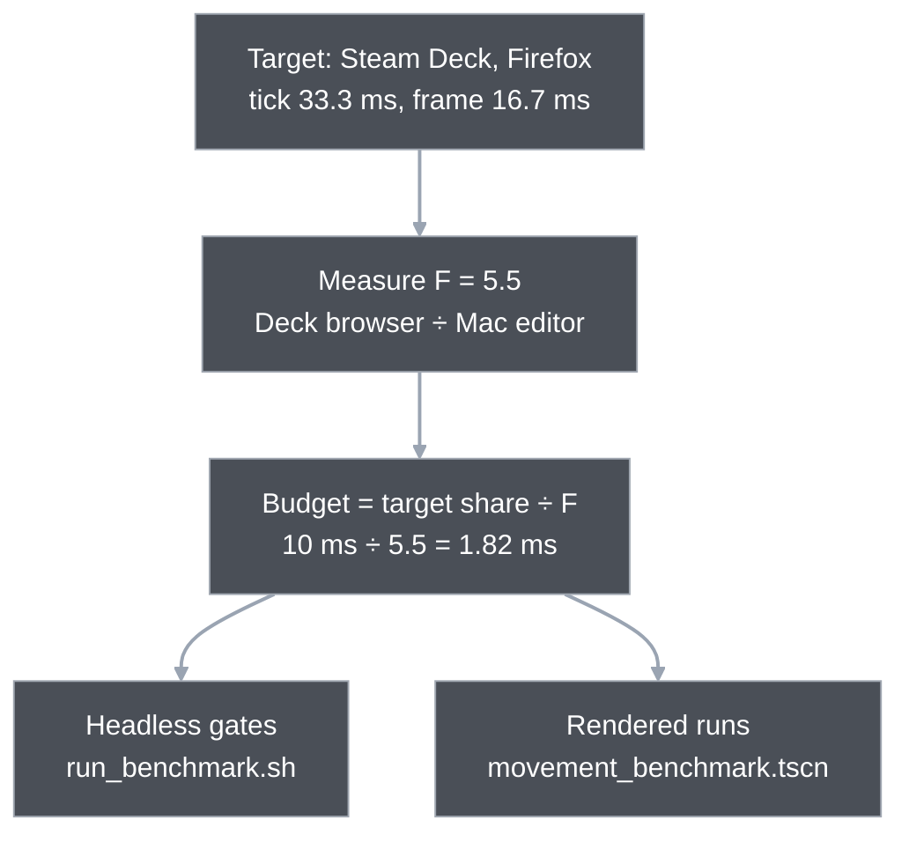
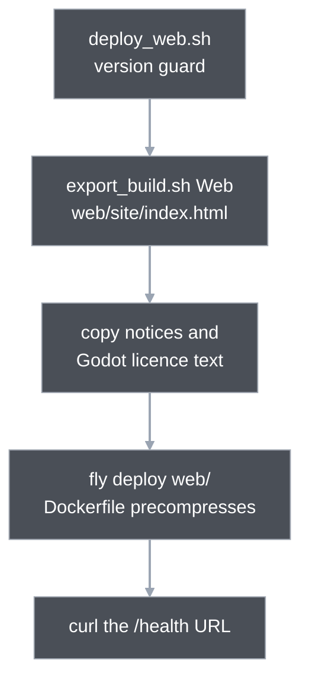

# 12. Performance and platforms

Wargrid is tuned for a machine it is not written on. Every speed limit is a share of the target's 33.3 ms tick or 16.7 ms frame (a Steam Deck running the game in Firefox as WebAssembly), divided by a measured slowdown F, and checked on the development Mac. A fast Mac says little; the ledger says whether a cost stays inside its derived budget.

This chapter covers the budget model, the tools that check it, what was found hot, what the native-code spike concluded, and the browser build behind it all. The last section lists three performance ideas that are proposals only.

## One slowdown factor turns a Deck budget into a Mac budget

A tick lasts 33.3 ms at 30 Hz and a rendered frame 16.7 ms at 60 fps. The target budget for each cost is a share of one of those. The development-machine budget is that share divided by **F = 5.5**, the measured ratio of Firefox on the Deck to the Mac's editor build, which is what the headless benchmarks run ([performance ledger](../reference/performance.md#target-device-measured-2026-11-06); the browser is a target next to desktop).

The ledger's budget table holds the derived rows. The key ones, each "target ÷ F":

| Cost | Target | On the Mac | Where checked |
|---|---:|---:|---|
| Simulation tick p95 (300 units moving) | 10 ms | 1.82 ms | `run_movement.gd`, `run_combat.gd` |
| Simulation tick p99 | 20 ms | 3.64 ms | the same |
| Presentation plumbing per tick | 5 ms | 0.91 ms | `run_profile.gd` zones inside `run_benchmark.sh`, recorded, not gated |
| Rendered frame p95 | 16.7 ms | 3.04 ms | rendered benchmark, report only except one guard |
| Lockstep overhead p99 | 3.3 ms | 0.6 ms | `run_lockstep.gd` |

Source: [ledger budget table](../reference/performance.md#budgets). Status at the guide's commit:

- **Plumbing** is measured as the hand-off sum (state fill plus draw-batch sort and build). Since the view rows change it fits 0.91 ms on skirmish3v3 only; the team match, hordes300 and the movement layouts exceed it. No budget changed.
- **Rendered frame:** the open and dense layouts passed in the 2026-11-08 rows; the later art lab rows (2026-11-10, at the game's start zoom) and the interpolation-on rows (2026-11-11) are **EXCEEDED** on every layout. These rows are report-only, and nothing was loosened ([History rows](../reference/performance.md#history)).
- **HUD rows:** the HUD adds draw work (text, slabs, the selection lines) that the four layouts do not show, and a wide window shows more map. The `hud_select` rows measure both at 1280x720 and at 2560x1080 (2.37:1, under the 2.4:1 cap, so it is laid out at 1280x720 with `expand`, about 1707x720 of map; only wider windows get `ViewCaps.WIDE`): the wider view draws more map with no culling (F25), so its time is the honest cost of `expand`'s extra area. Built and tested headless in P2.3a1; the rendered rows, the draw-call ceiling and the ledger entry are owed to its stop gate B (a window is needed), so no HUD number is quoted here yet. The guard `hud_failure` fails a run whose header is not `120 selected` or whose selection draws no lines, so a row cannot pass with an empty HUD.
- **What the HUD rows do not time (P2.3b).** `hud_select` gives the HUD an `Economy` box, so the 120 selected units show their command card and the row times the card (T8b step 1, a benchmark-only commit). F38 (the HUD's avoidable layout work per refresh; p95 at 2560x1080 3.06-3.22 ms against the report-only 3.04 ms) closes only on the rendered before and after rows at the gate; `test_unchanged_refresh_keeps_layout` pins that an unchanged refresh keeps the tiles, but it cannot see a `reset_size` that leaves the size unchanged (three per refresh in the strip). The card may push `hud_select` over its draw-call ceiling (30); the owner changes ceilings, not the build.
- **The placement preview now runs on every job.** Offline and online, the standing preview request rides on each job of a frame until it is cleared (P2.3b, F33), so it runs once per job: offline once per physics step, up to `max_physics_steps_per_frame` (Godot's default 8, the project sets none) in one slow rendered frame, and online once per job of a catch-up, up to its five-tick bound. `test_preview_once_per_physics_step` (PV1) pins it: four physics steps and one drain cost four full-grid previews. One `preview_build` of a footprint that could cut a route rebuilds a local navigation grid: a reviewer measured 2.4 to 7.0 ms on the development machine, about 14 to 42 ms at the assumed six-times slowdown. No benchmark arms a placement, so no row covers this and nothing was measured on the Deck or in a browser; the gate's benchmark row does not include it. Treat it as an unmeasured cost, not as a budget result, and never as a reason to loosen a budget.
- **Combat stress rows:** open, dense and hordes300 exceed the simulation budget (dense median was 1.811 ms over 13 runs, then 1.832 ms once the per-tick hash ring landed). They are accepted as exceeded (dense: user, 2026-11-14). A fixed ceiling per row is only a drift alarm now; regressions are judged by timing the branch against its merge base in pairs ([pair gate](../reference/performance.md#pair-gate-benchmark-pair-gate-2026-11-19), [gate proposals](../reference/performance.md#gate-proposals-t3-2026-11-08)).

The ledger's rule: a budget or the factor is never loosened to make a row pass. Either the code gets faster or the target is changed on purpose, with a recorded decision.

## Benchmarks are workloads plus a stopwatch

Each benchmark builds a fixed scenario with a workload script from `game/scripts/debug/`, steps it for 300 warm-up ticks and 1800 timed ticks, and sorts the per-tick times into p50, p95, p99 and max (`timing_stats.gd`, nearest-rank percentiles). The budgets are constants there: `BUDGET_P95_MS` 1.82 and `BUDGET_P99_MS` 3.64.

| Tool | What it runs | Gates? |
|---|---|---|
| `sh tools/run_benchmark.sh` | four headless scripts in a row: `run_movement.gd` (layouts open, dense; 300 units), `run_combat.gd` (ten layouts), then `run_bench_pairs.sh` (the pair step, about 3 min), then `run_lockstep.gd` and `run_profile.gd` for the plumbing rows. The pair step is skipped only when `PERF_REF` is unset and `game/` (committed, uncommitted and untracked files) is unchanged against the merge base; `PERF_REF` always runs it. A full run with the pair step took about 7 min (measured 2026-11-19); without it the run is shorter by that step | yes: exit code, no engine errors, a completion line, the exact count of `BUDGET PASS` lines, and a pair verdict (`PAIR GATE FAILED` or `INCONCLUSIVE` fails the run; `CEILING ALARM` and `BUDGET EXCEEDED` inform only); the movement rows also fail if the path budget never bound, or the queue drain or per-tick route cells pass their ceilings, and hordes300 fails if no retaliator went home through the reservation map inside the timed window or full-scan allocations in one tick pass their ceiling |
| `sh tools/run_profile.sh` | the same workloads with the zone profiler on (`profiler.gd`, zones such as `step.combat_plan`; `step.advance` splits into `advance.move`, `advance.containers`, `advance.horde` and `advance.salvage`) | no, reports only |
| `sh tools/run_scaling.sh` | the combat open layout at 50, 100, 200, 400 and 800 units total; prints per-zone means and which zones grew by more than 2.2 times in both of the last two doublings | no, reports only (`SCALING COMPLETE 5`) |
| `sh tools/run_team_match.sh` | a 3v3 bot match on the Ashfall map to the 45,000-tick cap | pins the outcome line and the `TEAM PATHS` counts (the budget bound, per-tick route cells, one bot decision per tick), not the time |
| `sh tools/run_game.sh res://scenes/movement_benchmark.tscn` | the rendered scene: open window, `vsync=off`, layouts open, dense, ashfall, horde, team2v2 (a four-bot 2v2 on Ashfall, `CombatWorkload.create("late_game_2v2")` stepped by `TeamMatch.step`, camera following the units, most of the fight in the warmup) | one guard, `ASHFALL_FRAME_P95_MS` 3.3; team2v2 has no budget or ceiling and fails only when `team_failure` finds no bot orders, no shot in the sample window or a team with no units at its end; `RENDERED BENCHMARK PASSED 4` counts the gated layouts and team2v2 adds `RENDERED TEAM2V2 PASSED 1`; the rest is reported |
| `sh tools/run_game.sh res://scenes/movement_benchmark.tscn -- --hud` | the HUD row: one `hud_select` layout, 120 units selected under the live `Hud` with its command card (an `Economy` box since P2.3b T8b) (every tick `step`, `view_state`, `set_view`, `update_hud`); `--resolution 2560x1080 ... --expect-window=2560x1080` makes the wide row, and the run fails when the window is not the size the row is named for | draw-call ceiling `DRAW_CALL_CEILINGS["hud_select"]` once measured; time report only, against the rendered 3.04 ms budget |
| `game/benchmarks/bench_runner.gd` | the same workloads in 30-tick chunks per frame, for the `Web Bench`, `macOS Bench` and `Linux Bench` presets (feature tag `wargrid_bench`) | no; used to measure F on the Deck |

The combat gate has two kinds of verdict. Seven layouts must pass the budget, an absolute number checked in every run. Layouts open, dense and hordes300 exceed it (dense only since the hash ring, user decision 2026-11-14), so they cannot be judged against the budget. They are judged against the branch's own merge base instead: when `game/` differs from the merge base (or `PERF_REF` is set), `run_bench_pairs.sh` unpacks the merge base into a scratch directory, runs `run_combat.gd` on it and on the working tree in three alternating pairs, and `perf_pairs.py` fails the gate when the median branch/reference ratio of a guarded row exceeds `MAX_RATIO` (`PAIR GATE FAILED`; a log it cannot trust gives `PAIR GATE INCONCLUSIVE`, also a failure). A pair is used because the host swings 5-7 % between sessions (`benchmark-noise-investigation.md`, private): the ratio inside one pair cancels a slow session, which a fixed millisecond ceiling cannot. The threshold and how an A/A calibration (the same tree timed against itself) set it: [pair gate](../reference/performance.md#pair-gate-benchmark-pair-gate-2026-11-19). The old `STRESS_CEILING` values ("worst of 13 quiet runs + 5 %") stay as a drift alarm: a run above one prints `CEILING ALARM` and nothing fails, and on a clean `main` without `PERF_REF`, where no pairs run, it is the only stress signal. A ceiling is changed only by a recorded decision with a ledger line, and neither check makes the row pass ([gate proposals](../reference/performance.md#gate-proposals-t3-2026-11-08)).

Two kinds of number stay outside wall-clock timing because they cannot flake. The snapshot-size ceiling and the combat target-check counters are asserted in the ordinary test suite ([machine-independent counters](../reference/performance.md#machine-independent-counters)). CI runs neither timing benchmark: "The wall-clock gates in `run_benchmark.sh` stay a local, quiet-host exit-gate step" ([ledger](../reference/performance.md#not-covered-yet)).

## One benchmark run, from command to ledger row

Take the headless movement gate. The command is `sh tools/run_benchmark.sh`.

1. The script imports the project, then starts Godot with `--script res://benchmarks/run_movement.gd` and reads its output.  
   `run_benchmark.sh → run_movement.gd`
2. For each layout the script builds a simulation of 300 units on a 64x64 map and loops 2100 ticks. Each tick the timer covers the settled check, issuing the next leg's orders when due, and `step`; the sample counts once the warm-up ends. The snapshot used for validation sits outside the timer; the ledger notes the harness has been sim-only since an earlier fix removed the snapshot from the timer.  
   `Workload.create → Workload.issue_leg → Simulation.step`
3. After the loop it checks that 1800 samples exist and every unit reached a unique destination, so a run that did no movement cannot pass. Then it sorts the samples and compares p95 and p99 with 1.82 and 3.64.  
   `Stats.summary → Stats.within → BUDGET PASS`
4. The shell wrapper accepts the run only if the exit code is 0, no `ERROR:` line appeared and the completion marker and the expected count of `PASS` lines are present.  
   `run_benchmark.sh: grep BENCHMARK PASSED 2`
5. A History row is then added to the ledger: tree, machine, load, command, values against the budget. A milestone's exit gate is not met without that row ([rule per milestone](../reference/performance.md#rule-per-milestone)).
6. The record step appends the run's rows to `docs/reference/perf-history.csv`, and `tools/perf_chart.py` then writes two places from it: the ledger's verdict table, with a verdict for every line, and the README's two tables. A row in the README's checked table shows pass or fail against its limit: seven are estimated from the Mac, and two (per-frame CPU p95 and p99 of a 3v3 match in Firefox) are measured on the Steam Deck itself from hand-appended rows of machine `deck-firefox`, with the target as the limit and no ÷F; they are over budget today (Deck frame goal, user, 2026-11-22). A row in the tracked table has no known route to green yet, so it shows no limit, only the latest value, a sparkline of its last eight runs and how it moved against the median of the three runs before it, as an icon ([ledger paragraph](../reference/performance.md#history)).

A real row (measured): on 2026-11-10 after the art lab fixes, the movement layouts gave sim-only p95 0.691 (open) and 0.676 (dense), p99 0.855 and 0.874 ms, against 1.82 and 3.64. The run was at host load 2.3 against about 1.5 for quiet rows, so the ledger reads it as an upper bound ([History](../reference/performance.md#history), "art lab exit-review fixes").

**What an exceeded budget means.** The combat benchmark's `hordes300` layout (400 units fighting) took a median of 2.852 ms p95 across 13 quiet runs, about 57 % over 1.82 (measured). The script prints `COMBAT STRESS PASS` (or `COMBAT STRESS ALARM` above the drift value; report only) with the words "exceeds the 1.82/3.64 budget", because it compares against the drift value of 3.07 and not the budget. The regression verdict comes from the pair gate. The row stays labelled exceeded in the ledger. Nothing is silently relaxed: the options are to optimise, to change the target on purpose, or to report the row as exceeded.

Wall-clock numbers carry host noise. A window covered by another application made every rendered metric about 5 times slower, while focus and load did not (measured, [noise check row](../reference/performance.md#history), 2026-11-12). The ledger's iteration rule follows from it: keep the window fully visible, run only the layout a change touches, and never average a throttled run into a result.

## What was measured hot

Two sets of numbers explain where a tick goes. Both are Mac means on the 2026-11-11 profile ([performance next](../reference/performance-next.md#2-where-the-time-goes-measured), [data layout inputs](../reference/data-layout-decision.md#2-inputs-after-t4-measured-unless-labelled)).

| Row | `step` mean | Biggest zones in `step` | Presentation hand-off, after view rows |
|---|---:|---|---:|
| skirmish3v3, 210 units (goal row) | 0.70 ms | `combat_plan` 53 %, `combat_fire` 25 %, `advance` 17 % | 0.537 ms |
| team match, peak 261 units (goal row) | 1.07 ms | `combat_plan` 38 %, `advance` 30 % | 0.951 ms |
| hordes300, 400 units (stress row) | 1.98 ms | `advance` 48 %, `combat_plan` 40 % | 1.927 ms |

The goal row is a 210-unit 3v3 that must run smoothly in Firefox on the Deck; hordes300 is a reported stress row ([performance next section 8](../reference/performance-next.md#8-decisions-user-2026-11-11)). Four findings follow from the profile:

- **The hand-off used to cost more than the step.** Before the view rows change, copying state out for drawing was 1.1 to 1.4 times the simulation step on the combat and team rows (measured, performance next section 2). The view rows work cut the hand-off sum by 0.18 to 1.1 ms per tick, ten or more times the run-to-run spread (measured, [perf-next stop gate row](../reference/performance.md#history)). Chapter 5 describes the rows.
- **The tail matters more than the mean.** In the 2026-11-11 profile the worst tick is 5 to 9 times the mean: 9.31 ms on the team match (about 51 ms at F = 5.5), of which one bot decision took 7.37 ms. The three rows' worst ticks are 40 to 60 ms at F = 5.5, longer than the 33.3 ms tick, and the ledger lists it as a watch item without a gate ([performance next](../reference/performance-next.md#2-where-the-time-goes-measured), [ledger](../reference/performance.md#budgets)). Path-queue bursts, the other recorded source of tail ticks, are explained in chapter 4. Since Flatter worst ticks the team match's worst profiled tick is 5.2 ms (`opponent.decide` 2.1 ms, `service_paths` 3.4 ms) and hordes300's worst benchmark tick is 4.0 ms instead of 7.6 ms (single-host medians of five runs, [verification](../reference/flatter-worst-ticks-verification.md)). Wall-clock worst ticks are reported, not gated: the five runs spread 1 to 5 percent, and one dense run spiked 61 percent.
- **Rendering is the expensive part with smoothing on.** Interpolation costs 0.82 to 1.14 ms of CPU per frame against 0.04 to 0.05 ms with it off, because the draw batch is rebuilt every frame (measured, [perf-next rendered rows](../reference/performance.md#history)); the cause is read from code in [data layout section 7](../reference/data-layout-decision.md#7-interpolation-and-presentation-short-list), not profiled.
- **Typing and threads were small.** Static typing of hot loops gained 3 to 5 %. Parallel movement natively gained 2 to 3 % at four threads (measured, [technology findings](../reference/performance.md#technology-findings)). The kept simulation fixes were a per-owner target grid, cached radii and early exits, all trace-preserving; combat `open` fell from 2.763 to 1.865 ms p95 across them (measured, [kept fixes](../reference/performance.md#kept-fixes)).

## The native-code spike: conditional go, whole port only

The question: can a Rust core, loaded into Godot as an extension, buy the 2.2 times the browser row needed? The spike ran on branch `spike-native-sim` and ended **"CONDITIONAL GO, whole-port branch only"** ([native sim spike report](../reference/native-sim-spike.md#1-recommendation), 2026-11-10).

It built two slices (the horde bonus and the movement step) in Rust and measured them on the Deck in Firefox. The code is not merged: the `native/` directory does not exist on the guide's tree (the report and notes are on `main`).

What it found:

- **Hot loops alone are a dead end.** The kernel itself was tiny; 60 to 73 % of each slice's time was packing the per-unit Dictionaries into buffers (measured). The effective gain per slice was 1.35 to 1.54, and the whole-tick gain G_inc was 1.09 against a need of 2.20 to 2.26 (inferred from measured rows). On the Deck, `hordes300` p95 went from 15.04 ms to 14.42 ms with both slices native, still **EXCEEDED** against 10 ms (measured).
- **The extension template has a tax.** The `dlink` web template slows everything else by 6 to 7 %, which alone pushes `combat_open` on the Deck from 9.76 to 10.34 ms, over the budget (measured). A Rust panic also aborts the whole page, so the core must never panic.
- **A whole port might pay, on paper.** The projection G_port is 3.3 to 4.6 (estimate), but only if drawing reads packed columns cheaply; if the read side costs as much per entity as today's `snapshot()`, it is 1.34 and fails (estimate, read side unmeasured at the time).
- **Determinism held.** Native and WebAssembly digests were equal on every platform measured; Windows is unverified (measured).

A later experiment moved the verdict's cause. With state already in packed arrays, a Rust kernel ran 34 to 58 times faster than GDScript on the same arrays and the hand-off dropped to 0.1 to 0.4 % of the tick, digests equal natively and in Firefox ([performance next 5.4](../reference/performance-next.md#54-a-rust-kernel-on-packed-arrays), measured, one friendly kernel shape). The report carries a banner that its whole-port verdict "holds for today's storage only". So the layout question below, not Rust, is the live decision.

## The browser build, and why it sets the budget

The Web export ships with every release and has been live since 2026-11-06 (blueprint platform-target row); the browser is the main target ([blueprint §11](../blueprint.md#11-performance-multiplayer-and-future-architecture)).

It sets the budget because WebAssembly is slow on the budget device: Firefox on the Deck ran the simulation 4.9 to 5.45 times slower than the Mac editor build, against 3.4 to 4.2 for the Deck's native build (measured, [target factor table](../reference/performance.md#target-factor-measurement-2026-11-06)). The 2026-11-08 re-check gave 5.0 to 5.2 on the simulation rows, and F stayed 5.5 ([F re-check](../reference/performance.md#f-re-check-2026-11-08)).

How a browser build gets to players:

- **Export.** `tools/export_build.sh PRESET OUT` runs Godot headless in release-export mode and resolves the output path itself, because Godot resolves a relative path against `game/`. It refuses when the gitignored licensed sound pack (`game/audio/licensed/`) is missing, since the game would quietly fall back to the old synth sounds; `WARGRID_SYNTH_AUDIO=1` builds without it (CI and `compare_local_traces.sh` set it), and `deploy_web.sh` always clears it. The Web preset in `export_presets.cfg` turns off both `thread_support` and `extensions_support`. CI installs only the no-threads web template (`install_export_templates.py`).
- **Deploy.** `tools/deploy_web.sh` picks the production or test app by its argument and refuses a mismatch: production needs a release version, the test app needs a prerelease such as `0.7.0-dev`. Each target also fixes the pair it ships: `test` exports the threaded preset `Web Threads` and builds the image with `sws-threads.toml` (the two isolation headers a threaded export needs), while production and `test-nothreads` export `Web` and keep the Dockerfile default `sws.toml`, which has neither header. `tools/test_deploy_web.py` follows each route from preset to served headers, and CI's Docker job curls both images. The script's comment gives the reason: the relay only pairs equal build strings, so a `-dev` build keeps test players out of production rooms. Every fly deploy needs explicit approval ([worker thread design section 5](../superpowers/specs/2026-11-12-worker-thread-design.md#5-builds-tax-and-cross-origin-isolation)).
- **Hosting.** The Dockerfile precompresses the wasm, pack, script and page files once with brotli and gzip, because the wasm (about 40 MB, per the Dockerfile comment) would otherwise be compressed on every request. The wasm, the same bytes until an engine upgrade, gets its own cached layer at brotli quality 11; the pack, script and page use quality 9, which costs about 1 % more pack download and makes deploys about 160 s faster (estimate, [web deploy time](../reference/web-deploy-time.md)). `web/sws.toml` revalidates every file (`no-cache`) so a redeploy cannot pair a new wasm with an old pack. `web/sws.toml` also sends the old host `wargrid.pdstuber.dev` a 301 to `wargrid.blackcindergames.com` (live from the first release deployed after 2026-11-26); `/health` is answered before redirects, whatever the Host header. `web/fly.toml` sets one shared VM that suspends when idle. No cross-origin isolation headers are sent in production: the server config has none.
- **Why no threads.** A threaded build needs those headers and measured 4.7 to 8.3 % slower on the simulation rows in Firefox (measured, [technology findings](../reference/performance.md#technology-findings)). Godot's "Separate" render thread doubled desktop tick time and does not work on the web ([performance next 5.2](../reference/performance-next.md#52-threads-separate-render-thread-and-the-simulation-on-a-worker-measured)).
- **Edge scroll in the browser (unverified).** The match pans when the pointer is within 3 logical pixels of the visible picture's edge (`match_screen.edge_scroll`), only while the window has focus. It stops on `NOTIFICATION_WM_MOUSE_EXIT` and on focus loss; whether the web build delivers those two notifications when the pointer leaves the canvas or the tab, and whether Ctrl+1 or Cmd+1 reach the game at all (the fallback is Shift+Ctrl+1), is the owner's web pass and is not checked here.
- **Same simulation, different CPU.** Native and WebAssembly digests matched on eight workloads including the 45,000-tick team match, and a real mixed match through the live relay (WASM on one machine, native macOS on another, about ten minutes with fighting) showed no desync (measured: the eight digests in [technology findings](../reference/performance.md#technology-findings); the mixed match in [remaining work](../reference/performance.md#remaining-work) and the [development notes](../development.md)). Chapter 10 explains why the rules make that possible.

## Engineering depth: what the model assumes

**F comes from one device and one browser.** It is a Steam Deck and Firefox. The ledger lists Safari and Chrome as open, and the Deck row for today's sim-only movement benchmark does not exist: "The F of the post-P1 sim-only movement row is unmeasured: no Deck run of HEAD exists" ([F re-check](../reference/performance.md#f-re-check-2026-11-08)). The Deck is also parked for now; the Mac mini is the measuring host. Every "on the target" number written since is a Mac number times 5.5 (inferred).

**The budget is a ratio, so it moves with every ratio's error.** The browser factor was 4.98 to 5.28 in one run and 5.02 to 6.55 in another, depending on the row. A lower F would loosen every budget by the same share. The ledger therefore treats F as a recorded decision and has never lowered it to make a row pass.

**Budgets assume one thread.** The simulation step, the hand-off and the drawing share one frame. Any structure that moves work to another thread changes what each row means, which is why the worker-thread proposal below suggests new rows rather than quietly reusing the old ones.

**Gates that run only locally.** Local wall-clock gates catch regressions only when someone runs them on a quiet host. CI cannot, because runners differ from the Mac and from each other, and load moved rows by about 60 % in M7 ([ledger](../reference/performance.md#not-covered-yet)). The counters that can gate everywhere do, in the suite.

**No player has reported a performance problem yet.** Current playtesters use gaming PCs, so nobody has played on low-end hardware. The work is preventive: the budgets model the target device, a horde mode would need the headroom, and core costs are cheaper to fix before more systems depend on them. That argues for measuring first and keeping changes small.

## Proposed, not built

Three ideas below are on paper or on a branch. None is in the game on `main`. A search of `game/scripts` on `main` for thread, mutex and semaphore classes finds nothing, and there is no packed simulation storage. The pump (`sim_pump.gd`) is merged on `main` but inline. The worker thread is built behind it on branch `sim-boundary-sb5a` (SB5a, not merged, off by default; see the status line below).

### Simulation on a worker thread

Status in its design: "proposed, design only. Nothing built, no thread, no benchmark, no header change." ([design](../superpowers/specs/2026-11-12-worker-thread-design.md)). Since then the thread itself is built on branch `sim-boundary-sb5a` (SB5a, 2026-11-27): native and headless only, behind `WARGRID_SIM_THREAD=1`, merged as `9e6ee156`, no go decision (that is SB6). SB5b (branch `sim-boundary-sb5b`, not merged) adds the threaded `Web Threads` test export with its isolation headers and, on that export only, the Settings switch `Simulation worker`, which the next match's pump takes as its request instead of the environment switch.

The idea: a `SimPump` object owns the simulation and runs one job per tick (commands in, `step`, then a finished view state out). Scenes post jobs and draw the newest result; no main-thread code reads the live simulation. The design recommends two stages: "go now" for the first, a later measurement for the second.

Stage one runs the pump on the main thread in every build, which changes the scenes and lockstep code but adds no thread. Its offline half is merged (SB3: inline `SimPump`, the screen reads slots). The online half (SB4: lockstep split into `take` and `record`, the online tick a pump job with its own hash-tick digest, tick 0's digest and the hash ring by query job) is merged (2026-11-18, fast-forward `14e254d`, pushed, owner check passed); no main-thread screen code reads the live simulation there either. One cost it adds, not measured on its own: online commands now also pass the pump's `CommandRecorder`, which keeps a copy of every accepted command for the whole match, and nothing online reads that copy. The offline half has a measured cost row since Pump hardening: `run_profile.gd` plays the team match twice, once stepping the simulation directly and once through the pump (`post`, then `drain`, then the view handed to the draw layer), with the same bots, and prints one `PROFILE_PUMP team_match` line with the direct and pump times and their difference (`extra_pct`, the pump's own cost; the `team_match_pump:profile` row beside it is the same hand-off sum as `team_match:profile` and does not measure the pump). The run fails only if the two matches end differently, a drained note is missing or the pump refuses a job, never on the time: it is report-only, one back-to-back run on one host (about 1.3 % extra, 2026-11-18), with no budget. Stage two switches it to a `Thread` in threaded builds, decided by the Steam Deck session at SB6 ([critique review](../reference/design-answers-2026-11-08.md#sim-boundary-critique-review-user-2026-11-18)).

**Stage two as built (SB5a, off by default).** On native builds a player notices nothing, because no build sets the switch; on the threaded test export the Settings switch asks for the worker at the next match (SB5b). What it gives the project is a thread SB6 can measure. With `WARGRID_SIM_THREAD=1` on a build that has threads, one worker runs every job in order. The drivers post a job only when `has_room()` says fewer than three jobs are unpublished (the one running plus two waiting), and drains finished notes once per rendered frame. So a slow tick slows game time down instead of queueing without bound, and a refused post costs a frame, not a command. Main never reads the simulation while the worker owns it: the screen sees only the slots, `live()` is for tests and asserts the pump is idle, and every failure (a stalled job, a logged error, a dead thread) becomes one main-side reason that ends the match within about 5 s ([chapter 1](01-big-picture.md#the-pump-the-one-holder-of-the-simulation)). The mechanics, in order of depth:

- **One lock, one reader.** The worker takes a job from the queue, runs it with no lock held, then under the lock appends the note, makes its slot ready and lowers the unpublished count. Main is the only caller of `post`, `drain`, `query` and `stop`, so room can only grow between `has_room()` and `post`. A `query` (the online start digest, `record()`, the desync ring) is a queue entry main waits on for at most 5 s; a stuck one abandons the pump.
- **Stop and stall.** `stop()` lets the running job finish, drops the waiting ones and joins only after the worker says it has exited. A worker that never does is abandoned (never joined while it may still run; the next pump's `start()` joins it once it has exited), and the process stays inline from then on. The stall check needs both 90 physics frames and 3 s to pass and only runs while jobs are unpublished, so a pause menu, a slow peer or a suspended laptop cannot trip it.
- **What the tests prove.** Worker and inline notes and views agree every 30 ticks on four loads (`sh tools/run_worker_digests.sh`: `skirmish3v3`, `hordes300`, `late_game_3v3`, `team`; the self-test `--inject-divergence` shows both comparisons fire); the whole scene suite passes under the switch with `SIM PUMPS` showing a worker for every pump and none left alive; `tools/run_pump_faults.sh` runs 12 fault cases, one process each, and the two driver cases (`stall_offline`, `stall_online`) each finish, end of the match included, in about 3.1 s and 4.3 s, inside the 5 s bound (online the peer sees the leave); a loopback test pairs a worker client with an inline one.
- **What the bench measured (headless, report-only, one host).** `match_bench.tscn` plays the team load through the real match screen in each mode: tick rate 30.00 in both arms over a 1800-tick window, main-thread CPU time per tick, p95, 9.17 ms inline against 11.13 ms worker, worker job run time (`job_ms`) p95 10.94 ms and result age from publish to drain (`age_ms`) p95 14.76 ms, no refused post. These rows come from the earlier window (ticks 6600 to 8400), a build-up with no combat on the current bots (first shot about tick 10365); the owner moved the start to tick 10200 (window 10500 to 12300, 483 shots and 12 deaths in both arms; user, 2026-11-27), and the Deck baseline is re-taken at that window before SB6. `tools/worker_ab.py` reads the bench logs and gives a verdict only when its guards are set (they are unset until the owner sets them before SB6). On the Steam Deck (an unexported tree on the official 4.7.2 Linux binary, because the export cannot start a scene path; offline team load, twenty one-second holds in which the bench stops stepping, as a waiting online match does), the delay from the hold start to the first rendered frame after the last in-flight note drained had p99 29.4 ms against a bar of about 150 ms (one run, idle Deck), so the thread does not hold back the "Waiting for player N" line; the online half of that line is a headless test (`test_sb5a_waiting_line_after_drain`).
- **Known limits.** Online, in a frame-script test (no wall clock, a best case, host-dependent), a worker client keeps 30 ticks per second down to about 10 rendered frames per second and an inline one down to about 6: the inline floor is the catch-up bound of input delay + 1 ticks per rendered frame (own packets leave from `drain`), the worker floor the queue cap of 3 (`test_sb5a_catch_up_bound_per_frame`; below the floor game time slows, an accepted limit). On macOS an abandoned worker still inside a job at process exit can abort the process (SIGABRT or SIGSEGV in a probe, 7 to 9 of 10 runs per stall case exited cleanly); a player who hits a real stall and then quits could see a crash dialog (open owner question, [verification](../reference/sim-boundary-verification.md#sb5a)). The Profiler is not thread-safe and stays off while a worker lives. The main thread busy-waits while it waits for a query or a stop, which would cost on the web, a number SB5b needs (`main_wait_*` in `queue_stats()`).

What backs it:

- **Measured:** a worker ran the simulation at main-thread speed, within 1 to 2 % on three rows, and kept a main thread with no game work at 16.6 ms frames. A threaded build costs 4 to 7 % on the simulation rows. Digests were identical across main thread, worker, native and browser. The hand-off of a result back to the main thread was never measured ([design section 2](../superpowers/specs/2026-11-12-worker-thread-design.md#2-what-is-measured)).
- **Estimate:** main-thread work per tick drops 62 to 69 % across the three rows, and the worst bot tick leaves the frame ([design section 6](../superpowers/specs/2026-11-12-worker-thread-design.md#6-expected-gain)).
- **Budget proposal, not applied:** worker tick p95 3.40 ms, p99 5.66 ms and main presentation 0.85 ms. W1 (the worker tick p95) is report-only in the spike plan (user, 2026-11-15); W2 and M1 were never applied; the Deck rows decide at SB6. While production is a no-threads build today's rows bind ([ledger](../reference/performance.md)).
- **Gates before production:** a GO at the SB6 Deck decision (production stays on the no-threads build until then), a Safari check, explicit approval of the cross-origin isolation headers and the deploy, and the SB5b gate: the threaded test app opened from a link in each chat app friends use, plus one listen check ([critique review](../reference/design-answers-2026-11-08.md#sim-boundary-critique-review-user-2026-11-18)). A threaded build served without the headers does not start, which is why the design adds a deploy test pairing preset and headers.

### Packed-array data layout

Status in its note: "proposed, not approved." ([data layout decision](../reference/data-layout-decision.md))

The idea: store per-unit simulation state in packed arrays in GDScript, system by system, only inside the milestone that rewrites that system (movement and pathing first, avoidance on the same columns, combat with split rates). No Rust kernel and no whole port now; a kernel is justified only by a named system that already sits in packed arrays and misses its budget. The note puts presentation per-frame cost ahead of storage as the next target.

Why packed arrays: on the horde workload they gave 1.4 to 1.6 times in GDScript, and the copy for drawing becomes nearly free (measured, [performance next 5.3](../reference/performance-next.md#53-horde-spike-stage-1-simple-agents-in-three-data-layouts-measured)). The note's expected gain on the 210-unit goal row is small: about 1.3 times on the per-tick total with combat on columns (estimate), because the kernel-shaped share of the step is only 0.32 there (inferred).

The rules it sets are strict: dense columns in id order, never swap-remove, `snapshot()` keeps its exact output shape so no pin moves, and the golden-scenarios plan comes first as the oracle.

What is already built is on the drawing side only: view rows, the unit table that `view_state` hands to presentation (chapter 5). The simulation's own `_entities` is still one Dictionary per unit.

### Unit avoidance

Status: on tag `archive/spike-avoidance` only. Evidence-only spike: "MEASURED, EVIDENCE ONLY. No design decision, nothing merged, nothing on main." (spike note on tag `archive/spike-avoidance`, `docs/reference/unit-avoidance-spike.md`; read with `git show`). It is a requirement (units go around each other instead of through), and the blueprint calls the milestone "not designed", scheduled after the movement and pathing milestone ([blueprint §7](../blueprint.md), "Unit avoidance milestone").

The cost cap is about +0.5 ms p95 on the 300-unit rows.

Round 1 built two prototypes, Zero Hour-style yielding (A) and OpenRA-style reservation (B), in `avoidance.gd` and two helper files in the simulation folder, plus a benchmark and scenarios. Its verdict: "Neither approach meets the user's cost cap (about +0.5 ms p95 on the 300-unit benchmark) cleanly". B's movement rows pass only because units give up (one leg in the timed window against main's two), and `hordes300` fails at +0.639 ms (measured, spike note).

No variant met the cap in round 2 either. Later rounds are on the branch; none is merged ([development notes](../development.md)). Chapter 6 explains the movement it would change.

A horde mode (about 1,000 simple agents) is also undecided; throwaway spike branches `spike-horde` and `spike-horde-native` hold its measurements ([performance next 5.3 and 5.5](../reference/performance-next.md#53-horde-spike-stage-1-simple-agents-in-three-data-layouts-measured)).

## Where in the code

- `tools/run_benchmark.sh` — headless gate: movement, combat and lockstep scripts, exit code plus marker and PASS-line counts; the profile script adds the plumbing rows (only its completion line is checked).
- `tools/perf_chart.py` — reads `perf-history.csv` and writes the ledger's verdict table and the README's checked and tracked tables; `PASS_FAIL` and `TRENDS` pick the rows, `NOISE_PCT` the same-versus-changed rule, and a line's `machine` (default `dev`) picks which rows feed it. Tests: `test_perf_charts.py`.
- `tools/run_bench_pairs.sh`, `tools/perf_pairs.py` — the pair step on a branch that touches `game/`: the script archives the merge base (or `PERF_REF`), imports it, and runs `run_combat.gd` in three alternating pairs; the Python tool prints the `PAIR` lines and the verdict, with `MAX_RATIO` holding the threshold (values and derivation: [pair gate](../reference/performance.md#pair-gate-benchmark-pair-gate-2026-11-19)). Tests: `test_perf_pairs.py`, the pair cases in `test_perf_charts.py` and the TERM case in `test_shell_traps.py`.
- `game/benchmarks/run_movement.gd`, `run_combat.gd`, `run_lockstep.gd` — the three gates; `STRESS_CEILING` (the report-only drift alarm) in `run_combat.gd`, `BUDGET_P99_MS` in `run_lockstep.gd`.
- `game/benchmarks/run_profile.gd`, `tools/run_profile.sh` — zone profile, never gates (the completion line counts 11 scenarios; the last is the team match through the pump).
- `game/benchmarks/run_scaling.gd`, `tools/run_scaling.sh` — size sweep of the combat open layout, never gates.
- `game/benchmarks/bench_runner.gd`, `tools/serve_web_bench.py` — workloads in per-frame chunks for desktop and Web bench exports; used for F.
- `game/benchmarks/run_team_match.gd`, `tools/run_team_match.sh` — the 45,000-tick bot match.
- `game/scripts/debug/timing_stats.gd` — `summary`, `within`, `BUDGET_P95_MS`, `BUDGET_P99_MS`.
- `game/scripts/debug/profiler.gd` — static zone timers (`begin`, `end`, `report`); off unless `enabled`.
- `game/scripts/debug/movement_workload.gd`, `combat_workload.gd`, `team_match.gd` — the scenarios; `movement_benchmark.gd` is the rendered scene script with `ASHFALL_FRAME_P95_MS`, the draw-call ceilings and the `--hud` row; `tools/perf_record.py` reads its `hud_select_<size>` samples.
- `tools/export_build.sh`, `tools/deploy_web.sh`, `tools/install_export_templates.py`, `tools/test_deploy_web.py`, `tools/test_export_build.py` — export, deploy, the version guard and the sound-pack guard tests.
- `web/Dockerfile`, `web/sws.toml`, `web/sws-threads.toml`, `web/fly.toml`, `.github/workflows/ci.yml` (Docker job) — static hosting; `web/site/` is untracked export output.
- `game/export_presets.cfg` — presets `Web`, `Web Bench`, `Web Render Bench` (`variant/thread_support=false`) and `Web Threads` (`thread_support=true`, pools 8/4).

## Further reading

- [Performance ledger](../reference/performance.md) — budgets, History rows, F measurements, gate table, the rule per milestone.
- [Performance next](../reference/performance-next.md) — hot spots, experiments and the recommended path.
- [Native sim spike](../reference/native-sim-spike.md) — the decision-rule table, platform coverage and the migration recommendation; [sim core options](../reference/sim-core-options.md) and [engine portability](../reference/engine-portability-and-horde-mode.md) for the earlier reasoning.
- [Worker thread design](../superpowers/specs/2026-11-12-worker-thread-design.md) and [data layout decision](../reference/data-layout-decision.md) — the two proposals.
- Previous: [11. Multiplayer](11-multiplayer.md). Next: [13. Testing and tooling](13-testing-and-tooling.md).

---
Checked against `ae09473`; the SB5a and SB5b worker status against the SB5b Task 3 working tree over `206d6152` (branch `sim-boundary-sb5b`, 2026-11-27); the sound-pack guard against the P20 hardening working tree over `24ad3da0` (branch `p20-lobby`, 2026-11-27); the old-host redirect against `web/sws.toml` on the `move-to-blackcindergames` working tree over `fe28b72e`, run locally in static-web-server 2.44.3 (2026-11-26); the rendered-scene row's team2v2 layout against the `p7-2-team-online` working tree over `15bf4e12` (2026-11-25); the stress-row verdict, the pair step in the gate table and its times against `5674ef1` (branch `benchmark-pair-gate`, plus this docs change; the final sha follows); the pump row and the profile completion count against `328bc2e` (Pump hardening, on branch `pump-hardening`); the worker-thread stage-one status, the budget-proposal and production-gates bullets against `d108b90` (SB4 merged); the plumbing row and the `run_benchmark.sh` lines against `29724db` plus the hand-off rows change, the tail sentence, gate table and worst-tick figures against `b88dc0f`; the HUD rows against `8fc8be90` (branch `p2-3a1-see-your-selection`, plus the Task 17 docs in the working tree); the unit avoidance status against the tag `archive/spike-avoidance` (2026-11-20); the README speed block passage against the `honest-speed-report` working tree over `4363cba3` (2026-11-22, not merged), and its tracked-table description against the `main` working tree after the sparkline columns change (2026-11-22); the checked table's Deck rows against the `main` working tree over `9f4dbffe` (2026-11-22). The worker-thread passages (stage two as built, the bench and test figures) against `86d4eb36` (branch `sim-boundary-sb5a`, SB5a, not merged; the docs commit follows). The Deploy bullet and the hosting files list against the `sim-boundary-sb5b` working tree over `5487644b` (SB5b Task 2, 2026-11-27, not merged). Also checked against `f33c8714` (branch `p2-3b-build-from-the-dock`; the docs commit follows) for the HUD-row, preview-cost and browser edge-scroll notes (no ledger row added); the HUD-row note against `fa1a76d6` (T8b built, F38 open until the gate's rendered rows), and the preview-count sentence against the G4 fix working tree over `762b1e5d` (2026-11-23). Files: `tools/perf_chart.py`, `game/scripts/match/sim_pump.gd`, `game/scripts/match/online_driver.gd`, `tools/run_benchmark.sh`, `tools/run_bench_pairs.sh`, `tools/perf_pairs.py`, `tools/run_profile.sh`, `tools/run_team_match.sh`, `tools/export_build.sh`, `tools/deploy_web.sh`, `game/benchmarks/run_movement.gd`, `game/benchmarks/run_combat.gd`, `game/benchmarks/run_lockstep.gd`, `game/benchmarks/run_profile.gd`, `game/benchmarks/bench_runner.gd`, `game/scripts/debug/timing_stats.gd`, `game/scripts/debug/profiler.gd`, `game/scripts/debug/movement_workload.gd`, `game/scripts/debug/combat_workload.gd`, `game/scripts/debug/movement_benchmark.gd`, `game/scripts/debug/team_match.gd`, `tools/perf_record.py`, `game/export_presets.cfg`, `web/Dockerfile`, `web/sws.toml`, `web/fly.toml`, `tools/run_scaling.sh`, `game/benchmarks/run_scaling.gd`, `game/scripts/debug/match_bench.gd`, `game/scripts/debug/match_bench_screen.gd`, `game/scripts/debug/bench_loads.gd`, `game/benchmarks/run_worker_digests.gd`, `tools/run_worker_digests.sh`, `tools/run_pump_faults.sh`, `tools/worker_ab.py`, `web/sws-threads.toml`, `tools/test_deploy_web.py`, `.github/workflows/ci.yml`
